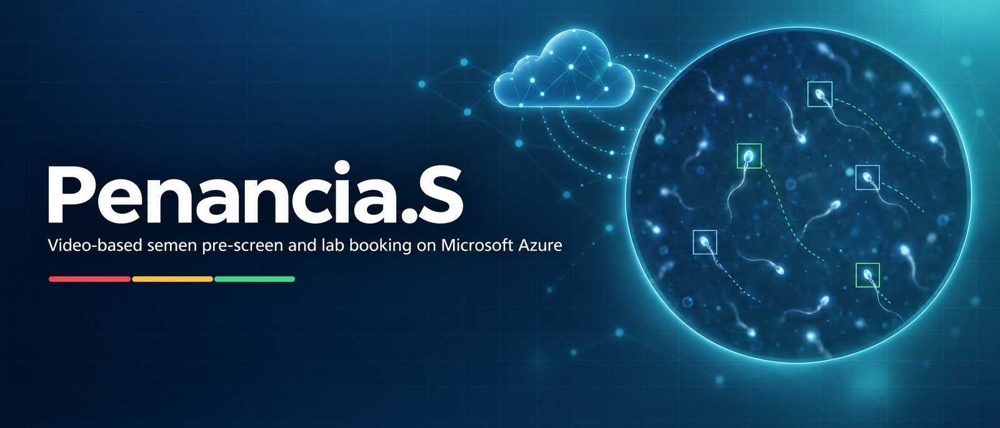
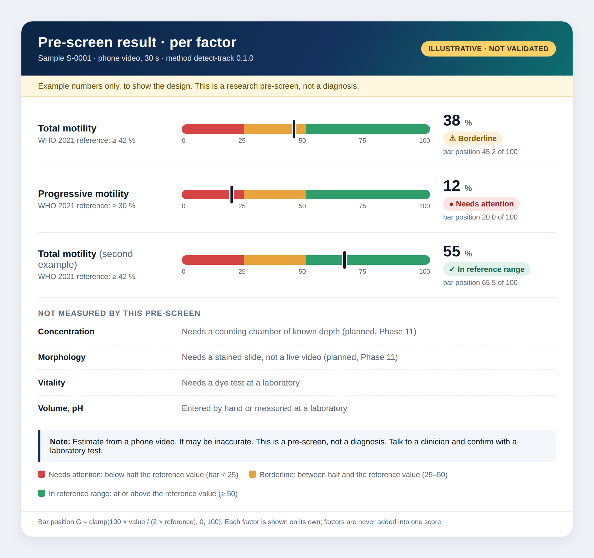
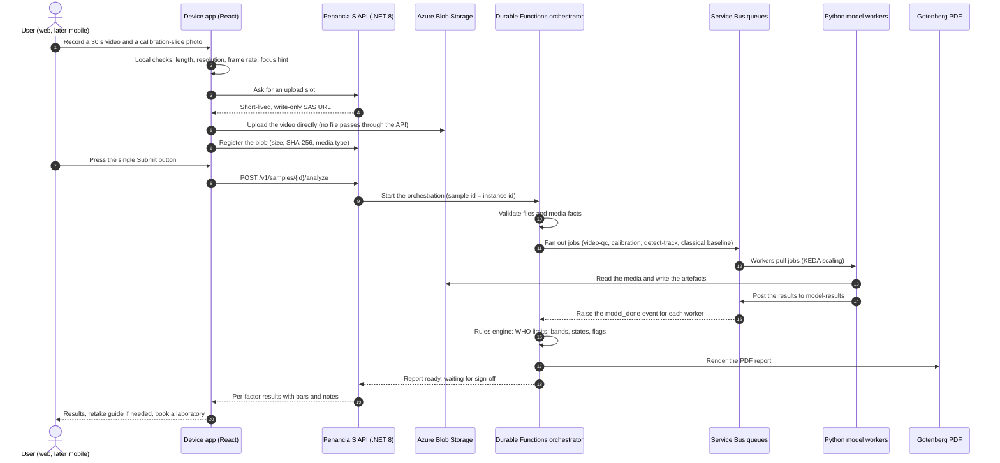
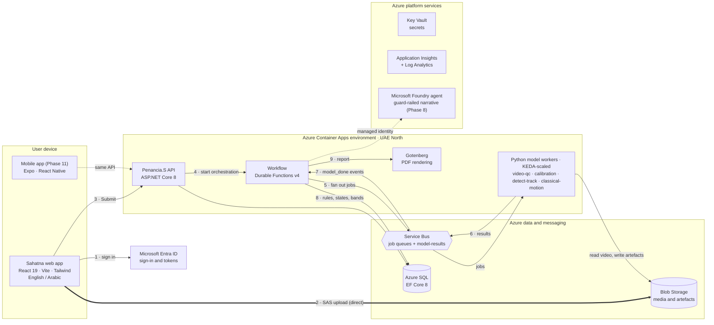
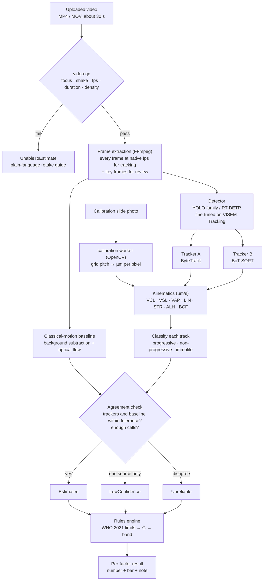
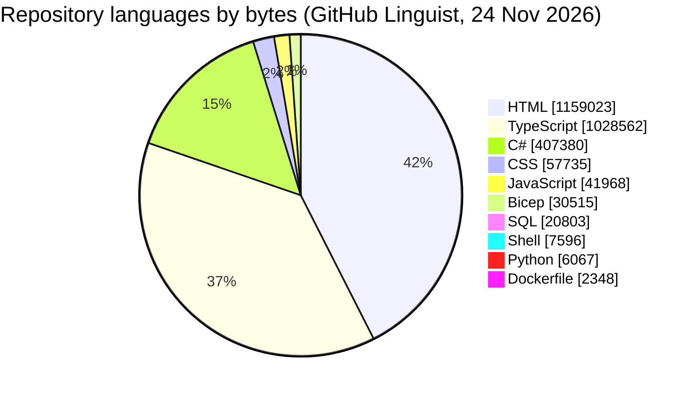
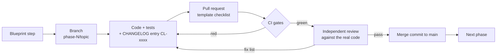

<!-- Penancia.S README. Status facts in this file must stay true: update the status table and roadmap when a phase is merged. -->

<p align="center">
  
</p>

<h3 align="center">A phone video goes in. You get an honest result for each factor, then a laboratory booking.</h3>

<p align="center">
  <a href="https://github.com/S4syedRauf/Penancia.S/actions/workflows/deploy.yml"></a>
  
  
  
  <br>
  
  
  
  
  
  
  
  
  
  
  
  
</p>

> [!IMPORTANT]
> **Penancia.S is a research pre-screen. It does not diagnose anything and it is not yet validated.** Every number it shows is an *estimate* and comes with a note: *"Estimate from a phone video. It may be inaccurate. This is a pre-screen, not a diagnosis."* It never claims 100% accuracy. A laboratory semen analysis confirms every result, and the platform exists to make booking that analysis easy.

---

## Contents

1. [What Penancia.S is](#1-what-penancias-is)
2. [What you get at the end](#2-what-you-get-at-the-end)
3. [What is measured and what is not](#3-what-is-measured-and-what-is-not)
4. [How a result is shown: the three-colour scale](#4-how-a-result-is-shown-the-three-colour-scale)
5. [How it works, step by step](#5-how-it-works-step-by-step)
6. [System architecture](#6-system-architecture)
7. [The multi-model video pipeline](#7-the-multi-model-video-pipeline)
8. [Technology stack](#8-technology-stack)
9. [Languages in this repository](#9-languages-in-this-repository)
10. [Repository structure](#10-repository-structure)
11. [Implementation roadmap (Phases 0–11)](#11-implementation-roadmap-phases-011)
12. [Engineering workflow and quality gates](#12-engineering-workflow-and-quality-gates)
13. [Getting started](#13-getting-started)
14. [Security and privacy](#14-security-and-privacy)
15. [Documentation, media and licence](#15-documentation-media-and-licence)
16. [References](#16-references)

---

## 1. What Penancia.S is

Many men put off a semen analysis because the first step feels awkward, slow or expensive. **Penancia.S** makes that first step private and simple. A user records a short video of a sample under a phone microscope or a clip-on lens and presses **one Submit button**. The cloud then works out the factors it can honestly estimate, shows each one on a clear red, amber and green scale, and helps the user book a proper laboratory test.

| | |
|---|---|
| **Platform** | **Penancia.S**: the clinical engine (API, workflow, model workers, reports, lab booking, partner portal) |
| **Patient app** | **Sahatna** (صحتنا, "our health"): the bilingual patient experience in English and Arabic, right-to-left aware |
| **Who it is for** | Individuals who want a private first look; clinics and laboratories that receive bookings and signed reports; researchers validating phone-based semen analysis |
| **Where it runs** | Web first (React). A mobile app (Expo / React Native) follows in Phase 11 and reuses the same API |
| **Cloud** | Microsoft Azure, region UAE North (`uaenorth`); UAE Central is the planned disaster-recovery region |

**Our principles, in one line each**

- **One factor at a time.** Each factor gets its own number and bar. There is never a combined "fertility score".
- **Honest numbers.** The exact estimate is always visible with an accuracy note. A factor that cannot be measured says **Not measured**; no number is ever invented.
- **The cloud does the heavy work.** The device records and uploads. Azure does the analysis.
- **Everything is auditable.** Each change is logged in [`CHANGELOG.md`](CHANGELOG.md). Each report has a content hash and needs dual sign-off before release.

---

## 2. What you get at the end

When all twelve phases (0–11) are complete, the platform delivers the following:

| Outcome | What the user sees |
|---|---|
| **Per-factor motility** | **Total motility** and **progressive motility**, each with its exact number (for example *38%*), a red/amber/green bar and an "it may be inaccurate" note |
| **Honest gaps** | Factors outside the scope show *"Not measured by this pre-screen"* and name the test that would measure them |
| **Quality feedback** | If a video is blurred, shaky or too short, the user gets a plain-language retake guide instead of a made-up result |
| **PDF report** | A signed, hash-stamped PDF report rendered by Gotenberg |
| **Lab booking** | Quotes, slot holds and orders with partner laboratories, plus a partner portal |
| **AI explanation** | A narrative written by a Microsoft Foundry agent that is checked by guardrails: it may only repeat the numbers that were measured and cannot use diagnostic wording |
| **Validated claim** | Phase 10 compares results with paired laboratory results and publishes measured error bands, then locks the thresholds |
| **More factors later** | Concentration, morphology (stained slides), vitality support and the mobile app, in Phase 11 |

---

## 3. What is measured and what is not

The reference values are the WHO 2021 lower reference limits (5th centile) [R1], [R2]. They live in one place in code, [`Who2021Limits.cs`](src/Penancia.S.Domain/Rules/Who2021Limits.cs), and no client ever retypes them.

| Factor | WHO 2021 lower limit | From a phone video? | When |
|---|---:|---|---|
| **Total motility (PR + NP)** | 42 % | **Yes**: detection plus tracking | Release 1 |
| **Progressive motility (PR)** | 30 % | **Yes**: detection plus tracking | Release 1 |
| Sperm concentration | 16 million/mL | Only with a counting chamber of known depth | Phase 11 |
| Total sperm number | 39 million | Needs concentration × volume | Phase 11 |
| Semen volume | 1.4 mL | No. Entered by hand | Manual entry |
| pH | 7.2 | No. Entered by hand or measured at a laboratory | Manual entry |
| Vitality | 54 % | No. Needs a dye test (eosin–nigrosin) | Laboratory |
| Morphology (normal forms) | 4 % | Not from live video. Needs a stained slide | Phase 11 |
| Agglutination | none | Visual flag only | Flag |
| DNA fragmentation, antibodies | none | No | Laboratory |

> [!NOTE]
> Morphology numbers such as *"head L/W ratio"*, *"acrosome area"* or *"TZI"* taken from an unstained phone image are not reliable. They were **removed from the result path in Phase 0**, and the screen now shows *Not measured*.

---

## 4. How a result is shown: the three-colour scale

Each factor is drawn on its own bar from 0 to 100. The bar position **G** comes from the estimate `v` and the factor's lower reference limit `L`:

```text
G = clamp( 100 × v / (2 × L), 0, 100 )

Red    "Needs attention"     G < 25        (v below half the reference value)
Amber  "Borderline"          25 ≤ G < 50   (v between half the reference and the reference)
Green  "In reference range"  G ≥ 50        (v at or above the reference value)
```

So **50 is the pass mark** and equals the WHO limit, while **25 is half of it**. For total motility (L = 42%), an estimate of **38%** gives G = 45.2 (amber), **15%** gives 17.9 (red) and **55%** gives 65.5 (green). The 0.5 and 1.0 multipliers are provisional design values until Phase 10 validation locks them.

<p align="center">
  
  <br><sub><b>Illustrative design only.</b> The numbers are examples, not a real sample.</sub>
</p>

| State | When | What is displayed |
|---|---|---|
| `Estimated` | The quality check passed, enough tracks were found and both trackers agree | Number, bar, band and note |
| `LowConfidence` | Only one tracker was available, or a fallback model was used | Number, bar, band, a "low confidence" badge and note |
| `Unreliable` | The trackers disagree beyond tolerance | Number in grey, **no colour**, and "Unreliable, please retake" |
| `UnableToEstimate` | The quality check failed, too few cells were found, or the job failed | **No number**, the reason in plain words, and a retake guide |
| `NotMeasured` | The factor is outside the release scope | "Not measured by this pre-screen" and which test measures it |
| `Borderline` *(modifier)* | After validation, when the 95% interval crosses a band edge | Band colour with a hatch pattern and the word "borderline" |

<details>
<summary><b>The JSON the API returns for one factor</b></summary>

```json
{
  "factor": "total_motility",
  "label": "Total motility",
  "state": "Estimated",
  "value": 38.2,
  "unit": "%",
  "ci95": null,
  "gauge": 45.5,
  "band": "amber",
  "reference": { "limit": 42, "op": ">=", "source": "WHO 2021 lower reference limit", "locked": false },
  "method": { "primary": "detect-track-0.1.0", "fallback": "classical-motion-0.1.0" },
  "flags": ["NotValidated"],
  "note": "Estimate from a phone video. It may be inaccurate. This is a pre-screen, not a diagnosis.",
  "validated": false
}
```
</details>

**Wording and accessibility rules.** Colour is never the only signal: every band also has a text label and an icon, following WCAG 2.2 [R68]. The app never uses the words "infertile" or "abnormal count". It says "below the WHO reference value, talk to a clinician" instead. A *"Why this might be wrong"* section explains the common causes: poor focus, shake, too few cells, a cold sample and phone camera processing.

---

## 5. How it works, step by step



**In plain words**

1. **Capture (on the device).** The user records a short video and a photo of a calibration slide. The app checks the basics before anything is uploaded.
2. **Direct upload.** The API issues a short-lived SAS link, and the video goes straight to Azure Blob Storage [R22].
3. **One Submit.** One call starts one Durable Functions orchestration, keyed by the sample ID, so pressing Submit twice does not run the analysis twice [R17].
4. **Fan out.** The orchestrator places one job per model on Azure Service Bus. Duplicate detection is on and each message is retried up to 5 times before it goes to a dead-letter queue [R26], [R27].
5. **Analyse.** Python workers in containers pull the jobs, analyse the media and post their results to the `model-results` queue.
6. **Wait safely.** The orchestrator waits for each `model_done:*` event and uses timeouts, so a lost worker cannot hang a sample forever [R18].
7. **Decide.** The domain rules engine converts the raw measurements into per-factor states, bands and flags, using the WHO limits and the `ParameterSet`.
8. **Report and release.** Gotenberg renders the PDF [R47]. A second person signs off before release (the signer cannot be the person who entered the data).
9. **Next step.** The user sees the results and can book a laboratory test with a partner.

> [!NOTE]
> This is the target flow. Phases 0 and 1 (done) built the foundations: calibration, media facts, the database and CI. Phases 2 to 7 make each step above real. See the [roadmap](#11-implementation-roadmap-phases-011) for exact status.

---

## 6. System architecture



### Where each piece of code runs

| Layer | Runs on | Code in this repo | Responsibility |
|---|---|---|---|
| Patient UI | User's browser (mobile app later) | [`frontend/`](frontend) | Capture, local checks, SAS upload, results, booking, English/Arabic |
| Local dev server | Node.js (Express) | [`frontend/server.ts`](frontend/server.ts) | App state, report vault, Gemini assistant; demo routes are gated behind `DEMO_MODE` |
| API gateway | Azure Container Apps | [`src/Penancia.S.Api/`](src/Penancia.S.Api) | Versioned REST `/v1`, Entra JWT, SAS issuing, calibration, lab booking, sign-off |
| Domain engine | Inside the API and the workflow (pure .NET) | [`src/Penancia.S.Domain/`](src/Penancia.S.Domain) | Kinematics, resolvers, WHO rules, states, report hashing, narrative guardrails |
| Persistence | Azure SQL | [`src/Penancia.S.Data/`](src/Penancia.S.Data), [`migrations.sql`](migrations.sql) | EF Core 8 entities and migrations, verified in CI against SQL Server 2022 |
| Orchestration | Azure Functions (Durable, isolated v4) | [`src/Penancia.S.Workflow/`](src/Penancia.S.Workflow) | One Submit becomes one orchestration, with fan-out, events, timeouts, PDF and release |
| Model workers | Azure Container Apps jobs (CPU; serverless GPU optional) [R14] | [`models/`](models) | video-qc, calibration, detect-track, classical baseline |
| Infrastructure | Azure Resource Manager | [`infra/`](infra), [`azure.yaml`](azure.yaml) | Bicep templates for every resource; `azd` deployment [R42], [R43] |

---

## 7. The multi-model video pipeline

A video is not judged by a single model. It is broken into frames, checked for quality, measured by **two independent methods**, and the two answers are compared before any number is shown.



**Shared images and other content.** Each upload is routed by its media type. Nothing is guessed.

| What is shared | What happens |
|---|---|
| **Video** of a wet sample | The full pipeline above runs; motility factors are estimated |
| **Photo of a calibration slide** | The calibration worker measures the grid pitch and stores the µm/px value. It is used only for that sample and device setup, and it expires |
| **Single photo of a sample** | Motility needs movement, so it shows **Not measured**. Morphology from *stained* slides is handled by a separate model in Phase 11 (SAM 2 / Cellpose segmentation plus a classifier trained on HuSHeM) [R56], [R57] |
| **Laboratory report** (PDF or photo) | The report pipeline extracts the values and **the user confirms each one** before it is saved (`/v1/reports/extract` → `/confirm`) |
| **Anything else** | Rejected by a file-type allowlist. Malware scanning before processing is planned (Defender for Storage) [R21] |

**Candidate models (chosen against gates, not by fashion).** The detectors are the YOLO family [R51] and RT-DETR, fine-tuned on the VISEM-Tracking dataset [R48]. The trackers are ByteTrack [R54] and BoT-SORT [R55]; BoostTrack++ with tracklet stitching is a candidate for dense samples [R50]. Each model must pass a detection gate (**G-DET**) and a tracking gate (**G-TRK**) on held-out data before it is allowed into the result path. The classical OpenCV baseline [R58] gives the deep models an independent cross-check.

---

## 8. Technology stack

| Layer | Technologies |
|---|---|
| **Front end** | React 19, TypeScript (strict, `tsc --noEmit`), Vite 8, Tailwind CSS 4, StyleX, Astryx design system, Motion, Lucide icons, English/Arabic i18n with RTL |
| **Local services** | Node.js, Express 4, `tsx`, Google Gemini (`@google/genai`) for the in-app assistant |
| **API** | ASP.NET Core 8 (C#), Microsoft.Identity.Web + JWT Bearer (Entra ID), Swagger/Swashbuckle, Azure.Storage.Blobs, Azure.Identity |
| **Domain** | Pure .NET 8 class library: kinematics, resolvers (motility, concentration, morphology, vitality), WHO 2021 rules engine, flag catalogue, sample state machine, report hashing (SHA-256), narrative guardrails |
| **Data** | Entity Framework Core 8.0.8, Azure SQL / SQL Server 2022, idempotent migration scripts |
| **Workflow** | Azure Functions isolated worker v4, Durable Task (orchestrations, activities, external events, timers), Service Bus and Blob triggers |
| **Messaging** | Azure Service Bus: 11 job queues and a `model-results` queue, with duplicate detection and dead-lettering |
| **Model workers** | Python 3.11, OpenCV 4.10, NumPy 2.0, SciPy 1.13, a shared worker base and JSON contract; planned: PyTorch, Ultralytics/RT-DETR, ByteTrack/BoT-SORT, FFmpeg |
| **Documents** | Gotenberg (HTML → PDF) |
| **AI narrative** | Microsoft Foundry agent (Phase 8), template fallback, numeric-match and banned-phrase guardrails [R28] |
| **Identity and secrets** | Microsoft Entra ID [R32], user-assigned managed identity, Azure Key Vault [R33] |
| **Infrastructure** | Bicep, Azure Developer CLI (`azd`), Azure Container Registry, Container Apps environment, Docker |
| **Observability** | Application Insights [R36], Log Analytics |
| **CI/CD** | GitHub Actions: CHANGELOG gate, .NET build and test, SQL Server 2022 migration verification, pytest, Bun frontend tests, Static Web Apps deploy |
| **Testing** | xUnit 2.9, EF Core InMemory, SkippableFact (SQL Server integration), pytest 8.3, Bun test / `tsx --test`, mutation checks during review |
| **Mobile (Phase 11)** | Expo, React Native, `expo-camera`, MSAL [R63] |

---

## 9. Languages in this repository



| Language | Share | Used for |
|---|---:|---|
| HTML | 42.0 % | Report templates, static pages and the Vite entry point |
| TypeScript | 37.2 % | The whole web app, the Express server and the front-end tests |
| C# | 14.7 % | API, domain engine, EF Core data layer, Durable Functions and xUnit tests |
| CSS | 2.1 % | Themes and Tailwind layers |
| JavaScript | 1.5 % | Build helpers and configuration |
| Bicep | 1.1 % | All Azure infrastructure as code |
| SQL | 0.8 % | Generated migration scripts (`migrations.sql`; GitHub labels it PL/pgSQL) |
| Shell | 0.3 % | CI gates: `check_changelog.sh`, `verify_migrations.sh` |
| Python | 0.2 % | Computer-vision model workers (this share grows from Phase 4) |
| Dockerfile | 0.1 % | API, workflow and worker container images |

---

## 10. Repository structure

```text
Penancia.S/
├── frontend/                     React 19 + TypeScript web app (Sahatna) and Express dev server
│   ├── src/screens/sahatna/      Home, Onboarding, Questionnaire, SemenPreScreenFlow, AskAgent,
│   │                             CareDirectory, ReportVault, PlanNutrition, Wearables, SettingsAdmin
│   ├── src/screens/panacea/      SemenPreScreenView, LabBookingView, PartnerPortalView, HealthCheckView
│   ├── src/components/sahatna/   ThreeColourBar.tsx (the result bar), UrgentCareBanner.tsx
│   ├── src/i18n/                 English and Arabic translations
│   └── server.ts                 Express server (demo routes gated by DEMO_MODE)
├── src/
│   ├── Penancia.S.Api/           ASP.NET Core 8 REST API (/v1): samples, calibration, reports,
│   │                             questionnaire, follow-up, lab booking, partner, sign-off, ask
│   ├── Penancia.S.Domain/        Pure domain: Kinematics, Resolvers, Rules (WHO 2021), Report,
│   │                             Narrative guardrails, Workflow state machine, ParameterSet
│   ├── Penancia.S.Data/          EF Core 8 DbContext, entities and migrations
│   └── Penancia.S.Workflow/      Durable Functions: SampleOrchestrator and activities
│                                 (TransitionState, ValidateFiles, DispatchModelJob,
│                                 EvaluateRules, RenderPdfReport, FinalizeRelease)
├── models/
│   ├── shared/                   base_worker.py and the job/result contract
│   ├── calibration/              OpenCV calibration worker, pytest suite and fixtures
│   └── video-qc/                 Video quality worker (stub; becomes real in Phase 4)
├── tests/Penancia.S.Tests/       xUnit tests: domain, API, data, workflow, SQL Server integration
├── infra/                        main.bicep, web-auth.bicep, parameters and deploy script
├── tools/                        check_changelog.sh, verify_migrations.sh and their tests
├── docs/                         BLUEPRINT.md, CLINICAL_WHO2021.md, architecture SVGs, assets/
├── .github/                      CI workflow (deploy.yml) and the pull-request template
├── azure.yaml                    Azure Developer CLI service map
├── Dockerfile, Dockerfile.workflow
├── migrations.sql                Idempotent SQL migration script (checked in CI)
├── MAP.md                        Truthful module status map
└── CHANGELOG.md                  Append-only change log (CL-0001 …)
```

---

## 11. Implementation roadmap (Phases 0–11)

The work follows a binding blueprint ([`docs/BLUEPRINT.md`](docs/BLUEPRINT.md)). Each phase is reviewed against the real code on GitHub and must receive a pass before the next phase starts.

```mermaid
flowchart LR
    P0["0 · Stop harm<br/>establish truth"]:::done --> P1["1 · Data foundation<br/>calibration, media facts"]:::done
    P1 --> P2["2 · Upload and<br/>the single Submit"]:::review
    P2 --> P3["3 · Workflow<br/>correctness"]:::plan
    P3 --> P4["4 · Worker framework<br/>real video-qc"]:::plan
    P4 --> P5["5 · Detection, tracking<br/>classical baseline"]:::plan
    P5 --> P6["6 · Domain, rules<br/>bands, report"]:::plan
    P6 --> P7["7 · Front end"]:::plan
    P7 --> P8["8 · Foundry<br/>narrative agent"]:::plan
    P8 --> P9["9 · Infrastructure<br/>and CI/CD"]:::plan
    P9 --> P10["10 · Validation<br/>and lock"]:::plan
    P10 --> P11["11 · Optional modules<br/>mobile app"]:::plan
    classDef done fill:#2f9e6b,stroke:#1c6b47,color:#fff
    classDef review fill:#e8a33d,stroke:#8a5a00,color:#1a1200
    classDef plan fill:#e8eef6,stroke:#9aa9bd,color:#0f1b2d
```



| # | Phase | Status | What it delivers |
|---:|---|---|---|
| 0 | Stop harm and establish truth | ✅ **Done** (PR #1) | Unreliable morphology removed, demo paths gated behind `DEMO_MODE`, truthful `MAP.md`, CHANGELOG gate in CI |
| 1 | Data foundation: calibration and media facts | ✅ **Done** (PR #2) | Calibration entities and migration, OpenCV calibration worker, calibration API and lifecycle, sample facts from stored truth sources, SQL Server 2022 migration verification in CI |
| 2 | Upload and the single Submit | 🟠 **In progress** | SAS upload with checks, blob registration, one idempotent Submit that starts exactly one orchestration |
| 3 | Workflow correctness | ⏳ Planned | Real file validation, transactional outbox [R41], timeouts, retries and dead-letter handling |
| 4 | Worker framework and the real video-qc | ⏳ Planned | `model-results` receiver, shared worker base, real focus/shake/fps checks |
| 5 | Detection, tracking and the classical baseline | ⏳ Planned | Detector and two trackers, kinematics, classical baseline, G-DET and G-TRK gates |
| 6 | Domain, rules, bands, report | ⏳ Planned | Per-factor states, the G formula, bands, flags, PDF report |
| 7 | Front end | ⏳ Planned | Three-colour bars with exact numbers and notes, retake guides, English/Arabic, WCAG 2.2 |
| 8 | Foundry narrative agent | ⏳ Planned | A Microsoft Foundry agent behind guardrails, with a template fallback |
| 9 | Infrastructure and CI/CD | ⏳ Planned | Complete Bicep, managed identities, `azd` deploys, environments |
| 10 | Validation and lock | ⏳ Planned | Comparison with paired laboratory results, published error bands, locked thresholds |
| 11 | Optional modules and the mobile app | ⏳ Planned | Concentration (counting chamber), morphology (stained slides), vitality support, Expo / React Native app |

---

## 12. Engineering workflow and quality gates



**CI jobs** (in [`.github/workflows/deploy.yml`](.github/workflows/deploy.yml)):

| Job | What it enforces |
|---|---|
| Enforce CHANGELOG Entry | Any change under `src/`, `models/`, `frontend/src/` or `infra/` must add a CHANGELOG entry |
| Build & Test Backend (.NET) | Release build and the full xUnit suite |
| Verify SQL Migrations (SQL Server 2022) | No pending model changes, an idempotent script that matches `migrations.sql`, a real apply on SQL Server 2022, and integration tests that must actually run |
| Test Model Workers (Python) | pytest for the model workers |
| Build & Test Frontend | `bun install`, lint (`tsc --noEmit`), tests, production build |
| Deploy Frontend to Azure Static Web Apps | Deploys the web app (needs the repository secret) [R45] |

**Latest independent verification** (reviewer, Phase 1 final commit `6df24c5`, 24 Nov 2026): **259 .NET tests passed** (1 SQL Server test skipped locally; it runs against SQL Server 2022 in CI), **16/16 pytest**, **31/31 frontend tests**, lint and build clean. Mutation testing during review caught 18/18 Python and 56/63 C# mutations; the 7 remaining gaps were closed by new tests on the Phase 2 branch.

**Rules every contributor follows**

- **No invented numbers.** If a value cannot be measured, the code returns `NotMeasured` or `UnableToEstimate` and never a default.
- **Per-factor only.** Factors are never summed or averaged into a single score.
- **Append-only CHANGELOG.** Every change gets a numbered `CL-xxxx` entry with date, author, files, tests and rollback, in the style of *Keep a Changelog* [R65]. Corrections are new entries, never edits.
- **Idempotency everywhere.** Submit, Service Bus redelivery and worker results can all arrive twice without causing damage [R27].
- **Thresholds are parameters.** They live in `ParameterSet` and stay `Validated = false` until Phase 10 locks them.

---

## 13. Getting started

**Prerequisites:** Node.js 20+ (or Bun), .NET 8 SDK, Python 3.11, and Docker (optional, for SQL Server 2022 and Gotenberg).

```bash
# 1. Clone
git clone https://github.com/S4syedRauf/Penancia.S.git
cd Penancia.S

# 2. Front end (http://localhost:3000)
cd frontend
cp .env.example .env.local        # GEMINI_API_KEY is only needed for the assistant
npm install                       # or: bun install
npm run dev
npm run lint && npm test && npm run build
cd ..

# 3. .NET API, domain, data and workflow
dotnet restore Penancia.S.sln
dotnet build Penancia.S.sln -c Release
dotnet test Penancia.S.sln -c Release

# 4. Python model workers
python3 -m venv .venv && source .venv/bin/activate
pip install -r models/calibration/requirements.txt
pytest models/calibration -v

# 5. (Optional) verify SQL migrations against a local SQL Server 2022
bash tools/verify_migrations.sh
```

To send uploads through the .NET backend instead of the local Express pipeline, set `VITE_API_BASE` and `VITE_BACKEND_ENABLED=true` in `frontend/.env.local`. See [`DEPLOY.md`](DEPLOY.md) for Azure deployment with Bicep and `azd`.

> [!WARNING]
> Never commit `.env` files, connection strings or keys. Demo fixtures only run when `DEMO_MODE=true`, and every demo result is clearly labelled **DEMO**.

---

## 14. Security and privacy

| Control | How |
|---|---|
| **Identity** | Microsoft Entra ID sign-in; the API validates JWTs with Microsoft.Identity.Web [R32] |
| **Uploads** | Short-lived, write-only, single-blob SAS links; files never pass through the API [R22] |
| **Service-to-service** | A user-assigned managed identity with least-privilege role assignments; no stored passwords |
| **Secrets** | Azure Key Vault [R33] |
| **Data residency** | All resources in Azure UAE North |
| **Integrity** | SHA-256 of each upload; each report has a content hash and a separately hashed sign-off |
| **Release control** | Dual sign-off: the signer must differ from the person who entered the data |
| **Malware** | Defender for Storage malware scanning before processing (planned) [R21] |
| **Messaging safety** | Service Bus duplicate detection and dead-letter queues [R26], [R27] |

Please report security issues privately to the repository owner rather than opening a public issue.

---

## 15. Documentation, media and licence

| Resource | Link |
|---|---|
| Implementation blueprint (binding) | [`docs/BLUEPRINT.md`](docs/BLUEPRINT.md) |
| Clinical specification (WHO 2021) | [`docs/CLINICAL_WHO2021.md`](docs/CLINICAL_WHO2021.md) |
| Module status map | [`MAP.md`](MAP.md) |
| Change log | [`CHANGELOG.md`](CHANGELOG.md) |
| Deployment guide | [`DEPLOY.md`](DEPLOY.md) |
| Front-end guide | [`frontend/README.md`](frontend/README.md) |
| Architecture diagrams | [`docs/foundry-architecture.svg`](docs/foundry-architecture.svg), [`docs/foundry-call-lifecycle.svg`](docs/foundry-call-lifecycle.svg) |
| Explainer video | https://youtu.be/9RTThE5CtZE |
| Project document | https://drive.google.com/file/d/1y5hvj0xxA0e40u-xa8g58wwgSD3ArNj6/view?usp=sharing |

**Licence.** The `frontend/` folder is MIT-licensed ([`frontend/LICENSE`](frontend/LICENSE)). The rest of the repository has no licence file yet, so all rights are reserved by the owner until one is added.

**Medical disclaimer.** Penancia.S and Sahatna provide research pre-screen information only. They do not diagnose, treat or prevent any condition and are not a substitute for a laboratory semen analysis or a clinician. Results may be inaccurate. If you have concerns about fertility or health, speak to a qualified clinician.

---

## 16. References

- [R1] WHO, Laboratory manual for the examination and processing of human semen, 6th edition: https://www.who.int/publications/i/item/9789240030787
- [R2] WHO, Laboratory manual, 6th edition (full text): https://iris.who.int/server/api/core/bitstreams/4038e736-37b3-4064-a39a-60475e0ccecc/content
- [R4] AUA/ASRM, Male Infertility Guideline (2024): https://www.auanet.org/documents/Guidelines/PDF/2024%20Guidelines/Male%20Infertility%20Unabridged%20Final.pdf
- [R6] FDA 510(k) decision summary K241628, YO Home Sperm Test 3.0: https://www.accessdata.fda.gov/cdrh_docs/reviews/K241628.pdf
- [R7] FDA 510(k) decision summary K242830, LensHooke X3 PRO SE: https://www.accessdata.fda.gov/cdrh_docs/reviews/K242830.pdf
- [R14] Azure Container Apps jobs: https://learn.microsoft.com/en-us/azure/container-apps/jobs
- [R17] Durable Functions overview: https://learn.microsoft.com/en-us/azure/azure-functions/durable/durable-functions-overview
- [R18] Durable Functions external events: https://learn.microsoft.com/en-us/azure/azure-functions/durable/durable-functions-external-events
- [R21] Microsoft Defender for Storage, malware scanning: https://learn.microsoft.com/en-us/azure/defender-for-cloud/introduction-malware-scanning
- [R22] Azure Storage shared access signatures: https://learn.microsoft.com/en-us/azure/storage/common/storage-sas-overview
- [R26] Service Bus dead-letter queues: https://learn.microsoft.com/en-us/azure/service-bus-messaging/service-bus-dead-letter-queues
- [R27] Service Bus duplicate detection: https://learn.microsoft.com/en-us/azure/service-bus-messaging/duplicate-detection
- [R28] Microsoft Foundry agents overview: https://learn.microsoft.com/en-us/azure/foundry/agents/overview
- [R32] Microsoft identity platform (Entra ID): https://learn.microsoft.com/en-us/entra/identity-platform/v2-overview
- [R33] Azure Key Vault overview: https://learn.microsoft.com/en-us/azure/key-vault/general/overview
- [R36] Application Insights overview: https://learn.microsoft.com/en-us/azure/azure-monitor/app/app-insights-overview
- [R41] Transactional outbox pattern: https://learn.microsoft.com/en-us/azure/architecture/databases/guide/transactional-outbox-cosmos
- [R42] Bicep overview: https://learn.microsoft.com/en-us/azure/azure-resource-manager/bicep/overview
- [R43] Azure Developer CLI overview: https://learn.microsoft.com/en-us/azure/developer/azure-developer-cli/overview
- [R45] Azure Static Web Apps deploy action: https://github.com/Azure/static-web-apps-deploy
- [R47] Gotenberg: https://gotenberg.dev/
- [R48] VISEM-Tracking, a human spermatozoa tracking dataset (Scientific Data, 2023): https://www.nature.com/articles/s41597-023-02173-4
- [R50] Density-adaptive tracklet stitching with YOLOv12n and BoostTrack++ (Scientific Reports, 2026): https://www.nature.com/articles/s41598-026-63664-z
- [R51] Ultralytics documentation: https://docs.ultralytics.com/
- [R54] ByteTrack: https://github.com/ifzhang/ByteTrack
- [R55] BoT-SORT: https://github.com/NirAharon/BoT-SORT
- [R56] Segment Anything Model 2 (SAM 2): https://github.com/facebookresearch/sam2
- [R57] Human Sperm Head Morphology dataset (HuSHeM): https://data.mendeley.com/datasets/tt3yj2pf38/1
- [R58] OpenCV: https://github.com/opencv/opencv
- [R63] Expo: https://expo.dev/
- [R65] Keep a Changelog 1.1.0: https://keepachangelog.com/en/1.1.0/
- [R68] Web Content Accessibility Guidelines (WCAG) 2.2: https://www.w3.org/TR/WCAG22/

<p align="center"><sub>Built on Microsoft Azure · Reference numbers match <code>docs/BLUEPRINT.md</code> · Last updated 24 November 2026</sub></p>
