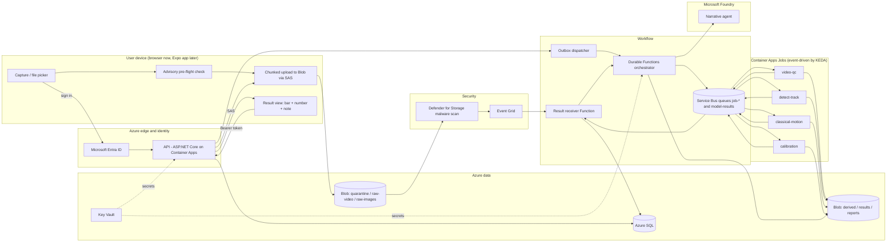

# Penancia.S / Sahatna — Implementation Blueprint (Binding)

| Field | Value |
|---|---|
| Document ID | `PENANCIA-BP-001` |
| Version | `1.0.0` |
| Date | 2026-11-23 |
| Author | Manus AI |
| Audience | Developers and AI coding models that will change the Penancia.S codebase |
| Audited commit | `236a70af009e198ab6fd4fd1767ee58daa63b809` (repository `Penancia.S`) |
| Status | **Binding.** Follow it in order. Do not skip phases. Do not "improve" a step without recording the deviation (Section 15). |
| What this file is | A plan. **Nothing in it has been built, run or tested by its author.** The sandbox used to write it had no .NET SDK, no Bun and no Azure subscription. |

---

## 0. How to Use This Document (Read First)

### 0.1 Rules that bind every developer and every AI model

1. **Read before you change.** Before editing any file, read Section 15 (Change-Log Protocol) and open `CHANGELOG.md`. Search it for the files you are about to touch.
2. **Work phase by phase.** Phases (Section 12) are numbered. A phase starts only when every "Done when" line of the previous phase is true.
3. **One step = one commit = one CHANGELOG entry.** Section 15 gives the entry template. No entry means the change is not finished.
4. **Never state that something works unless you ran it.** Write the exact command and its result in the CHANGELOG entry. If you could not run it, write `NOT RUN` and the reason.
5. **Fail closed.** If a value is missing, unmeasured or low-confidence, the system shows "Not measured" or "Unable to estimate — retake". It never invents a number and never silently falls back to a default (this is the existing `Measurement` convention in `src/Penancia.S.Domain/Model/`).
6. **No combined fertility score.** Every result is per factor. A single overall "fertility score" is forbidden.
7. **Units and thresholds live in one place.** Reference limits live in `src/Penancia.S.Domain/Rules/Who2021Limits.cs`. The client never contains clinical constants.
8. **Anything marked `CANDIDATE` is not decided.** It is a technology to benchmark. Pick it only after it passes the gate named next to it.
9. **Anything marked `VERIFY` must be checked in the live environment** (current Azure docs, region list, package version) before you rely on it.
10. **Do not widen scope.** The first release is a motility pre-screen (Section 2). Other factors are separate, later modules.

### 0.2 Requirement words

`MUST`, `MUST NOT`, `SHOULD`, `MAY` have their RFC 2119 meaning.

### 0.3 Evidence markers used in this document

| Marker | Meaning |
|---|---|
| **[V]** | Verified by reading the code at commit `236a70a` or by reading the cited source. |
| **[I]** | Inferred from code structure; confirm before acting. |
| **[C]** | Candidate technology; benchmark gate required. |
| **[VERIFY]** | External fact that changes over time; re-check the cited URL. |

Line numbers are those of commit `236a70a`. If the file has changed, find the code with the quoted anchor string (`grep -n "<anchor>" <file>`).

### 0.4 Terms

| Term | Meaning |
|---|---|
| Factor | One semen-analysis parameter (for example total motility). |
| Band | Red, Amber or Green display state for one factor. |
| Gauge position (G) | A 0–100 position of the measured value relative to a reference limit (Section 8). It is not a fertility score. |
| Key frame | A single, sharp, representative frame saved as a lossless image. |
| Analysis sequence | The full ordered frame stream the tracking models read. |
| Run | One analysis of one sample. A retake creates a new sample linked by `ParentSampleId`. |
| Orchestrator | The Durable Functions workflow `SampleOrchestrator`. |

---

## 1. Executive Summary

**What exists.** A React web front end, an ASP.NET Core API, a Durable Functions workflow, an Azure Bicep template, an xUnit-tested C# domain library (rules, resolvers, kinematics, state machine, narrative guardrails) and one Python model worker stub. [V]

**What is wrong.** The domain library is sound. The path that is supposed to feed it with real measurements is not connected:

- Calibration is computed and thrown away, and the formula does not use any pixel measurement (ISS-001).
- Nothing receives model results, so the orchestrator waits for events no one raises (ISS-004, ISS-005).
- The only worker returns hard-coded numbers (ISS-007).
- The rule and report activities are placeholders (ISS-008, ISS-009).
- The front end falls back to a browser heuristic that estimates "TZI" and acrosome area from one frame (ISS-011), which is the source of the unreliable numbers the owner saw.
- The backend is not deployed by CI and the front end ships with `BACKEND_ENABLED` false (ISS-013).

**What to build.** A cloud pipeline on Microsoft Azure: the phone or browser captures and uploads video; one Submit press creates an Azure workflow; the workflow runs a quality gate and then several independent models in parallel (detector-tracker, classical baseline); the existing domain library fuses them, measures kinematics, checks agreement, and maps each factor to a Red/Amber/Green band with the number always visible and an "may be inaccurate" note. Azure AI Foundry agents are used only to explain confirmed results in plain language.

**What it will not do.** It will not measure morphology, vitality, DNA fragmentation, volume, pH or antibodies from a phone video. Those need stains, assays or instruments (Section 2.3). The first release measures motility only; concentration is a later module that needs a known-volume chamber.

---

## 2. Product Policy (Binding Scope)

### 2.1 Result presentation (owner requirement)

Every measured factor is shown as:

1. A **three-colour bar**: red = needs attention, amber = borderline, green = within the reference range.
2. The **exact estimated number with unit**, always visible, never hidden behind the colour.
3. A fixed note next to the number: *"Estimate from a phone video. It may be inaccurate. This is a pre-screen, not a diagnosis."*
4. A **state** when no number is possible: `Not measured`, `Unable to estimate — please retake`, or `Needs lab test`.

Red means "see a clinician / book a lab test". It does not mean "infertile". WHO reference limits are population reference points, not pass/fail fertility cut-offs (AUA/ASRM position, [R4], [R5]).

### 2.2 Release tiers

| Tier | Meaning | Sign-off |
|---|---|---|
| `prescreen` (default) | Patient-facing estimate with bands, numbers and caveats. Labelled "Research preview — not validated" until Section 14 gate G-VAL is passed. | None |
| `clinical` | Lab-entered values plus estimates in a signed PDF. | Required (existing sign-off flow) |

The tier is stored on the sample (`WorkflowMode`). `prescreen` MUST NOT wait for manual entry or sign-off (today the orchestrator always waits, see ISS-010).

### 2.3 What can and cannot be screened from a phone-and-microscope video

| Factor | In first release? | Honest position | Required extra |
|---|---|---|---|
| Total / progressive motility | **Yes** | Best candidate for video; accuracy is device- and protocol-specific [R8], [R9], [R6], [R7] | Stable focus, known fps, calibrated scale |
| Concentration | Later (Phase 11) | Only with a known-volume chamber and counting immotile sperm too | Chamber type with known depth, calibrated field area |
| Total sperm number | Later | Concentration × whole-ejaculate volume, measured separately | Volume entry (scale or marked vessel) |
| Morphology | Not from live video | Needs stained smear and a validated classifier | Stained slide image; Phase 11 optional |
| Vitality | No | Eosin–nigrosin or hypo-osmotic swelling test (stained-sample smartphone work exists but needs a prepared sample [R10]) | Reagent test |
| Volume, pH, liquefaction, viscosity | Manual entry only | Macro observations | Scale, strip, observer |
| Agglutination | Visual flag only | Screen, not quantification | — |
| Round cells / leukocytes | No | Needs reagents | — |
| DNA fragmentation, anti-sperm antibodies | No | Separate assays; HFEA notes testing is not standardised [R11]; method checklists in [R12] | Lab assay |

Rules:

- The UI MUST show unsupported factors as "Not measured", not as a guess.
- The heuristic "Pyriform form / Acrosome area / Head L/W ratio / TZI" panel MUST be removed (ISS-011).
- Smartphone CASA literature is small and device-specific. FDA clearances for other devices ([R6], [R7]) do not transfer to this product.

---

## 3. Current-State Audit

### 3.1 What is completed (keep and build on)

| ID | Component | Location | Evidence |
|---|---|---|---|
| OK-01 | Measurement model with provenance and states Present / Missing / Failed / NotPerformed / NotApplicable | `src/Penancia.S.Domain/Model/` | [V] |
| OK-02 | WHO 2021 reference limits | `src/Penancia.S.Domain/Rules/Who2021Limits.cs`, `docs/CLINICAL_WHO2021.md` | [V] |
| OK-03 | Rules engine, flag catalogue (includes `TrackersDisagree`, `SingleTracker`, `ModelFallbackUsed`, `NotValidated`) | `Domain/Rules/` | [V] |
| OK-04 | Motility resolver with primary and fallback trackers and agreement status | `Domain/Resolvers/MotilityResolver.cs` | [V] |
| OK-05 | Kinematics calculator and aggregator (`TrackInput(TrackId, Frames[], XPx[], YPx[])`) | `Domain/Kinematics/` | [V] |
| OK-06 | Concentration, morphology, vitality resolvers | `Domain/Resolvers/` | [V] |
| OK-07 | Sample state machine (Draft, Validating, Analyzing, Collecting, Evaluating, AwaitingSignoff, Released, Rejected, Failed, Abandoned, Cancelled) | `Domain/Workflow/SampleState.cs`, `SampleStateMachine.cs` | [V] |
| OK-08 | Narrative guardrails and template narrative | `Domain/Narrative/` | [V] |
| OK-09 | Report builder and HTML template | `Domain/Reporting/`, `Domain/Report/` | [V] |
| OK-10 | xUnit tests for domain logic | `tests/Penancia.S.Tests/` | [V] |
| OK-11 | User-delegation SAS issuance | `SamplesController.cs` `GenerateUploadSas` (line 162) | [V] |
| OK-12 | Ownership checks on sample endpoints | `SamplesController.cs` lines 171–172, 246–248, 297–299 | [V] |
| OK-13 | Bicep: Storage, Service Bus (11 job queues + `model-results`), ACR, Container Apps environment, API / Gotenberg / workflow / web apps, SQL, Key Vault, role assignments | `infra/main.bicep` (848 lines) | [V] |
| OK-14 | CI: .NET build/test, front-end lint/test/build | `.github/workflows/deploy.yml` | [V] |
| OK-15 | Three-colour bar component | `frontend/src/components/sahatna/ThreeColourBar.tsx` | [V] |
| OK-16 | Durable orchestrator skeleton with timers and phases | `Workflow/Orchestrators/SampleOrchestrator.cs` (336 lines) | [V] |
| OK-17 | `JobRequest` / `JobResult` Python contract | `models/shared/contract.py` | [V] |

### 3.2 What is incomplete (not started or stub)

| ID | Item | State |
|---|---|---|
| INC-01 | Model workers other than `video-qc` | Only `models/video-qc/` exists; 10 queues have no consumer [V] |
| INC-02 | Result receiver for `model-results` | Missing [V] |
| INC-03 | Persisted measurements and report data | Report endpoint returns `measurementsAvailable:false` (`SamplesController.cs` ~line 122) [V] |
| INC-04 | Backend deployment | `deploy.yml` deploys front end only [V] |
| INC-05 | Event Grid / Defender scan hook | Not present [I] |
| INC-06 | Status push or polling endpoint for a running analysis | Only the Durable check-status response from the starter [V] |
| INC-07 | Validation against laboratory results | None |
| INC-08 | Mobile shell | None (planned) |

### 3.3 Defect register (what to fix, exactly where)

Severity: **P0** blocks any real result or produces false results; **P1** correctness or reliability; **P2** hygiene.

| ID | Sev | File and location | Observed behaviour | Required fix | Phase |
|---|---|---|---|---|---|
| ISS-001 | P0 | `src/Penancia.S.Api/Controllers/V1/CalibrationController.cs` `PostCalibration` (line 91; formula lines 120–121, 128) | Computes `umPerPx = fieldWidth / (lines * 50.0)`. No pixel measurement is an input, so the value is not µm per pixel. The result is returned but never stored. | Server-side calibration from an image; persist `Calibrations` row; link to sample (Step 1.3–1.5) | 1 |
| ISS-002 | P0 | `SamplesController.cs` lines 99–101 and 309–310 | `CreateSample` sets `MicronsPerPixel`, `FramesPerSecond`, `ChamberDepthMicrons` to 0. `TriggerAnalysis` requires all three > 0. Nothing writes them, so a real sample can never pass the readiness check. | Fill from calibration record, ffprobe, and chamber catalogue (Steps 1.5, 2.4) | 1–2 |
| ISS-003 | P0 | `src/Penancia.S.Workflow/Activities/ValidateFilesActivity.cs` lines 38–44 | Fails only when `!hasMedia && !hasCalibration` (AND). Media with no calibration, or calibration with no media, passes. No malware, type or duration check. | Require media AND calibration; add type, size, duration, scan checks (Step 3.1) | 3 |
| ISS-004 | P0 | `Workflow/Orchestrators/SampleOrchestrator.cs` lines 153–168 | Waits for `model_done:{svc}` typed `bool`. Contract says `model_done:{service}:{job_id}` carrying a `JobResult`. Nothing raises either. After 1 hour the timer wins. | Define the event contract and raise it from a receiver (Steps 3.2–3.4) | 3 |
| ISS-005 | P0 | `models/shared/base_worker.py` `BaseWorker.run` | Builds `result_uri` string but writes no blob and publishes nothing to `model-results`. | Write result blob, publish `JobResult` (Step 4.1) | 4 |
| ISS-006 | P1 | `models/shared/contract.py` `JobRequest.from_json` (lines 25–34) | Missing parameters fall back to 0.05 µm/px, 30 fps, 10 µm depth. Invented calibration. | Remove defaults; raise `ContractError` (Step 4.1) | 4 |
| ISS-007 | P0 | `models/video-qc/worker.py` | Returns constant focus 128.4, brightness 142.1, `qc_passed=True`. No OpenCV. | Real QC (Step 4.3) | 4 |
| ISS-008 | P0 | `Workflow/Activities/EvaluateRulesActivity.cs` (37 lines) | Loads sample, logs "evaluated successfully". Applies no rules. | Wire Domain rules (Step 6.3) | 6 |
| ISS-009 | P0 | `Workflow/Activities/RenderPdfReportActivity.cs` | Writes a placeholder draft without measurements. | Render from persisted measurements (Step 6.5) | 6 |
| ISS-010 | P1 | `SampleOrchestrator.cs` lines 176 (`manual_entry_completed`) and 212 (`sample_signed_off`); `Api/Controllers/V1/SignoffController.cs` (line 54) | Orchestrator waits on two events that no code raises. `SignoffController` applies the state machine directly. | Raise events; add `WorkflowMode` (Steps 3.6, 3.7) | 3 |
| ISS-011 | P0 | `frontend/src/utils/spermImageAnalyzer.ts` (421 lines; `analyzeSpermImage` line 101; `extractFrameFromVideo` line 38; acrosome estimate `b > r + 15` line 249; `tziScore = null` line 274); `frontend/src/screens/panacea/SemenPreScreenView.tsx` line 203 (`analyzeSpermImage(uploadedFile, 0.05)`) | One frame from a video, a fixed 0.05 µm/px, and a colour test are presented as "Pyriform form, Acrosome area, Head L/W, TZI". This is the root cause of the inaccurate numbers. | Delete from the result path; replace with API result (Steps 0.3, 7.2) | 0, 7 |
| ISS-012 | P1 | `Workflow/Activities/DispatchModelJobActivity.cs` lines 96–115 | Sends to Service Bus first, then writes `ModelRuns`. A crash between them loses the job record; a retry sends a duplicate. | Transactional outbox (Step 3.3) | 3 |
| ISS-013 | P1 | `.github/workflows/deploy.yml`; `frontend/src/config.ts` (`BACKEND_ENABLED` default false) | CI never deploys API, workflow or model images; the SPA runs against fixtures. SWA deploy fails without its token. | Backend deploy jobs; environment flags (Phase 9) | 9 |
| ISS-014 | P1 | `frontend/src/server/pipelineEngine.ts` (779 lines) | The S0–S13 pipeline is fixture-seed driven; it can produce plausible-looking output without any measurement. | Quarantine behind `DEMO_MODE`; never in production build (Step 0.4) | 0 |
| ISS-015 | P1 | `SamplesController.cs` `RegisterBlob` (line 238) | Stores any `BlobUri` the client sends. No check that the blob exists, belongs to this sample, or matches type/size. | Server-side verification (Step 2.3) | 2 |
| ISS-016 | P1 | `GenerateUploadSas` (line 162) | Container and extension are decided from a client string; video extension is always `.mp4`; 15-minute expiry; no size limit. | Allow-list, content-type, size cap, create/write-only permission (Step 2.2) | 2 |
| ISS-017 | P1 | `CalibrationController.cs` `POST v1/semen/analyze` (line 35) and `SamplesController.cs` `POST {sampleId}/analyze` (line 283) | Two parallel "analyze" entry points. The first requires µm/px, fps and depth > 0 (line 59) from the client. | Single `submit` endpoint; deprecate both (Step 2.5) | 2 |
| ISS-018 | P1 | `SamplesController.cs` `TriggerAnalysis` (lines 283–346) | Applies the state machine in memory, then calls the workflow starter. It does not persist the new state or write an outbox row; a failed start returns 502 and leaves state uncertain. [I] | Single DB transaction + outbox (Step 2.5) | 2 |
| ISS-019 | P2 | `CHANGELOG.md` (v1.0.1-FIX-BATCH) | States that stub activities throw `NotSupportedException`. The code does not. | Correct entry (Step 0.2) | 0 |
| ISS-020 | P2 | `models/shared/contract.py` docstring; `infra/main.bicep` line ~170; `MAP.md` | Docs say "10 models" / "12 queues"; 1 worker exists; `MAP.md` lists 3 wired and 7 planned. | Align to a single status table (Step 0.2) | 0 |
| ISS-021 | P1 | `frontend/src/screens/sahatna/SemenPreScreenFlow.tsx` (1,428 lines; `getUserMedia` line 185; calibration call line 263; analyze call line 363) | One very large component mixes capture, calibration, upload and display; sends calibration numbers typed by the client. | Split into modules; call the new endpoints (Step 7.1) | 7 |
| ISS-022 | P1 | Infra region `uaenorth` (`infra/parameters.json`, `main.bicep` line 12) | Serverless GPU regions listed by Microsoft do not include UAE North [VERIFY, R20]. | GPU decision OD-03 (Section 16) | 5, 9 |

### 3.4 Dependency order of the defects

```
ISS-001/002 calibration & media facts  ─┐
ISS-003 validation (needs 001/002)      ─┼─> ISS-012 outbox ─> ISS-007 real QC worker ─┐
ISS-005/006 worker contract             ─┘                                              ├─> ISS-004 receiver ─> ISS-008/009 rules+report
                                                                                         │
ISS-011 remove heuristic (do first: stops false numbers) ───────────────────────────────┘
```

Do ISS-011 (hide the false numbers) first, because it is the cheapest and stops the harm today.

---

## 4. Target Architecture

> **Status of this section: design.** Components marked *(exists)* are in the repository. Everything else is to be built by the phases in Section 12.

### 4.1 Where code runs (binding rule)

| Place | Allowed to do | Must not do |
|---|---|---|
| **User device** (browser now, Expo/React Native later) | Capture; show live preview; cheap advisory checks (blur, brightness, shake) to help the user retake early; calibration capture guidance; chunked upload to Blob using a short-lived SAS; submit; poll status; render results | Compute any value that is stored or shown as a result; hold clinical constants; hold secrets; talk to model services or Service Bus directly |
| **Azure API** (ASP.NET Core on Container Apps) *(exists)* | Authenticate (Entra); authorise ownership; issue user-delegation SAS; create sample; accept Submit; write DB + outbox in one transaction; serve status and results | Run models; hold long requests open |
| **Azure Durable Functions workflow** *(exists, incomplete)* | Orchestrate: validate, wait for scan, dispatch jobs via outbox, wait for results, evaluate rules, render report, wait for sign-off | Do heavy CPU/GPU work; use non-deterministic APIs inside the orchestrator |
| **Azure Container Apps Jobs** (model workers) *(1 of N exists)* | Decode video, extract frames, QC, detect, track, classify; read from Blob; write results to Blob; publish `JobResult` | Write to the SQL database; call other workers |
| **Azure SQL** *(exists)* | System of record for samples, calibrations, model runs, measurements, audit, outbox, inbox | Hold media |
| **Azure Blob Storage** *(exists)* | Raw media, derived frames, result files, reports | Be publicly readable |
| **Microsoft Foundry agent** *(planned)* | Turn confirmed numbers and flags into plain-language text; answer "what does this mean" questions from the report | Look at images or video; produce or change any measurement; give a diagnosis |

Why the device does not compute results: the same video must give the same answer on every device and every week. Results need pinned model versions, an audit trail, and re-runs. A browser heuristic on one frame (ISS-011) cannot give that.

### 4.2 Component diagram



### 4.3 Azure service map

| Need | Azure service | Already in `infra/main.bicep`? | Notes |
|---|---|---|---|
| Identity, sign-in | Microsoft Entra ID [R32] | Parameters for web/API client IDs exist [V] | Use app roles for `Patient`, `Technician`, `Signer`, `LabAdmin`, `ClinicalDirector` (existing role names in `SamplesController`) |
| API hosting | Azure Container Apps | Yes [V] | Keep |
| Workflow | Azure Functions + Durable Functions [R17] | Yes (workflow app) [V] | Isolated worker model |
| Message bus | Azure Service Bus | Yes (11 job queues + `model-results`) [V] | Add duplicate detection (Step 3.3) and dead-letter handling [R26], [R27] |
| Model workers | Container Apps **Jobs**, event trigger via KEDA Service Bus scaler [R14], [R15] | Not yet | One job per service; set `replicaRetryLimit` ≥ 1 and make workers idempotent because platform maintenance can interrupt jobs [R14] |
| GPU (optional) | Container Apps serverless GPU (T4/A100) on a Consumption workload-profile environment [R20] | No | Region constraint, see OD-03 |
| Alternative model hosting | Azure Machine Learning batch endpoints (async, scale to zero) [R30] | No | `CANDIDATE` if the team prefers a model registry and MLflow |
| Media storage | Azure Blob Storage | Yes [V] | Add containers `quarantine`, `derived`, `results`, `reports`; lifecycle rules [R35] |
| Malware scan | Microsoft Defender for Storage, on-upload malware scanning [R21] | No | Writes blob index tags and can emit Event Grid events. Do not make security decisions from tags alone (tags are not tamper-resistant); use the Event Grid event [R21] |
| Blob events | Event Grid [R24], [R25] | No | BlobCreated and scan result events |
| Database | Azure SQL | Yes [V] | EF Core migrations |
| Secrets | Key Vault [R33] | Yes [V] | Use managed identity; no connection strings in settings |
| PDF | Gotenberg container | Yes [V] | Keep |
| Agents | Microsoft Foundry (prompt agents, hosted agents, Responses API) [R28], [R29] | `agent.yaml` in repo (inspect) | Narrative only |
| Telemetry | Application Insights [R36] | [I] | Add correlation id = `sampleId` |
| Status push (optional) | Azure Web PubSub [R31] | No | Polling first; push is an upgrade |

### 4.4 Web now, mobile later

Design decisions that keep the mobile path open:

1. **All business logic is on the server.** The client is a thin shell. A mobile app calls the same endpoints.
2. **A UI-free TypeScript core** is created at `frontend/src/core/` (Step 7.1) containing: API client, request/response types, Zod schemas, band-display helpers, upload logic behind an interface. It MUST NOT import `react`, `react-dom`, or any `window` / `document` API. An ESLint `no-restricted-imports` rule enforces it. When the mobile app starts, `core/` moves unchanged to `packages/core/` in a workspace.
3. **Upload and capture are interfaces**: `MediaCapture` and `ChunkedUploader`. The web implementation uses `MediaRecorder` / file input and the Blob block API. The mobile implementation (Expo Camera, file system upload) is written later against the same interfaces [R62], [R63], [R64].
4. **Mobile specifics to remember**: phone cameras apply auto-exposure, auto-focus, stabilisation and digital zoom. The capture guide MUST tell the user to lock focus and exposure where the OS allows it and to avoid digital zoom. The server records the actual video metadata (resolution, fps, codec) from `ffprobe`; the client's claim is never trusted.
5. **Push notifications** for "your result is ready" are a mobile-phase item. Until then the web app polls.

---

## 5. The Single Submit Press: How It Starts Azure

This is the exact trigger chain. Every arrow is an implementation step in Section 12.

```
[Browser] Submit button
   │  POST /v1/semen/samples/{sampleId}/submit
   │  Headers: Authorization: Bearer <Entra token>, Idempotency-Key: <uuid>
   ▼
[API] SubmitSample
   1. Authenticate; check ownership (CreatedBy == caller) or staff role.
   2. Check the sample is in state Draft (state machine: event Submit).
   3. Check readiness against the DATABASE, not the request body:
        - at least one registered media asset with Status = Uploaded
        - a Valid, unexpired Calibration linked to the sample
        - consent recorded
   4. In ONE SQL transaction:
        - set state Draft -> Validating
        - insert OutboxMessage { Type: "StartWorkflow", Payload: { sampleId } }
        - store Idempotency-Key with the response
   5. Return 202 Accepted { sampleId, statusUrl: "/v1/semen/samples/{id}/status" }
   ▼
[Outbox dispatcher] (timer-triggered Function, every few seconds, plus an immediate attempt)
   Reads undispatched rows; calls the workflow starter with InstanceId = sampleId;
   marks the row dispatched. A repeat is harmless because a started instance id is not started twice.
   ▼
[Durable orchestrator SampleOrchestrator]
   Validate -> wait for scan result -> QC job -> parallel model jobs -> wait -> rules -> report -> done
   ▼
[Browser] polls GET /v1/semen/samples/{id}/status every 2 s, backing off to 10 s; shows stage names
```

Why this design (the status URL follows the Durable HTTP-API idea of a status resource [R19]):

- **202 + status** because analysis takes minutes; a request must not stay open.
- **Idempotency-Key** because users double-tap and networks retry. The same key returns the same 202 response and creates no second run.
- **Outbox** because "save to database" and "tell the workflow" are two systems. Writing both rows in one transaction means neither can happen without the other. The workflow starter is called only from the dispatcher.
- **Instance id = sampleId** gives a natural idempotency key for the workflow. [VERIFY] the Durable behaviour for starting an instance whose id already exists and is running, and test it (Step 2.5).

---

## 6. The Data Flow, One Step at a Time

Notation: **DF-nn** = one data-flow step. For each: where it runs, what it does, the data it produces, where that data is stored, and what happens on failure.

### 6.1 Storage layout (binding)

| Container | Contents | Path pattern | Who writes | Retention |
|---|---|---|---|---|
| `quarantine` | Uploaded files not yet cleared | `{sampleId}/{assetId}{ext}` | Client (SAS) | Delete after clearance copy, or 24 h on reject |
| `raw-video` *(exists)* | Cleared videos | `{sampleId}/{assetId}.{ext}` | Workflow copy activity | Policy decision OD-05 |
| `raw-images` *(exists)* | Cleared still images | same | same | same |
| `derived` | Key frames, manifests, QC | `{sampleId}/{runId}/keyframes/kf_0001.png`, `manifest.json`, `qc.json` | Workers | Same as raw |
| `results` | Model outputs | `{sampleId}/{runId}/{service}/result.json`, `tracks.ndjson.gz` | Workers | Same as raw |
| `reports` | PDFs | `{sampleId}/draft_v{n}.pdf`, `final_v{n}.pdf` | Workflow | Per policy |

Note: today clients upload straight to `raw-video` / `raw-images` (`GenerateUploadSas`, line 169). Moving to `quarantine` is Step 2.2.

### 6.2 Video path (the primary path)

| ID | Where | Step | Input | What happens | Output data | Stored at | On failure |
|---|---|---|---|---|---|---|---|
| DF-01 | Device | Capture or select | Camera stream or file | User records through the microscope eyepiece with the phone, or picks a video. Guide text: lock focus/exposure, no digital zoom, hold steady, 20–30 s per field [C: protocol parameters to be fixed in pilot] | Video file | Device memory | Re-record |
| DF-02 | Device | Advisory pre-flight | First seconds of video | Sample about 1 frame/s with `requestVideoFrameCallback` [R60]; compute Laplacian variance (blur), mean brightness, frame-to-frame shift. Show "too dark / blurry / shaky" | `advisory` object (UI only, never sent as a result) | RAM | Message, retake |
| DF-03 | Device→API | Create sample | Intake, consent, chamber type, device profile | `POST /v1/semen/samples` | `sampleId`, `Draft` state | SQL `Samples` | Error toast |
| DF-04 | Device→API | Calibration | Image of a stage micrometer at the same zoom and resolution as the sample video | Upload image; `POST /v1/semen/samples/{id}/calibration`; the **calibration job** measures line pitch in pixels on the server | `Calibration` row: `µm/px`, spacing CV%, lines, image size, status | SQL `Calibrations`, Blob `derived` | "Calibration failed — refocus" (existing 6-line and 5% rules, [V] `CalibrationController.cs` ~line 107, kept as provisional) |
| DF-05 | Device→Blob | Chunked upload | Video file | `POST …/upload-sas` returns a user-delegation SAS; browser uploads blocks (e.g. 4 MiB) with retry and resume [R34]; then `POST …/register-blob` | Blob in `quarantine`; `MediaAsset` row `Registered` | Blob + SQL | Resume from last block |
| DF-06 | Device→API | **Submit** | `sampleId`, `Idempotency-Key` | Section 5 | 202 + `statusUrl`; outbox row | SQL | Safe to retry |
| DF-07 | Cloud (API) | Verify upload | Blob properties | Server reads blob size, content type, computes SHA-256 (stream), confirms prefix matches the sample, confirms size within limit | `MediaAsset` row `Verified`: size, sha256, content type | SQL | Reject `UPLOAD_MISMATCH` |
| DF-08 | Azure (Defender + Event Grid) | Malware scan | New blob | Defender for Storage scans on upload; emits scan result event [R21] | Scan result event | Event Grid → Function | `Malicious` → delete, state `Rejected`; no result within timeout → fail closed `SCAN_TIMEOUT` |
| DF-09 | Cloud (activity) | Validate files | `MediaAsset`, calibration | Fixed `ValidateFilesActivity` (Step 3.1): requires media **and** calibration; MIME sniff from magic bytes; allowed container formats; max size; duration limits from `ffprobe`; copy cleared blob from `quarantine` to `raw-video` | `validation` record; `fps`, width, height, codec, duration written to `Samples` | SQL | State `Rejected` with reason code |
| DF-10 | Cloud (job `video-qc`) | **QC gate + key frames** | Video, calibration | OpenCV: focus, brightness, saturation, drift, frame-rate stability, cell-visible check; select key frames (Section 7.2) | `qc.json`, `keyframes/*.png`, `keyframes.json` | Blob `derived` | `qc_passed=false` → stop, ask retake with the specific reason code |
| DF-11 | Cloud (jobs) | **Parallel models** | Video, calibration, key frames | `detect-track` (detector + tracker) and `classical-motion` (non-learned baseline) run independently (Section 7.3) | `tracks.ndjson.gz` ×2, `result.json` ×2 | Blob `results` | Retry up to N; then measurement `Failed` |
| DF-12 | Cloud (Function) | Receive results | `JobResult` on `model-results` | De-duplicate in inbox; update `ModelRuns`; raise `model_done:{service}:{job_id}` | Updated rows, event | SQL | Dead-letter after max deliveries |
| DF-13 | Cloud (activity + Domain) | **Evaluate** | Tracks, calibration, parameters | `KinematicsCalculator.Compute` per track; `MotilityResolver.Resolve(primary, fallback)`; `RulesEngine.Evaluate`; band mapping (Section 8) | `Measurements` rows with provenance; flags; bands | SQL | Missing input → `Measurement.Missing`, never a number |
| DF-14 | Cloud (agent) | Narrative | Confirmed measurements and flags (JSON only) | Foundry agent writes plain text; `NarrativeValidator` rejects any number not in the input; template narrative is the fallback | `narrative` text | SQL | Fallback to `TemplateNarrative` |
| DF-15 | Cloud (Gotenberg) | Report | Measurements, bands, narrative | HTML → PDF | PDF | Blob `reports` | State `Failed`, alert |
| DF-16 | Device | Show result | `GET …/report` | Bar + number + note per factor; unsupported factors "Not measured" | UI | — | Retry |

### 6.3 Still-image path (user shares a photo instead of a video)

A single image has no motion. Motility, which is the only first-release factor, **cannot** be estimated from it.

| ID | Step | What happens | Output |
|---|---|---|---|
| IM-01 | Client | Accept JPEG/PNG/HEIC (convert HEIC server-side). Show: "A photo cannot show movement. Please record a video for a motility screen." Offer "Continue with photo anyway" | UI choice |
| IM-02 | API | Same upload, verify, scan and validate steps as DF-05 to DF-09 for `raw-images` | `MediaAsset` |
| IM-03 | Job `video-qc` (image mode) | Focus, brightness, resolution, calibration match | `qc.json` |
| IM-04 | Result | If QC passes: show "Photo received and checked. Motility not assessable from a photo." Every factor is `Not measured` except an optional **visible-cell count in this field** (not a concentration) if the detector gate G-DET passes. If the user marks the photo as a stained slide **and** the morphology module is released (Phase 11), run segmentation and the morphology classifier | `result.json` with `states` only |
| IM-05 | Never | No TZI, acrosome or shape numbers from an unstained live-field photo | — |

A set of several photos of different fields MAY be accepted later for concentration with a known-volume chamber (Phase 11). Until then each is treated as IM-01 to IM-04.

### 6.4 Other content shared (PDF lab report, document, audio, archive, anything else)

| Case | Rule |
|---|---|
| PDF or photo of an existing lab report | Route to the existing report-upload path (`ReportsController`: `upload-sas` line 49–50, `extract` line 101, `confirm` line 155). [I] Inspect what `extract` uses before changing it. The user MUST confirm extracted values before they are stored, as the existing `confirm` endpoint implies. Extracted lab values are labelled `source = "user-supplied lab report"` and are never mixed into the video-derived result |
| Video of something that is not a microscope field (face, room) | `video-qc` returns `VQC_NO_FIELD`; message "This does not look like a microscope view" |
| Audio, archive, executable, script, text, unknown | Rejected at DF-09 by magic-byte check against an allow-list; blob deleted; the response never echoes file content |
| Oversized or too long | Rejected with `VQC_TOO_LARGE` / `VQC_TOO_LONG`; limits set in configuration (Section 7.1) |
| Malware verdict | Blob deleted; sample `Rejected`; security event logged; the user sees a generic message |

---

## 7. Video Processing and the Multi-Model Stack

### 7.1 Input limits (configuration, not code)

Keep them in `models/shared/limits.yaml` and in `appsettings` for the API. The numbers below are **provisional starting values** to be set in the pilot, not validated facts.

| Setting | Provisional value |
|---|---|
| Allowed containers | MP4 (H.264, HEVC), MOV, WebM |
| Max file size | 1 GiB |
| Duration | min 10 s, max 120 s |
| Min resolution | 1280×720 |
| Min fps | 25 (30 or more recommended; 60 preferred) |
| Variable frame rate | Detect; normalise (Step 4.3) |

### 7.2 Splitting the video into key frames and a frame sequence

One phone video produces **two** products, because the two jobs need different things:

| Product | Purpose | Size | Selection |
|---|---|---|---|
| **Key frames** (about 12–24 lossless PNG) | Quality gate, detector sanity check, UI thumbnails, future image-only models | Small | Split the clip into equal time segments; in each, pick the frame with the highest focus score that is not motion-blurred and not over- or under-exposed. If the stage moved (new field), start a new segment |
| **Analysis sequence** (every frame, streamed, never stored as images) | Detection and tracking, which need consecutive frames at the native frame rate | Large | Decoded in the worker with OpenCV/FFmpeg [R58], [R59]; frames are processed as a stream. If fps > 60, optionally decimate to 60 only after the pilot shows it does not hurt tracking |

Algorithm for the `video-qc` job (Step 4.3):

1. `ffprobe` the file: fps (average and real), frame count, width, height, codec, pixel format, rotation, duration. Write them to `manifest.json`. These values, not user input, populate `Samples.FramesPerSecond`.
2. If fps is variable, record `vfr=true` and re-time frames by their timestamps; tracking uses timestamps, not frame index, for speed.
3. Decode every frame to grayscale. For every frame compute: Laplacian variance (focus), mean and standard deviation (illumination, contrast), clipped-pixel fraction.
4. Every N-th frame (N chosen so that about 2 per second): `cv2.phaseCorrelate` against the previous sampled frame to measure global drift in pixels per second.
5. Compute a simple "cell-like blob count" on a few frames (threshold + contour area) to detect an empty or non-microscope view.
6. Score each segment and choose key frames as described above; save as PNG (lossless) to `derived/{sampleId}/{runId}/keyframes/`.
7. Write `qc.json` with per-frame series and a pass/fail with reason codes: `VQC_BLUR`, `VQC_DARK`, `VQC_OVEREXPOSED`, `VQC_DRIFT`, `VQC_SHORT`, `VQC_LOW_FPS`, `VQC_LOW_RES`, `VQC_NO_FIELD`, `VQC_VFR`, `VQC_CALIBRATION_MISMATCH`.
8. Thresholds live in `models/video-qc/qc_thresholds.yaml`, versioned, with a comment that they are **provisional until calibrated against pilot videos**.

Small objects: sperm heads are only a few micrometres wide. Whether a detector can see them depends on the calibrated µm/px. The QC job MUST compute "head diameter in pixels" from the calibration (a nominal head width in µm divided by µm/px) and fail with `VQC_LOW_RES` below a minimum set in the pilot [C]. For high-resolution video the detector SHOULD run on overlapping tiles rather than a downscaled whole frame.

### 7.3 The models and why several

No single model is trusted. Independent methods are compared; disagreement lowers confidence or blocks the number. The domain library already encodes this (`MotilityResolver.Resolve(primary, fallback)` and the flags `SingleTracker`, `TrackersDisagree`, `ModelFallbackUsed`) [V].

| Stage | Service (queue) | Method | Status | Gate to adopt |
|---|---|---|---|---|
| Quality gate + key frames | `video-qc` (`job-video-qc`, exists) | Classical OpenCV (Laplacian focus, phase correlation, histograms) | Build | Unit tests on synthetic and real clips |
| **Primary tracker** | `detect-track` (new queue `job-detect-track`) | Learned detector fine-tuned on VISEM-Tracking [R48], [R49] plus multi-object tracker; CANDIDATE detectors: Ultralytics YOLO family [R51], RT-DETR family; CANDIDATE trackers: ByteTrack [R54], BoT-SORT [R55], BoostTrack++ with tracklet stitching [R50] | **CANDIDATE: benchmark** | G-DET, G-TRK (Section 14) |
| **Fallback tracker** | `classical-motion` (re-use existing queue name `job-pycasa` or `job-opencasa`; choose one, retire the other) | Non-learned: background subtraction, blob detection, nearest-neighbour or Hungarian linking, Kalman smoothing | Build | Agreement with primary within tolerance on the validation set |
| Kinematics | None (not a worker) | `KinematicsCalculator.Compute` in the Domain library | Exists [V] | Existing unit tests + new golden-file tests |
| Segmentation / morphology (stained images only) | existing planned queues `job-cellpose`, `job-maskrcnn`, `job-madrnet`, `job-cbam`, `job-maml`, `job-spermmorpho` | CANDIDATE: SAM 2 [R56] or Cellpose for segmentation; classifiers trained on HuSHeM [R57] and similar sets | Not in release 1 | G-MORPH (Phase 11) |
| Explanation | Foundry agent | LLM over structured facts | Build later | Narrative validator passes 100% of tests |

**Licence warning [V].** Ultralytics YOLO is offered under AGPL-3.0, with a paid Enterprise licence for uses that AGPL does not cover [R53]. For a closed commercial product this is a legal decision (OD-04). Alternatives to evaluate: detectors under permissive licences (for example RT-DETR implementations or YOLOX; **VERIFY** each licence at the time of choice).

**Why two trackers are built by different methods.** If both were the same architecture they would fail the same way on the same clip. A classical method fails differently (for example on dense fields), so disagreement is informative. The existing flags turn disagreement into a visible "low confidence" state.

**Why the video-qc gate comes first.** It is cheap CPU work. Running a GPU model on an unusable video wastes money and produces numbers that look real. The orchestrator MUST run `video-qc`, wait, and only then dispatch Stage C jobs (Step 3.5).

**Data the models read and write** (contract, Section 7.4). Messages carry blob addresses, not video bytes — the Claim Check pattern [R38]; several worker replicas read one queue — the Competing Consumers pattern [R39]. Inputs are blob URIs, the calibration, and fps; outputs are blob URIs. No model receives or returns a patient identifier.

### 7.4 Data contracts (binding schemas)

All JSON uses `snake_case` fields and `schema_version`. Put the JSON Schema files in `contracts/` (Step 4.1) and validate in both languages.

**JobRequest** (Service Bus message body to `job-{service}`):

```json
{
  "schema_version": "2.0.0",
  "job_id": "S-2026-000123:detect-track:1",
  "sample_id": "S-2026-000123",
  "service": "detect-track",
  "attempt": 1,
  "inputs": {
    "media_blob_uri": "https://<account>.blob.core.windows.net/raw-video/S-2026-000123/a1.mp4",
    "keyframes_manifest_uri": "https://<account>.blob.core.windows.net/derived/S-2026-000123/r1/keyframes.json",
    "qc_uri": "https://<account>.blob.core.windows.net/derived/S-2026-000123/r1/qc.json"
  },
  "params": {
    "microns_per_pixel": 0.274,
    "fps": 59.94,
    "chamber_depth_microns": 20.0,
    "calibration_id": "c0a8…",
    "model_version": "detect-track-0.1.0"
  },
  "output_prefix": "https://<account>.blob.core.windows.net/results/S-2026-000123/r1/detect-track/"
}
```

Rules: `params.microns_per_pixel`, `fps` and `calibration_id` are **required**; the worker raises `ContractError` and returns `status="failed"`, `error_code="CONTRACT_MISSING_PARAM"` if absent. No defaults (ISS-006). Workers read blobs with a managed identity, not with SAS URLs in the message.

**JobResult** (message body to `model-results`):

```json
{
  "schema_version": "2.0.0",
  "job_id": "S-2026-000123:detect-track:1",
  "sample_id": "S-2026-000123",
  "service": "detect-track",
  "attempt": 1,
  "status": "succeeded",
  "result_uri": "https://<account>.blob.core.windows.net/results/S-2026-000123/r1/detect-track/result.json",
  "error_code": null,
  "error_detail": null,
  "execution_time_seconds": 41.7,
  "provenance": {
    "repo_commit": "<git sha of worker image>",
    "weights_sha256": "<sha256 of model weights>",
    "image_digest": "sha256:…"
  }
}
```

The Service Bus `MessageId` MUST equal `job_id` so the broker can drop duplicates [R27].

**Durable event** (raised by the receiver):

- Name: `model_done:{service}:{job_id}` (exactly the string the contract docstring in `contract.py` already promises).
- Payload: `{ "job_id", "status", "result_uri", "error_code" }`.
- The orchestrator computes the same `job_id` deterministically (`{sampleId}:{service}:{attempt}`) before waiting. Events for another attempt never match, so stale results from a retried job cannot satisfy a newer wait [R18].

**`result.json` for `detect-track` and `classical-motion`**:

```json
{
  "schema_version": "2.0.0",
  "service": "detect-track",
  "frame_count": 1798,
  "fps": 59.94,
  "microns_per_pixel": 0.274,
  "tracks_uri": ".../tracks.ndjson.gz",
  "summary": { "n_tracks": 212, "n_detections": 41230, "mean_detection_confidence": 0.81 },
  "classes": { "0": "normal", "1": "cluster", "2": "pinhead" },
  "diagnostics": { "fragmentation_estimate": 0.07, "id_switch_proxy": 0.03 }
}
```

Each line of `tracks.ndjson.gz` maps one-to-one to the C# type `TrackInput(TrackId, Frames[], XPx[], YPx[])`:

```json
{"track_id": 17, "frames": [102,103,104], "x_px": [311.2,313.0,315.1], "y_px": [88.4,89.0,89.9], "mean_conf": 0.84}
```

The classes above follow VISEM-Tracking's annotation (0 normal, 1 cluster, 2 pinhead) [R48]. They describe what the dataset labels, not a morphology diagnosis, and MUST NOT be shown to users as morphology.

**Manifest** (`derived/{sampleId}/{runId}/manifest.json`): `{ "video": {fps_avg, fps_real, vfr, width, height, codec, pix_fmt, rotation, duration_s, frame_count, sha256}, "calibration_id", "keyframes": [{ "index", "frame", "t_s", "focus", "uri" }] }`.

---

## 8. Scoring and Display Specification

### 8.1 Principles

1. One result per factor. No combined score.
2. Bands and gauge positions are computed **on the server** by one class (`BandMapper`, Step 6.4) and sent to the client. The client only draws them.
3. The number is always shown with its unit and the fixed note from Section 2.1.
4. Until the validation gate G-VAL passes, every band carries the label **"Research preview — not validated"** and the limit source is labelled provisional.

### 8.2 The gauge (the "25 and 50 pass mark" scale)

For a factor whose **lower** reference limit is `L` and whose estimate is `v`:

```
G = clamp( 100 × v / (2 × L), 0, 100 )

Red    : G <  25    (v < 0.5 × L)
Amber  : 25 ≤ G < 50   (0.5 × L ≤ v < L)
Green  : G ≥ 50     (v ≥ L)
```

So 50 is the "pass mark" and equals the reference limit; 25 is half of it. A value at or above twice the limit saturates at 100. G is only a **position on a bar**. It is not a fertility score and it is never summed or averaged across factors. If a 1–10 ruler is wanted for visual friendliness, draw tick marks every 10 gauge points; do not show a separate "score out of 10".

Provisional lower reference limits (WHO 2021, 5th centile, to be read from `Who2021Limits.cs`, never retyped in a client) [R1], [R2]:

| Factor (release 1 in bold) | Limit L | Unit |
|---|---|---|
| **Total motility (PR + NP)** | 42 | % |
| **Progressive motility (PR)** | 30 | % |
| Sperm concentration (Phase 11) | 16 | million/mL |
| Total sperm number (Phase 11) | 39 | million per ejaculate |
| Semen volume (manual entry) | 1.4 | mL |
| Vitality (assay) | 54 | % |
| Morphology, normal forms (stained) | 4 | % |

Worked example (total motility): L = 42 %. Estimate 38 % gives G = 100 × 38 / 84 = 45.2, amber. Estimate 15 % gives G = 17.9, red. Estimate 55 % gives G = 65.5, green.

These limits are population reference points. AUA/ASRM state that the fifth-centile values do not diagnose fertility [R4], [R5]. The final band thresholds (the 0.5 and 1.0 multipliers) are **provisional design values** and become locked only after validation against paired laboratory results (Section 14).

### 8.3 States and what the user sees

| State | Condition | Display |
|---|---|---|
| `Estimated` | QC passed, both trackers present and agree, enough tracks | Number + bar + band + note |
| `LowConfidence` | Only one tracker, or `ModelFallbackUsed` | Number + bar + band + amber "low confidence" badge + note |
| `Unreliable` | `TrackersDisagree` beyond tolerance | Number in grey, **no band colour**, text "Unreliable — please retake" |
| `UnableToEstimate` | QC failed, too few tracks, or job failed | No number; reason in plain words; retake guide |
| `NotMeasured` | Factor outside the release scope | "Not measured by this pre-screen" with what test would measure it |
| `Borderline` (modifier) | Once validated: the 95% interval crosses a band edge | Band colour with diagonal hatch and the words "borderline" |

Thresholds are parameters in the existing `ParameterSet` record (`src/Penancia.S.Domain/Parameters/ParameterSet.cs`): "enough cells" = `MinCellsMotility` (placeholder 200), "trackers agree" = `MotilityAgreementPp` (placeholder 5 percentage points). A borderline-interval parameter is new and is added in Phase 10. All are **placeholders until the validation manifest replaces them**; `ParameterSet.Validated` stays `false` until then and forces the NOT_VALIDATED banner (existing behaviour, [V]).

### 8.4 The result JSON the API returns (per factor)

```json
{
  "factor": "total_motility",
  "label": "Total motility",
  "state": "Estimated",
  "value": 38.2,
  "unit": "%",
  "ci95": null,
  "gauge": 45.5,
  "band": "amber",
  "reference": { "limit": 42, "op": ">=", "source": "WHO 2021 lower reference limit", "locked": false },
  "method": { "primary": "detect-track-0.1.0", "fallback": "classical-motion-0.1.0" },
  "flags": ["NotValidated"],
  "note": "Estimate from a phone video. It may be inaccurate. This is a pre-screen, not a diagnosis.",
  "validated": false
}
```

### 8.5 Accessibility and wording rules

- Colour is never the only signal. Each band also has a text label ("Needs attention", "Borderline", "In reference range") and an icon or pattern. Follow WCAG 2.2 contrast rules [R68].
- Do not use the words "infertile", "abnormal sperm count" or "you have". Use "below the WHO reference value" and "talk to a clinician".
- Provide a "Why this might be wrong" expander: poor focus, shake, too few sperm in view, sample not at body temperature, phone camera processing.
- The existing component `frontend/src/components/sahatna/ThreeColourBar.tsx` is the base. Read its props, then extend it (Step 7.3). Do not create a second bar component.

---

## 9. Microsoft Azure Agents: What They Are and How to Connect Them

### 9.1 What an "agent" means here

Microsoft's agent service is now called **Microsoft Foundry** (formerly Azure AI Foundry Agent Service). It offers prompt agents, hosted agents (your own container) and the Responses API (ephemeral agents), with tools, tracing and evaluations, and it uses Microsoft Entra identities [R28], [R29]. [VERIFY] names and SDK packages in the live documentation before coding; they changed more than once.

### 9.2 What agents are allowed to do in this product

| Agent | Purpose | Input | Output | Must never |
|---|---|---|---|---|
| `penancia-narrator` (prompt agent) | Write plain-language explanation of confirmed results | Structured JSON of `FactorResult[]` + flags + reference sources | Short text (per factor and overall) | See images/video; compute or change any number; diagnose; recommend treatment |
| `penancia-ask` (prompt agent; the repo already has an `AskController` at `Api/Controllers/V1/AskController.cs` line 27 and `agent.yaml`) [V] | Answer questions about a released report | The report JSON and a small fixed knowledge text | Short answer or "please ask a clinician" | Answer outside the report; give a diagnosis |

Image and video understanding stays in the classical and learned CV workers. Using a general language model to "read" a microscope image is **not** allowed: it cannot be validated and would reintroduce the failure the owner is trying to remove.

### 9.3 How to connect (steps)

1. Create a Foundry resource and project in Azure; deploy one chat model. **VERIFY** the model list and region availability in the portal at deployment time.
2. Create the `penancia-narrator` prompt agent with the system prompt in 9.4 and **no tools**. (Narrative needs only the JSON given in the message; tools add attack surface.)
3. Give the workflow app's managed identity the role needed to invoke the agent, and store only the endpoint URL and agent name in app settings. No API key in code [R16], [R32].
4. Add `GenerateNarrativeActivity` in `src/Penancia.S.Workflow/Activities/` that:
   - builds the JSON input from persisted measurements only,
   - calls the agent through the current Foundry SDK or the REST Responses API,
   - passes the output through `NarrativeValidator` (existing) which MUST reject any numeral, band or factor that is not in the input,
   - on any failure or rejection uses `TemplateNarrative` (existing) instead.
5. Optionally pass the input and output through Azure AI Content Safety [R37].
6. Send traces to Application Insights with the `sampleId` as correlation id; keep prompts and outputs out of logs if they contain personal data [R36].
7. Maintain an evaluation set (JSON inputs with expected "forbidden content" checks) in `tests/Narrative/`; run it in CI against the validator, and manually against the live agent before each prompt change.

### 9.4 Narrator system prompt (starting text)

```
You explain screening results in plain language. You receive JSON. Use ONLY numbers,
factors and flags present in that JSON. Never add or change a number. Never diagnose.
Never say a person is or is not fertile. For each factor state: the estimate, the
reference value, the colour band in words, and that the estimate may be inaccurate.
If a factor state is not "Estimated", say it could not be reliably estimated and why.
End with: "This is a pre-screen. Please discuss results with a clinician."
Maximum 150 words per factor. Plain, calm English.
```

### 9.5 Why not a "multi-agent swarm"

An orchestration of many LLM agents adds cost and non-determinism where the problem is signal processing. The correct place for parallelism is the model jobs (Section 7), coordinated by the deterministic Durable orchestrator. Agents are used at the end, where language is the task.

---

## 10. Security, Privacy and Governance

1. **Identity.** Entra sign-in for users; app roles for staff; managed identities for service-to-service. No account keys. Remove any remaining key-based auth after Phase 2 [R16], [R32].
2. **Upload safety.** Upload only to `quarantine` with a user-delegation SAS (create/write only, one blob name, 15 minutes). User-delegation SAS is signed with Entra credentials and can be revoked by revoking the delegation key [R22], [R23]. Defender malware scanning runs on upload; use the Event Grid result, not only the blob index tag, for decisions [R21].
3. **Data minimisation.** Models and agents receive `sampleId` and measurements only. No names, phone numbers or e-mails.
4. **Retention and deletion.** Raw video may be personal health data. Choose a retention period (OD-05), implement it with blob lifecycle rules [R35], and implement a "delete my data" endpoint that removes blobs and nulls links.
5. **Audit.** Every state change writes `AuditEvents` (existing entity). Every `Measurement` carries provenance (existing).
6. **Secrets.** Key Vault references only [R33].
7. **Regulatory and risk management.** A tool that tells a person their semen quality may be low can be regulated as medical-device software in some jurisdictions. Ask counsel in each target country before launch. Keep a risk file following ISO 14971 [R13]; ISO 23162 describes the laboratory methods the product is compared against [R3]. This document is not legal advice.
8. **Misuse of results.** Display text and band wording follow Section 8.5.

---

## 11. Repository Organisation and Coding Standards

### 11.1 Target folder structure

Changes are additive. Do not move existing folders until a step says so.

```
Penancia.S/
├── CHANGELOG.md                 # Mandatory, append-only (Section 15)
├── MAP.md                       # Architecture status table (kept in sync)
├── BLUEPRINT.md                 # Copy of this document (docs/ is also fine)
├── DEPLOY.md
├── azure.yaml  agent.yaml
├── contracts/                   # NEW. JSON Schemas shared by C#, Python, TypeScript
│   ├── job_request.schema.json
│   ├── job_result.schema.json
│   ├── tracks_ndjson.schema.json
│   ├── factor_result.schema.json
│   └── examples/
├── docs/
│   ├── CLINICAL_WHO2021.md
│   ├── adr/                     # Architecture decision records (one file per decision)
│   └── validation/              # Validation protocol, reports
├── infra/
│   ├── main.bicep
│   ├── modules/                 # NEW. One module per concern (jobs.bicep, eventgrid.bicep, defender.bicep, foundry.bicep)
│   └── parameters.{dev,test,prod}.json
├── models/
│   ├── shared/                  # contract.py, base_worker.py, blob_io.py, limits.yaml
│   ├── video-qc/                # worker.py, qc_thresholds.yaml, Dockerfile, tests/
│   ├── detect-track/            # NEW
│   ├── classical-motion/        # NEW
│   ├── calibration/             # NEW
│   └── tests/                   # contract + golden tests shared by workers
├── src/
│   ├── Penancia.S.Api/          # HTTP only: controllers thin, services in Application layer
│   ├── Penancia.S.Application/  # NEW (optional). Use cases: SubmitSample, RegisterMedia, CalibrationService
│   ├── Penancia.S.Data/         # EF entities + migrations
│   ├── Penancia.S.Domain/       # Pure rules. No I/O. Already well structured
│   └── Penancia.S.Workflow/     # Orchestrators, Activities, Functions (receivers, outbox dispatcher)
├── tests/
│   ├── Penancia.S.Tests/        # Domain unit tests (exists)
│   └── Penancia.S.IntegrationTests/  # NEW. Api + Workflow with Testcontainers or local emulators
├── frontend/
│   └── src/
│       ├── core/                # NEW. UI-free: api client, types, zod schemas, upload interfaces
│       ├── features/semen/      # NEW. capture/, calibration/, upload/, submit/, result/
│       ├── components/sahatna/  # existing; ThreeColourBar etc.
│       └── screens/             # existing; keep as thin composition
└── .github/workflows/           # ci.yml, deploy-backend.yml, deploy-web.yml, model-images.yml
```

### 11.2 Naming

| Item | Convention | Example |
|---|---|---|
| C# types/files | PascalCase, one public type per file | `SubmitSampleService.cs` |
| C# private fields | `_camelCase` | `_db` |
| Python | `snake_case` modules and functions, `PascalCase` classes, type hints on every function | `video_qc.py` |
| TypeScript | `camelCase` values, `PascalCase` components and types, file per component | `ThreeColourBar.tsx` |
| Queues | `job-{service}` and `model-results` | `job-detect-track` |
| Events | `model_done:{service}:{job_id}`, `scan_completed`, `manual_entry_completed`, `sample_signed_off` | — |
| Blob paths | `{container}/{sampleId}/{runId}/...` | — |
| Reason codes | `UPPER_SNAKE` with a family prefix | `VQC_BLUR`, `CONTRACT_MISSING_PARAM` |
| Git branches | `phase-{n}/{step}-{short-name}` | `phase-1/1.3-calibration-entity` |
| Commits | Conventional Commits [R67] with the step id | `fix(workflow): require media AND calibration (ISS-003, step 3.1)` |

### 11.3 Mandatory file header

C#:

```csharp
// <file>
//   Purpose : One sentence on what this file is for.
//   Layer   : Api | Application | Domain | Data | Workflow
//   Issue   : ISS-nnn / Step n.n that created or last changed it
//   Rules   : Pure? (Domain must be pure.) Thread-safety? Determinism? (Orchestrators must be deterministic.)
// </file>
```

Python:

```python
"""
Purpose : One sentence.
Service : video-qc | detect-track | ...
Issue   : ISS-nnn / Step n.n
Inputs  : What the JobRequest must contain.
Outputs : Files written and JobResult fields.
Idempotent: yes (re-running with the same job_id overwrites the same blob names).
"""
```

TypeScript:

```ts
/**
 * Purpose : One sentence.
 * Layer   : core (no React, no DOM) | feature | component
 * Issue   : ISS-nnn / Step n.n
 */
```

### 11.4 Commenting rules

1. Comment **why**, not what. A clinical or safety rule MUST cite its source with a reference id, for example `// WHO 2021 lower reference limit, see Blueprint R1`.
2. Every provisional number carries the word `PROVISIONAL` and a pointer to the validation gate that will fix it.
3. Every fail-closed branch says what the user sees.
4. No commented-out code. Delete it; Git keeps history.
5. No `TODO` without an issue id: `// TODO(ISS-nnn): ...`.
6. Public API controllers have XML summaries listing status codes and error codes.

### 11.5 Orchestrator determinism (workflow rules)

Inside any Durable orchestrator function: never use `DateTime.Now`, `DateTime.UtcNow`, `Guid.NewGuid()`, `Random`, environment variables, or I/O. Use `context.CurrentUtcDateTime`, `context.NewGuid()`, and activities for everything else. Name every external event with a constant in `WorkflowEvents.cs`; the same constant is used on the raise side and the wait side because mismatched names silently never match, and an event sent to a non-existent instance is discarded [R18].

### 11.6 Formatters, linters and hooks

| Language | Tools (verify the versions installed in the repo) |
|---|---|
| C# | `dotnet format`, analyzers on; warnings as errors in CI for new code |
| Python | `ruff` (lint + format), `mypy` on `models/`, `pytest` |
| TypeScript | existing ESLint config, Prettier, `tsc --noEmit` |
| Bicep | `az bicep build` and `az bicep lint` [R42] |
| Repo | `pre-commit` hook: format, lint, secret scan, and **CHANGELOG check** (fails if source files changed but `CHANGELOG.md` did not) |

---

## 12. Numbered Phases and Steps

**Format of every step:** *Files* → *Do* → *Code sketch (if needed)* → *Verify* → *Done when*. Code sketches are **illustrations of intent**, not tested code. Adapt names to the real signatures after reading the files. If a sketch conflicts with the real code, the real code's types win and you record the deviation in the CHANGELOG.

Before every step: read Section 15; after every step: write the CHANGELOG entry.

| Phase | Name | Purpose |
|---|---|---|
| 0 | Stop harm and establish truth | Hide false numbers, correct docs, baseline the build |
| 1 | Data foundation | Calibration and media facts stored correctly |
| 2 | Upload and Submit | Safe upload; one Submit that reliably starts Azure |
| 3 | Workflow correctness | Validation, events, outbox, receiver, retries |
| 4 | Worker framework and `video-qc` | Real workers can run, report and be tested |
| 5 | Detection, tracking and baseline | The multi-model motility stack |
| 6 | Domain, rules, bands, report | Numbers become persisted, banded results |
| 7 | Front end | Remove heuristic; real flow; result view |
| 8 | Foundry narrative agent | Grounded explanation |
| 9 | Infrastructure and CI/CD | Deploy everything repeatably |
| 10 | Validation and lock | Lab-paired study; lock thresholds; release gates |
| 11 | Optional modules and mobile | Concentration, morphology on stained slides, Expo app |

---

### PHASE 0 — Stop Harm and Establish Truth

#### Step 0.1 — Baseline build and test (no code changes)

- *Files:* none.
- *Do:*
  1. `git clone` the repository; `git checkout 236a70af009e198ab6fd4fd1767ee58daa63b809`; `git checkout -b phase-0/baseline`.
  2. Install tools from Section 17.
  3. Backend: `dotnet restore Penancia.S.sln && dotnet build Penancia.S.sln -c Release && dotnet test tests/Penancia.S.Tests -c Release`.
  4. Front end: `cd frontend && bun install && bun run lint && bun test && bun run build` (use the scripts in `frontend/package.json`; `cat package.json` first).
  5. Python: `cd models && python -m venv .venv && . .venv/bin/activate && pip install pytest ruff mypy`.
- *Verify:* Record pass/fail counts and the exact command output summary in the first CHANGELOG entry (`CL-0001`).
- *Done when:* the baseline result is written down. If the baseline fails, stop and fix the environment before Step 0.2.

#### Step 0.2 — Documentation truth (ISS-019, ISS-020)

- *Files:* `CHANGELOG.md`, `MAP.md`, `models/shared/contract.py` (docstring only), `infra/main.bicep` (comment near line 168–173 only), `docs/BLUEPRINT.md` (copy of this file).
- *Do:*
  1. `CHANGELOG.md` is **append-only**. Do not edit old entries. Append a `CORRECTION` entry stating: "v1.0.1-FIX-BATCH claimed stub activities throw `NotSupportedException`; at commit 236a70a they do not (`EvaluateRulesActivity` logs success; `RenderPdfReportActivity` writes a placeholder)".
  2. Rewrite `MAP.md` as a status table: service, queue, status (`wired` / `stub` / `planned`), owner phase. Today: `video-qc` = stub (hard-coded), all others `planned`.
  3. Fix the docstring in `contract.py` (replace "10 models" with "all model workers") and the Bicep comment ("12 queues" vs 11 job queues + `model-results`).
  4. Copy this blueprint to `docs/BLUEPRINT.md`.
- *Verify:* `grep -rn "NotSupportedException" CHANGELOG.md src/` shows the correction only in the new entry.
- *Done when:* `MAP.md` has no claim the code does not support.

#### Step 0.3 — Remove the heuristic morphology from the result path (ISS-011)

- *Files:* `frontend/src/screens/panacea/SemenPreScreenView.tsx` (call at line ~203; backend path lines ~233–273), `frontend/src/utils/spermImageAnalyzer.ts`, `frontend/src/config.ts`.
- *Do:*
  1. Find every use: `grep -rn "analyzeSpermImage\|tziScore\|TZI\|Teratozoospermia\|acrosome" frontend/src`.
  2. Add to `config.ts`: `export const ENABLE_HEURISTIC_MORPHOLOGY = false;` with the comment `// ISS-011: heuristic estimates were removed from results. Do not enable.`
  3. In `SemenPreScreenView.tsx`, wrap the `analyzeSpermImage(uploadedFile, 0.05)` call so it does not run unless the flag is true. Where its output was displayed, render the neutral `Not measured by this pre-screen` state (Section 8.3).
  4. Add the JSDoc tag `@deprecated ISS-011 — delete in Step 7.2` on `analyzeSpermImage` and `extractFrameFromVideo`.
- *Verify:* write a test in the existing front-end test runner: render the view with a file and assert the text `TZI`, `Acrosome Area` and `Pyriform` is absent. Run `bun test`.
- *Done when:* a manual run shows no TZI, acrosome or L/W numbers anywhere.

#### Step 0.4 — Quarantine the demo pipeline (ISS-014)

- *Files:* `frontend/src/server/pipelineEngine.ts` and its importers (`frontend/server.ts`), `frontend/src/config.ts`.
- *Do:*
  1. Add `DEMO_MODE` (default false). When false, `server.ts` MUST NOT mount routes served by `pipelineEngine.ts`.
  2. When true, every response includes `"demo": true` and the UI shows a banner "DEMO DATA — NOT A REAL RESULT".
- *Verify:* a test with `DEMO_MODE=false` expects 404 from the demo routes.
- *Done when:* the production build cannot produce a fixture-seed result.

#### Step 0.5 — Enforce the change log

- *Files:* `tools/check_changelog.sh` (new), `.github/pull_request_template.md` (new), `.github/workflows/ci.yml` (see Step 9.3; until then add a job to `deploy.yml`).
- *Do:* the script runs `git diff --name-only origin/main...HEAD`; if any file under `src/ models/ frontend/src/ infra/ contracts/` changed and `CHANGELOG.md` did not, exit 1. The PR template has checkboxes: "CHANGELOG entry added", "Tests run (paste commands)", "Issue/Step id".
- *Done when:* a PR that changes code without a CHANGELOG line fails CI.

**Phase 0 done when:** Steps 0.1–0.5 are done; no heuristic morphology is visible; docs are truthful; CI enforces the log.

---

### PHASE 1 — Data Foundation: Calibration and Media Facts

#### Step 1.1 — Database entities and migration

- *Files:* `src/Penancia.S.Data/Entities/SampleEntity.cs`, new `CalibrationEntity.cs`, `MediaAssetEntity.cs`, `OutboxMessageEntity.cs`, `InboxMessageEntity.cs`, `IdempotencyKeyEntity.cs`, `PenanciaDbContext.cs`, `src/Penancia.S.Data/Migrations/`.
- *First check:* how are migrations applied? `grep -rn "Migrate\|migrations.sql" src/ Dockerfile* DEPLOY.md`. Use the same mechanism. [I] There is both a `Migrations/` folder and a root `migrations.sql`; decide which is authoritative and note it in the CHANGELOG.
- *Do:* add entities (fields in the table), configure keys and indexes, then `dotnet ef migrations add Phase1_Foundation -p src/Penancia.S.Data -s src/Penancia.S.Api`.

| Entity | Fields |
|---|---|
| `CalibrationEntity` | `CalibrationId` (Guid, PK), `SampleId`, `TargetId`, `ReferencePitchUm`, `MeasuredPitchPx`, `MicronsPerPixel`, `LinesDetected`, `SpacingCvPct`, `ImageWidthPx`, `ImageHeightPx`, `AssetId`, `Status` (`Pending`/`Valid`/`Rejected`/`Expired`), `RejectReason`, `ToolVersion`, `CreatedAtUtc`, `ExpiresAtUtc` |
| `MediaAssetEntity` | `AssetId` (Guid, PK), `SampleId`, `Kind` (`video`/`image`/`calibration`), `Container`, `BlobName`, `ContentTypeDeclared`, `ContentTypeSniffed`, `SizeBytes`, `Sha256`, `Status` (`Issued`/`Uploaded`/`Verified`/`Cleared`/`Rejected`), `RejectReason`, `Fps`, `WidthPx`, `HeightPx`, `Codec`, `DurationS`, `CreatedAtUtc` |
| `OutboxMessageEntity` | `Id`, `Type`, `PayloadJson`, `CreatedAtUtc`, `DispatchedAtUtc`, `Attempts`, `LastError` |
| `InboxMessageEntity` | `MessageId` (PK), `ReceivedAtUtc`, `RaisedAtUtc` |
| `IdempotencyKeyEntity` | `Key` (PK, with `SampleId`), `ResponseJson`, `CreatedAtUtc` |
| `SampleEntity` additions | `CalibrationId`, `WorkflowMode` (`prescreen`/`clinical`, default `prescreen`), `ParentSampleId`, `ChamberTypeId`, `ConsentAtUtc`; make `MicronsPerPixel`, `FramesPerSecond`, `ChamberDepthMicrons` **nullable** (`double?`) |

- *Verify:* `dotnet build`; apply to a local SQL instance; `dotnet test`.
- *Done when:* migration applies cleanly on an empty and on a pre-existing database.

#### Step 1.2 — Catalogues (no free-typed physical constants)

- *Files:* `src/Penancia.S.Domain/Model/Catalogues.cs` (new), `appsettings.json` (optional).
- *Do:* define `ChamberTypes` (id, display name, depth µm) and `CalibrationTargets` (id, display name, pitch µm). **The depth and pitch values MUST be taken from the manufacturer datasheet of each product that Penancia.S supports. Do not invent them. If the datasheet is not available, the entry is not created.** The UI offers a dropdown; users cannot type a depth or a pitch.
- *Done when:* a unit test proves unknown ids are rejected.

#### Step 1.3 — Calibration algorithm (server side, in a worker)

- *Files:* `models/calibration/worker.py`, `models/calibration/test_calibration.py`, `models/calibration/Dockerfile`.
- *Why:* the current formula (ISS-001) has no pixel input. Correct physics: `µm/px = known_pitch_µm / measured_pitch_px`.
- *Algorithm:*
  1. Read the image (any size). Convert to grayscale. Record `ImageWidthPx`, `ImageHeightPx`.
  2. Estimate the ruling's angle with a Hough line transform or the minimum-area rectangle of the dominant lines; rotate to make lines vertical.
  3. Take the central 40% band of rows; average each column to a 1-D intensity profile; smooth it.
  4. Find line centres with `scipy.signal.find_peaks` on the inverted profile with a prominence threshold.
  5. `pitch_px = median(diff(centres))`; `cv_pct = 100 * std(diff) / mean(diff)`.
  6. Reject if lines < 6 or `cv_pct > 5` (the thresholds the repository already uses at `CalibrationController.cs` ~lines 107–108, kept as **PROVISIONAL** until Phase 10).
  7. `µm/px = target.pitch_um / pitch_px`; output a `result.json` with all numbers and `status`.
- *Verify:* tests with synthetic ruling images drawn at known pitch (for example 10 px) and a known µm pitch: expected µm/px equals the exact ratio within 0.5%; rotated by 3°; with noise; with uneven spacing (must reject).
- *Done when:* `pytest models/calibration` passes.

#### Step 1.4 — Calibration API

- *Files:* `CalibrationController.cs`, new `Application/CalibrationService.cs` (or inside the controller until the Application project exists).
- *Do:*
  1. `POST /v1/semen/samples/{sampleId}/calibration` body `{ assetId, targetId }`. Check ownership. Verify the asset is `Verified`. Insert `CalibrationEntity(Status=Pending)` and an outbox row to dispatch `job-calibration`. Return 202 `{ calibrationId }`.
  2. `GET /v1/semen/samples/{sampleId}/calibration/{calibrationId}` returns the row.
  3. Mark the old `POST v1/semen/calibration` (line 91) as deprecated: return **410 Gone** unless `DEMO_MODE`. Do the same for `POST v1/semen/analyze` (line 35) in Step 2.5.
- *Verify:* integration test: post → Pending; simulate result → Valid.
- *Done when:* a Valid calibration exists in SQL for a sample.

#### Step 1.5 — Fill sample facts from truth sources (ISS-002)

- *Files:* `SamplesController.cs` lines 99–101 and 309–310, `ValidateFilesActivity.cs`.
- *Do:*
  1. In `CreateSample`, stop writing `0`. Leave the fields `null`.
  2. `MicronsPerPixel` is copied from the Valid `Calibration` when the calibration result is received.
  3. `FramesPerSecond` is written from `ffprobe` output in Step 3.1/4.3, never from a user.
  4. `ChamberDepthMicrons` is written from `ChamberTypes[ChamberTypeId]`.
  5. Replace the readiness test (`MicronsPerPixel > 0 && FramesPerSecond > 0 && ChamberDepthMicrons > 0 && hasMedia`) in the future Submit service (Step 2.5) with: Valid unexpired calibration **and** `MediaAsset.Status in (Uploaded, Verified)` **and** consent.
- *Verify:* unit tests for each missing-prerequisite case return the correct reason code.
- *Done when:* a sample can become ready only through real stored facts.

**Phase 1 done when:** a calibration image can be uploaded, measured, stored and linked; no code path writes invented calibration numbers.

---

### PHASE 2 — Upload and the Single Submit

#### Step 2.1 — Storage, scan and event infrastructure (Bicep)

- *Files:* `infra/main.bicep`, new `infra/modules/storage.bicep`, `infra/modules/eventgrid.bicep`, `infra/modules/defender.bicep`.
- *Do:*
  1. Add containers `quarantine`, `derived`, `results`, `reports` (private).
  2. Add storage CORS for the web origin: methods `PUT, GET, HEAD, OPTIONS`; allowed headers `*` (at least `x-ms-*`, `content-type`); exposed headers `*`; max age 3600. Without it a browser upload to a SAS URL fails.
  3. Enable Microsoft Defender for Storage with on-upload malware scanning for the account; configure scan-result delivery through Event Grid [R21]. **VERIFY** the current Bicep resource names in the Microsoft docs at the time of the change.
  4. Add an Event Grid system topic on the storage account with subscriptions to the workflow Function endpoints `OnBlobCreated` and `OnScanResult` [R24], [R25].
  5. Add lifecycle management rules: delete `quarantine` blobs older than 1 day; other retention per OD-05 [R35].
- *Verify:* `az bicep build --file infra/main.bicep`; `az deployment group what-if` in the dev resource group; review the diff.
- *Done when:* what-if shows only expected additions.

#### Step 2.2 — Harden SAS issuance (ISS-016)

- *Files:* `SamplesController.cs` `GenerateUploadSas` (line 162), helper `BuildUserDelegationSasUriAsync`.
- *Do:*
  1. Replace `fileType`/`fileName`/`contentType` free text with an allow-list: kinds `video`, `image`, `calibration`; content types `video/mp4`, `video/quicktime`, `video/webm`, `image/jpeg`, `image/png`, `image/heic`.
  2. Always target container `quarantine`. Blob name `{sampleId}/{assetId}{ext}` where `assetId = Guid.NewGuid()`.
  3. SAS permissions: **create and write only**, for that single blob, expiry 60 minutes (large mobile uploads are slow); the client can request a new one.
  4. Insert `MediaAssetEntity(Status=Issued)`. Return `{ assetId, uploadUrl, expiresAtUtc, maxBytes, blockSizeBytes }`.
  5. Keep the response property names `sasUrl`/`targetBlobUri` for one release for the old front end; mark them deprecated in XML comments.
  6. Rate-limit per sample (for example 10 SAS per hour).
- *Verify:* tests: unknown kind → 400; non-owner → 403; permissions string equals `cw`.
- *Done when:* a file cannot be uploaded anywhere except the quarantine blob of its own sample.

#### Step 2.3 — Replace `RegisterBlob` with server verification (ISS-015)

- *Files:* `SamplesController.cs` `RegisterBlob` (line 238) and `RegisterBlobRequest`.
- *Do:* new body `{ assetId }` only. The server: loads the `MediaAsset`; checks owner; uses the API's managed identity to read blob properties; confirms existence, size ≤ `maxBytes`, name prefix equals `{sampleId}/`; sets `Status=Uploaded`, `SizeBytes`. It does **not** accept a URI from the client. The SHA-256 and content sniffing are done by the validate activity (Step 3.1) because hashing a large blob must not block a request.
- *Verify:* test: fake asset id → 404; asset of another sample → 403.
- *Done when:* the database never stores a client-supplied blob URI.

#### Step 2.4 — Event Grid receivers

- *Files:* `src/Penancia.S.Workflow/Functions/BlobEventsFunction.cs` (new).
- *Do:* two functions with Event Grid triggers: `OnBlobCreated` sets `MediaAsset.Status=Uploaded` if not already; `OnScanResult` maps the Defender verdict (`No threats found` / `Malicious` / `Error` / `Not scanned` [R21]) to a payload `{ assetId, verdict }` and raises `WorkflowEvents.ScanCompleted(assetId)` to the orchestrator instance for that sample. Look up the instance id from the blob name prefix. If the instance does not exist yet, store the verdict on the `MediaAsset` row; the validate activity reads it (events raised to a non-existent instance are discarded [R18]).
- *Done when:* a EICAR test file upload (the standard harmless antivirus test string) in `dev` results in verdict `Malicious` recorded on the asset. **VERIFY** the exact event schema in the live docs.

#### Step 2.5 — The Submit endpoint (ISS-017, ISS-018)

- *Files:* new `Application/SubmitSampleService.cs`; `SamplesController.cs` (new action; old `analyze` becomes a 410/redirect); `StartAnalysisFunction.cs`; new `OutboxDispatcherFunction.cs` (Step 3.3).
- *Do:* implement `POST /v1/semen/samples/{sampleId}/submit` exactly as in Section 5:

```csharp
// SKETCH — adapt to real types. One transaction, one outbox row, idempotent by header.
public async Task<SubmitResult> SubmitAsync(string sampleId, string caller, string idemKey, CancellationToken ct)
{
    await using var tx = await _db.Database.BeginTransactionAsync(ct);

    var prior = await _db.IdempotencyKeys.FindAsync(new object[]{ sampleId, idemKey }, ct);
    if (prior is not null) return SubmitResult.FromJson(prior.ResponseJson);       // same answer on retry

    var sample = await _db.Samples.Include(s => s.Calibration).SingleAsync(s => s.SampleId == sampleId, ct);
    EnsureOwnerOrStaff(sample, caller);

    // Readiness reads STORED facts only (Step 1.5)
    var missing = Readiness.Check(sample, await _db.MediaAssets.Where(a => a.SampleId == sampleId).ToListAsync(ct));
    if (missing.Count > 0) return SubmitResult.Rejected("PREREQUISITES_MISSING", missing);

    var t = SampleStateMachine.Apply(Enum.Parse<SampleState>(sample.State), SampleEvent.Submit, ctx);
    if (!t.Success) return SubmitResult.Rejected("INVALID_TRANSITION", t.FailureReason);
    sample.State = t.NewState.ToString();                                           // persisted HERE

    _db.OutboxMessages.Add(OutboxMessage.StartWorkflow(sampleId));                  // same transaction
    var response = SubmitResult.Accepted(sampleId, $"/v1/semen/samples/{sampleId}/status");
    _db.IdempotencyKeys.Add(new(sampleId, idemKey, response.ToJson()));
    await _db.SaveChangesAsync(ct);
    await tx.CommitAsync(ct);
    return response;
}
```

  Also: `POST v1/semen/analyze` (CalibrationController line 35) and `POST {sampleId}/analyze` (SamplesController line 283) return 410 with a message pointing to `/submit` unless `DEMO_MODE`.
  The `StartAnalysisFunction` keeps `InstanceId = sampleId`. [VERIFY] by test what `ScheduleNewOrchestrationInstanceAsync` does when that id already exists and is running or completed, and make the dispatcher treat "already exists" as success.
- *Verify:* integration tests: (a) double Submit with the same key → one outbox row; (b) different key while Validating → `INVALID_TRANSITION` (409); (c) missing calibration → `PREREQUISITES_MISSING` with the list; (d) non-owner → 403.
- *Done when:* pressing Submit twice never creates two workflows.

#### Step 2.6 — Status endpoint

- *Files:* `SamplesController.cs` (new action `GetStatus`).
- *Do:* `GET /v1/semen/samples/{id}/status` returns `{ state, stage, stageLabel, percent, reasonCode?, retakeGuide?, updatedAtUtc }`. `stage` is one of `Uploading`, `Scanning`, `Checking`, `Analysing`, `Evaluating`, `Done`, `NeedsRetake`, `Failed`. The orchestrator writes the stage through `TransitionStateActivity` or a small `SetStageActivity` (new). The client polls at 2 s increasing to 10 s. Upgrade to Web PubSub push later if needed [R31].
- *Done when:* the UI can show each stage without calling Durable's check-status URL.

**Phase 2 done when:** a file travels browser → quarantine → scanned → verified; one Submit creates exactly one workflow; status is observable.

---

### PHASE 3 — Workflow Correctness

#### Step 3.1 — Fix `ValidateFilesActivity` (ISS-003)

- *Files:* `src/Penancia.S.Workflow/Activities/ValidateFilesActivity.cs` lines 38–44.
- *Do:* replace the condition and add the checks:

```csharp
// BEFORE (bug): if (!hasMedia && !hasCalibration) return false;   // passes when only one is present
// AFTER:
if (!hasMedia || !hasCalibration) { /* log which one; return failure with reason code */ }
```

  Then add, in this order, each returning a distinct reason code and moving the asset to `Rejected` on failure:
  1. Scan verdict is `No threats found` (or scan mode `Disabled` in dev only, from configuration `Scan:Mode`; default `Required`).
  2. Magic-byte sniff against the allow-list (ISO base media `ftyp` for MP4/MOV; EBML `1A 45 DF A3` for WebM; JPEG `FF D8 FF`; PNG `89 50 4E 47`; HEIC `ftyp heic`). Reject if the declared and sniffed types disagree.
  3. Size and SHA-256 (streamed).
  4. `ffprobe -v error -print_format json -show_format -show_streams` for videos: duration, fps (average and real), width, height, codec, pixel format, rotation. Enforce `limits.yaml` (Section 7.1).
  5. Copy `quarantine/{sampleId}/{assetId}` to `raw-video` or `raw-images`; delete the quarantine blob; asset `Cleared`.
  6. Write `Fps`, `WidthPx`, `HeightPx`, `Codec`, `DurationS` to the asset; copy `Fps` to `Samples.FramesPerSecond`.
  7. Calibration image size must match the video's resolution class: reject `VQC_CALIBRATION_MISMATCH` if resolution differs or the calibration is expired.
  - `ffprobe` is not in the .NET image by default. Either install `ffmpeg` in `Dockerfile.workflow` or, preferred, run this step inside the `video-qc` job and keep the activity to steps 1–3 and 5. Pick one and record it as ADR-0002.
- *Verify:* tests: media only → fail; calibration only → fail; both → pass; renamed `.exe` as `.mp4` → fail; too long → fail.
- *Done when:* the former AND bug cannot recur (a regression test exists).

#### Step 3.2 — Event and message constants

- *Files:* `src/Penancia.S.Domain/Workflow/WorkflowEvents.cs` (new), `JobMessages.cs` (new).
- *Do:*

```csharp
public static class WorkflowEvents
{
    public static string ModelDone(string service, string jobId) => $"model_done:{service}:{jobId}";
    public static string ScanCompleted(string assetId)           => $"scan_completed:{assetId}";
    public const string ManualEntryCompleted = "manual_entry_completed";
    public const string SampleSignedOff     = "sample_signed_off";
}
public sealed record JobResultEvent(string JobId, string Service, string Status, string? ResultUri, string? ErrorCode);
```

- *Done when:* no string literal event name remains in the orchestrator or any raiser (`grep -rn '"model_done' src/` shows only this file).

#### Step 3.3 — Transactional outbox for model dispatch (ISS-012)

- *Files:* `DispatchModelJobActivity.cs` (lines 85–120), new `OutboxDispatcherFunction.cs`, `infra/main.bicep` (queue property).
- *Do:*
  1. The activity now **only** inserts `ModelRunEntity(Status=Queued)` and `OutboxMessage(Type="SendJob", PayloadJson=<JobRequest>)` in one `SaveChanges`.
  2. `OutboxDispatcherFunction`: a timer trigger every 5 seconds. It claims a batch with `SELECT TOP (20) ... WITH (UPDLOCK, READPAST)` (raw SQL through EF), sends each message with `MessageId = job_id` and `ContentType = application/json`, sets `DispatchedAtUtc`, sets the `ModelRun` to `Dispatched`. On failure it increments `Attempts` and stores `LastError`.
  3. Types handled by the dispatcher: `SendJob` (Service Bus) and `StartWorkflow` (workflow start from Step 2.5).
  4. The outbox follows the transactional outbox pattern [R41]. Enable **duplicate detection** on the job queues in Bicep so a repeated send with the same `MessageId` is dropped [R27]. **VERIFY**: duplicate detection must be set when the queue is created; in dev delete and re-create queues; record it in the CHANGELOG.
- *Verify:* tests: kill the process between "insert" and "send" → after restart the message is sent once; send twice → broker keeps one.
- *Done when:* there is no code path that sends first and records later.

#### Step 3.4 — Result receiver (ISS-004, ISS-005 receiving side)

- *Files:* `src/Penancia.S.Workflow/Functions/ModelResultsFunction.cs` (new).
- *Do:*

```csharp
// SKETCH
[Function(nameof(ModelResultsFunction))]
public async Task Run(
    [ServiceBusTrigger("model-results", Connection = "ServiceBus")] ServiceBusReceivedMessage msg,
    [DurableClient] DurableTaskClient client, CancellationToken ct)
{
    var res = JobResultMessage.Parse(msg.Body);                  // validates against contracts/job_result.schema.json
    var inbox = await _db.Inbox.FindAsync(res.JobId, ct);
    if (inbox?.RaisedAtUtc is not null) return;                  // already fully processed -> safe duplicate

    // 1. Update ModelRuns idempotently (only forward: Dispatched -> Succeeded/Failed)
    await _runs.CompleteAsync(res, ct);                          // sets Status, ResultUri, ErrorCode, EndedAtUtc, RepoCommit, WeightsSha256
    // 2. Raise the event (idempotent: the orchestrator waits once per job id)
    await client.RaiseEventAsync(res.SampleId,
        WorkflowEvents.ModelDone(res.Service, res.JobId),
        new JobResultEvent(res.JobId, res.Service, res.Status, res.ResultUri, res.ErrorCode), ct);
    // 3. Only now mark the inbox as raised; a crash before this retries the whole thing safely
    await _inbox.MarkRaisedAsync(res.JobId, ct);
}
```

  Poison messages go to the dead-letter queue after `maxDeliveryCount` (already set to 5 in Bicep [V]); Step 3.8 handles them [R26].
- *Done when:* a hand-posted `JobResult` message advances a test orchestration.

#### Step 3.5 — Rebuild the orchestrator's model phases (ISS-004)

- *Files:* `SampleOrchestrator.cs` lines 109–170.
- *Do:* the order is now:
  1. **Validate** (Step 3.1) — wait for `scan_completed` with a timer; on timeout fail closed `SCAN_TIMEOUT` unless `Scan:Mode=Disabled`.
  2. **QC job** (`video-qc`) — gate. If `qc_passed=false`, transition to `NeedsRetake` (a terminal-for-run state with reason code from `qc.json`), do not run Stage 3.
  3. **Model jobs** — `detect-track` and `classical-motion` in parallel (calibration was already done in Phase 1).
  4. **Evaluate** (Phase 6).
  5. **If `WorkflowMode == clinical`:** wait for manual entry and sign-off. **If `prescreen`:** skip both; release to the patient with the `NotValidated` flag until G-VAL.
  
  Core helper:

```csharp
// SKETCH — deterministic: only context.* time and ids; timer is cancelled if the event wins [R17]
static async Task<JobResultEvent> RunJobAsync(TaskOrchestrationContext ctx, string sampleId, string service,
                                              TimeSpan timeout, int maxAttempts, TaskOptions retry)
{
    for (int attempt = 1; attempt <= maxAttempts; attempt++)
    {
        string jobId = $"{sampleId}:{service}:{attempt}";
        await ctx.CallActivityAsync(nameof(DispatchModelJobActivity), new DispatchInput(sampleId, service, attempt, jobId), retry);

        using var cts = new CancellationTokenSource();
        var evt   = ctx.WaitForExternalEvent<JobResultEvent>(WorkflowEvents.ModelDone(service, jobId));
        var timer = ctx.CreateTimer(ctx.CurrentUtcDateTime.Add(timeout), cts.Token);
        var winner = await Task.WhenAny(evt, timer);

        if (winner == evt) { cts.Cancel(); var r = await evt; if (r.Status == "succeeded") return r; }
        else
        {   // Timeout: the event may have been lost; reconcile from the database before retrying
            var r = await ctx.CallActivityAsync<JobResultEvent?>(nameof(ReconcileJobActivity), jobId, retry);
            if (r is { Status: "succeeded" }) return r;
        }
    }
    return new JobResultEvent($"{sampleId}:{service}:fail", service, "failed", null, "MAX_ATTEMPTS");
}
```

  Replace the `bool` waits (line 159) and the 1-hour single timer (line 161). Timeouts are per service and configurable (provisional: QC 10 min, detect-track 30 min, classical 20 min).
  Activity calls use the retry options in `DbRetryOptions` (the existing retry policy; see also the Retry pattern [R40]). A failed model job does **not** crash the run: the corresponding `Measurement` is `Failed` and the rules engine flags `SingleTracker` or "unable to estimate".
- *Verify:* orchestrator tests with the Durable test harness or a fake context: success; one failure then success; timeout then reconcile; QC fail stops the run; duplicate event ignored.
- *Done when:* the run completes end-to-end with fake workers posting `JobResult`.

#### Step 3.6 — Manual entry event (ISS-010, clinical mode only)

- *Files:* new endpoint in a controller (for example `ManualEntryController`), a Function `v1/analysis/{sampleId}/events/{name}` (function-key protected) in `StartAnalysisFunction.cs` neighbours.
- *Do:* `POST /v1/semen/samples/{id}/manual-entry/complete` validates role (Technician), writes entered values via the existing `FieldValidator`, then asks the workflow to raise `WorkflowEvents.ManualEntryCompleted`. The orchestrator waits for it only in `clinical` mode.
- *Done when:* a clinical-mode test run passes the manual-entry wait.

#### Step 3.7 — Sign-off through the orchestrator (ISS-010)

- *Files:* `SignoffController.cs` (line 54).
- *Do:* the controller validates the signer and role, then raises `WorkflowEvents.SampleSignedOff` with the signer's id and the content hash; it **does not** apply the state machine itself. The orchestrator's activity applies `SignedOff`. One writer of state after Submit: the workflow.
- *Done when:* sign-off in `clinical` mode releases the report; there is one code path that changes state.

#### Step 3.8 — Dead letters and reconciliation

- *Files:* `src/Penancia.S.Workflow/Functions/DeadLetterFunction.cs` (new), `ReconcileJobActivity.cs` (new).
- *Do:* a Function that reads `model-results/$deadletterqueue` and each `job-*` dead-letter queue, marks the `ModelRun` as `Failed` with `DEAD_LETTER`, raises the failed event, and logs an alert. `ReconcileJobActivity` loads the `ModelRun` row and returns the equivalent `JobResultEvent` if the row is terminal.
- *Done when:* a poisoned job produces a `Failed` measurement and an alert instead of a one-hour hang.

**Phase 3 done when:** with stub workers that post valid `JobResult` messages, a sample goes from Submit to a completed run with no manual intervention, and every failure path ends in a defined state.

---

### PHASE 4 — Worker Framework and the Real `video-qc`

#### Step 4.1 — Contract v2 and base worker (ISS-005, ISS-006)

- *Files:* `contracts/*.schema.json` (new), `models/shared/contract.py`, `models/shared/base_worker.py`, new `models/shared/blob_io.py`, `models/shared/limits.yaml`, `models/tests/test_contract.py`.
- *Do:*
  1. Write JSON Schemas for `JobRequest`, `JobResult`, `tracks_ndjson`, `factor_result` from Section 7.4. Add valid and invalid examples under `contracts/examples/`.
  2. In `contract.py` add `schema_version`, `attempt`, `output_prefix`, `provenance`. **Delete the default fallbacks** at lines 25–34 of `from_json`. Missing `microns_per_pixel`, `fps` or `calibration_id` raises `ContractError`.
  3. `BaseWorker.run` changes: the worker's `process` returns a dict; `run` writes it to `{output_prefix}result.json` through `blob_io.write_json` (managed identity), computes `repo_commit` (env `GIT_SHA`), `weights_sha256` (from the worker), and **publishes** `JobResult` to `model-results` with `MessageId=job_id`.
  4. Idempotency: output blob names depend only on `job_id`/`output_prefix`; a re-run overwrites the same blobs.
  5. Never return `str(e)` to users. `error_code` is a short code; `error_detail` goes to logs.

```python
# SKETCH
class BaseWorker(ABC):
    def run(self, raw: str) -> JobResult:
        t0 = time.time()
        try:
            req = JobRequest.from_json(raw)           # raises ContractError on missing fields
            out = self.process(req)                   # worker-specific; returns dict
            uri = blob_io.write_json(req.output_prefix + "result.json", out)
            res = JobResult.ok(req, uri, time.time() - t0, self.provenance())
        except ContractError as e:
            res = JobResult.failed(raw, "CONTRACT_MISSING_PARAM", str(e), time.time() - t0)
        except Exception as e:
            log.exception("worker failed"); res = JobResult.failed_from(req, "WORKER_ERROR", repr(e), time.time() - t0)
        bus.publish_result(res)                       # ALWAYS publish, success or failure
        return res
```

- *Verify:* `pytest models/tests`; a schema test that the Python output validates against the schema and a C# test that the C# parser accepts the same example files.
- *Done when:* a worker run publishes a `JobResult` to a local Service Bus emulator or a dev namespace.

#### Step 4.2 — Job runner for event-driven Container Apps Jobs

- *Files:* new `models/shared/runner.py`.
- *Do:* an event-triggered Container Apps Job starts the container when a message is waiting; the container must **receive the message itself** [R14]. `runner.py`: open a Service Bus receiver (managed identity) on `job-{service}`, receive one message in peek-lock mode, run the worker, publish the result, then complete the message; on exception abandon it. Renew the lock for long jobs. Exit 0.
- *Done when:* the container exits after one message and a message left on the queue triggers a new execution (checked in dev). **VERIFY** the exact job-trigger and scaler semantics in [R14] and [R15].

#### Step 4.3 — Real `video-qc` (ISS-007)

- *Files:* `models/video-qc/worker.py` (rewrite), `qc_thresholds.yaml`, `Dockerfile`, `requirements.txt`, `models/video-qc/tests/`.
- *Do:* implement exactly the algorithm in Section 7.2. Dependencies: `opencv-python-headless`, `numpy`, `scipy`, `ffmpeg` (apt in the image), pinned versions in `requirements.txt` with hashes where practical. `process()` returns `{qc_passed, reasons[], summary{...}, series_uri, keyframes_manifest_uri}`. It writes `qc.json`, `manifest.json`, `keyframes/kf_NNNN.png`, `keyframes.json`.
  The hard-coded constants (focus 128.4, brightness 142.1, `qc_passed=True`) are deleted.
- *Test fixtures:* script `models/tests/make_synthetic_video.py` generates (a) a sharp clip with moving dark blobs on a bright background, (b) the same blurred with a Gaussian, (c) a dark clip, (d) a clip with a constant shift (drift), (e) a clip at 10 fps, (f) a still image. Expected: (a) pass, (b)–(f) fail with the matching reason code.
- *Verify:* `pytest models/video-qc`.
- *Done when:* the worker passes (a) and fails (b)–(f) with exactly the expected codes, and key frames exist and are sharper than the clip's median frame.

#### Step 4.4 — Calibration worker

Implement Step 1.3 inside the same runner framework (queue `job-calibration`, new in Bicep).

#### Step 4.5 — Container Apps Jobs and image build (Bicep + CI)

- *Files:* `infra/modules/jobs.bicep` (new), `.github/workflows/model-images.yml` (new).
- *Do:*
  1. One job resource per service: `triggerType: Event`, scale rule `azure-servicebus` with `queueName`, `messageCount: 1`, authenticated by managed identity [R14], [R15]; `replicaTimeout` per service; `replicaRetryLimit: 1` or more; CPU/memory per worker.
  2. Role assignments for each job identity: Service Bus Data Receiver on its queue; Service Bus Data Sender on `model-results`; Storage Blob Data Reader on `raw-*`; Storage Blob Data Contributor on `derived` and `results`.
  3. CI builds each image with tag = commit SHA; push to ACR; record the image digest. Never `latest`.
- *Verify:* `az bicep build`; what-if; post a hand-made `JobRequest` to `job-video-qc` in dev; observe a `JobResult` in `model-results`.
- *Done when:* a real clip posted to the queue yields a real `qc.json` in Blob and a `JobResult` — with no human clicking.

**Phase 4 done when:** the QC gate works end to end in dev with the orchestrator from Phase 3.

---

### PHASE 5 — Detection, Tracking and the Classical Baseline

> Everything in this phase marked CANDIDATE is chosen by benchmark, not by preference. The acceptance numbers are **pre-registered**: the clinical owner writes them into `docs/validation/acceptance.md` **before** training starts, and they are not changed after seeing results.

#### Step 5.1 — Datasets and splits

- *Files:* `models/detect-track/training/README.md`, `data_manifest.csv`, `split.py`.
- *Do:*
  1. Download VISEM-Tracking (20 annotated 30-second wet-preparation videos, 29,196 frames, YOLO-format boxes with tracking ids; classes normal, cluster, pinhead; CC BY 4.0) [R48], [R49]. The Zenodo page may block automated downloads; use a browser. Record the licence and the attribution requirement.
  2. **Split by video, never by frame.** Frames from one video are near-duplicates; a frame split leaks and inflates scores.
  3. VISEM-Tracking was recorded with a laboratory microscope camera. A phone through an eyepiece has a different look (optics, colour, compression). Plan a consented **phone-microscope set** from the real devices users will use, labelled by trained staff and kept strictly as the final test. Without it, VISEM-only scores must not be reported as expected field accuracy.
  4. Keep the unlabelled VISEM clips (166 + 336, as listed in the dataset paper [R48]) for later semi-supervised work only.
- *Done when:* the manifest lists every video, split, device, and licence, and no video appears in two splits.

#### Step 5.2 — Classical baseline (`classical-motion`)

- *Files:* `models/classical-motion/worker.py`, `tracker.py`, tests.
- *Do:* background model (running median or MOG2 in OpenCV [R58]) → threshold → connected components filtered by area from the calibration (nominal head size in µm ÷ µm/px) → linking by Hungarian assignment with a maximum step in µm (so the gate scales with calibration) → Kalman smoothing → tracks in the `tracks.ndjson.gz` format. No learned weights; fully deterministic.
- *Verify:* synthetic clips with known ground-truth paths (circles, lines, random walks) at known µm/px and fps. The recovered mean speed MUST be within the tolerance written in `acceptance.md`.
- *Done when:* the baseline recovers synthetic speed and counts within tolerance and runs on a real clip without error.

#### Step 5.3 — Detector benchmark (CANDIDATE)

- *Files:* `models/detect-track/training/train_*.py`, `benchmark.md`.
- *Do:* train at least two candidate detectors from different families (for example a YOLO-family model [R51] and a transformer-based real-time detector) on the training videos at native resolution with tiling. Evaluate on held-out **videos**.
- *Metrics:* precision, recall and AP at IoU 0.5 for the class "sperm head"; inference speed per frame on the target hardware (CPU and, if used, GPU); false positives on debris-only frames.
- *Licence check (OD-04):* before adopting any detector library, read its licence. Ultralytics is AGPL-3.0 or paid Enterprise [R53].
- *Gate G-DET:* the chosen detector must meet the pre-registered thresholds on (i) held-out VISEM videos and (ii) the phone-microscope test set. If (ii) fails, the product ships with the classical baseline as the only motility method (bands labelled `LowConfidence`) until it passes.

#### Step 5.4 — Tracker selection (CANDIDATE)

- *Do:* compare ByteTrack [R54], BoT-SORT [R55] (also available through the Ultralytics tracking mode [R52]) and BoostTrack++ with density-adaptive tracklet stitching [R50] on the same detections. Sperm are small, numerous, fast, and cross paths; identity switches inflate path length and speed, so the **ID-switch rate and track fragmentation** are the key measures, together with HOTA and IDF1.
- *Note:* the cited BoostTrack++ paper was read only at the title/abstract level in this project's research; the paper's claims MUST be reproduced on this project's data before adoption [R50].
- *Gate G-TRK:* pre-registered limits for identity switches per 100 tracks, fragmentation, and mean-speed error against ground truth on the held-out set.

#### Step 5.5 — `detect-track` worker

- *Files:* `models/detect-track/worker.py`, `Dockerfile`, `requirements.txt`, `weights/` (not committed; stored in Blob or a model registry).
- *Do:* load weights from a versioned location, compute `weights_sha256`, stream frames (never hold the whole clip in memory), tile and merge detections, run the tracker, write `tracks.ndjson.gz` and `result.json` per Section 7.4. Track coordinates are in pixels in the original frame so that `TrackInput` can be built directly.
- *Hardware:* default CPU. GPU only if G-DET shows CPU is too slow. GPU serverless is region-limited (OD-03) [R20]. Azure Machine Learning batch endpoints are an alternative that scale to zero [R30].
- *Verify:* contract tests; a golden-clip test whose expected track count and mean speed are stored in the repo with a tolerance.
- *Done when:* the worker runs from the queue in dev and meets G-DET and G-TRK.

#### Step 5.6 — Agreement test

- *Do:* run both trackers on the full validation set and record the distribution of the difference in total motility. Use it to set `ParameterSet.MotilityAgreementPp` (existing field, placeholder 5 percentage points, provisional until Phase 10). Confirm that a deliberately degraded clip (blur, noise) produces `TrackersDisagree` or `UnableToEstimate`, not a confident wrong number.
- *Done when:* the degraded-clip test passes.

**Phase 5 done when:** both motility workers pass their gates (or the failure is recorded and the fallback policy is applied).

---

### PHASE 6 — Domain, Rules, Bands, Report

#### Step 6.1 — Persist measurements

- *Files:* `src/Penancia.S.Data/Entities/MeasurementEntity.cs` (new), migration, `PenanciaDbContext.cs`.
- *Do:* store every Domain `Measurement` with: `SampleId`, `FieldId`, `State` (Present/Missing/Failed/NotPerformed/NotApplicable), `Value`, `Unit`, `ProvenanceJson` (service, model version, weights hash, parameters, calibration id), `CreatedAtUtc`. Never store a number for a state other than Present.
- *Done when:* the report endpoint can read measurements from SQL.

#### Step 6.2 — Kinematics and motility classification

- *Files:* new `Workflow/Activities/ComputeMotilityActivity.cs`.
- *Do:*
  1. Read `tracks.ndjson.gz` for each tracker; build `TrackInput(TrackId, Frames, XPx, YPx)` objects.
  2. Call `KinematicsCalculator.Compute(track, calibration, parameters)` per track; `KinematicsAggregator.Aggregate(...)` for summaries.
  3. Classify each track as progressive, non-progressive or immotile. `KinematicsAggregator.Aggregate` returns only statistics (VCL, VSL, VAP, LIN, STR, WOB, ALH, BCF, counts) [V], so **add a `MotilityClassifier` class in `Domain/Kinematics/`** that turns per-track metrics into `TrackerMotility(PrPct, NpPct, ImPct, NCells)` (the existing record), with unit tests. Its class thresholds are new `ParameterSet` fields. The class thresholds are **PROVISIONAL**; WHO 6th edition defines the categories by motion pattern and CASA thresholds are laboratory-specific, so Phase 10 must fit them against paired data [R1], [R2].
  4. Build `TrackerResult` for primary and fallback and call `MotilityResolver.Resolve(primary, fallback, parameters)`.
  5. Persist the outcome and its agreement status as measurements and flags.
- *Verify:* golden tests: tracks with known speeds produce expected VCL/VSL/VAP within tolerance; a clip where both trackers agree → `Estimated`; one tracker missing → `SingleTracker` flag.
- *Done when:* `MotilityOutcome` is produced for a real clip in dev.

#### Step 6.3 — Real `EvaluateRulesActivity` (ISS-008)

- *Files:* `Workflow/Activities/EvaluateRulesActivity.cs` (37 lines today).
- *Do:* load persisted measurements → `RulesEngine.Evaluate(...)` (read its real signature first) → persist `EvaluationRow`s and `ClinicalFlag`s → transition the state (`Evaluating` → `AwaitingSignoff` in clinical mode, → `Released` in prescreen mode through `SampleStateMachine`). If a required input is `Missing`, the corresponding row is `Missing`; no number is invented.
- *Verify:* extend `tests/Penancia.S.Tests/` with integration of activity + rules: all-normal, one low, missing, failed.
- *Done when:* the activity no longer only logs; a test asserts it writes rows.

#### Step 6.4 — `BandMapper` (Section 8)

- *Files:* `src/Penancia.S.Domain/Rules/BandMapper.cs` (new), `tests/Penancia.S.Tests/BandMapperTests.cs` (new).

```csharp
// SKETCH — pure, no I/O. Limits come from Who2021Limits; never pass magic numbers.
public enum Band { Red, Amber, Green }

public static class BandMapper
{
    /// Gauge position 0..100 where 50 == the lower reference limit (Blueprint Section 8.2).
    public static (double Gauge, Band Band) MapLowerLimit(double value, double lowerLimit)
    {
        if (double.IsNaN(value) || value < 0 || lowerLimit <= 0) throw new ArgumentOutOfRangeException();
        double g = Math.Clamp(100.0 * value / (2.0 * lowerLimit), 0.0, 100.0);
        // PROVISIONAL multipliers (0.5 and 1.0): locked only after gate G-VAL.
        var band = g < 25.0 ? Band.Red : g < 50.0 ? Band.Amber : Band.Green;
        return (g, band);
    }
}
```

- *Tests (minimum):* `v=0` → Red, G 0; `v=0.4999·L` → Red; `v=0.5·L` → Amber (G exactly 25); `v=0.9999·L` → Amber; `v=L` → Green (G exactly 50); `v=2L` and `v=5L` → Green, G 100; NaN, negative, `L<=0` → throws. Also tests with the real limits: motility 42 → 41.9 is Amber, 42.0 is Green; progressive 30.
- *Done when:* boundary tests pass.

#### Step 6.5 — Report render (ISS-009)

- *Files:* `RenderPdfReportActivity.cs`, `Domain/Reporting/ReportBuilder.cs`, `Domain/Report/ReportHtmlTemplate.cs`.
- *Do:* build the report model from persisted measurements and bands; the template draws each factor with number, unit, three-colour bar, state, flags, the fixed note and the "not validated" label while G-VAL is open; send HTML to Gotenberg [R47]; store the PDF in `reports`; set `DraftReportPdfUri`. Wire `NarrativeValidator` (Phase 8).
- *Done when:* a PDF contains real numbers for a dev run and "Not measured" for unsupported factors.

#### Step 6.6 — Results API (INC-03)

- *Files:* `SamplesController.cs` `GET {sampleId}/report` (line 122).
- *Do:* return `FactorResult[]` (Section 8.4), the stage, the flags and the PDF link. Remove `measurementsAvailable:false`.
- *Done when:* the front end can render real bands from this endpoint alone.

**Phase 6 done when:** a dev run from video to banded, persisted results to PDF works.

---

### PHASE 7 — Front End

#### Step 7.1 — Structure: `core/` and `features/` (ISS-021)

- *Files:* `frontend/src/core/` (new), `frontend/src/features/semen/` (new), `frontend/src/screens/sahatna/SemenPreScreenFlow.tsx` (split).
- *Do:*
  1. Create `core/`: `apiClient.ts` (fetch wrapper with Entra bearer token, `Idempotency-Key`), `types.ts` (generated from `contracts/` JSON Schema), `schemas.ts` (Zod), `upload.ts` (interface `ChunkedUploader` + web implementation), `capture.ts` (interface `MediaCapture` + web implementation), `bands.ts` (display helpers only; **no thresholds**).
  2. ESLint rule `no-restricted-imports` forbidding `react`, `react-dom` and DOM globals inside `core/`.
  3. Split the 1,428-line flow into feature modules: `CaptureStep`, `CalibrationStep`, `UploadStep`, `SubmitStep`, `StatusStep`, `ResultStep`, each under 300 lines, with a `useReducer` state machine in `useSemenFlow.ts`.
  4. Keep the screens as composition only.
- *Verify:* `bun run lint`, `tsc --noEmit`, existing tests green.
- *Done when:* `SemenPreScreenFlow.tsx` is below 200 lines and imports only feature modules.

#### Step 7.2 — Delete the heuristic and old calls

- *Files:* `frontend/src/utils/spermImageAnalyzer.ts` and its tests; `SemenPreScreenFlow.tsx` calls at lines ~263 (`/v1/semen/calibration`) and ~363 (`/v1/semen/analyze`).
- *Do:* delete `spermImageAnalyzer.ts`; remove every import; replace the two endpoint calls with the new calibration and submit APIs (Steps 1.4, 2.5); set `BACKEND_ENABLED` default to true in production builds (`frontend/src/config.ts`); the demo path stays behind `DEMO_MODE` only.
- *Done when:* `grep -rn "analyzeSpermImage\|spermImageAnalyzer" frontend/` returns nothing.

#### Step 7.3 — Result view with the three-colour bar

- *Files:* `frontend/src/components/sahatna/ThreeColourBar.tsx`, new `features/semen/ResultStep.tsx`.
- *Do:* read the component first. Extend its props to `{ value, unit, gauge, band, state, note, limitLabel, validated }`. Draw the red/amber/green segments with a marker at `gauge`, tick marks at 25 and 50, the number and unit always visible beside it, the note under it, the state badge, and the hatch for `Borderline`. Provide text labels and icons (Section 8.5). Unsupported factors use `NotMeasured`.
- *Verify:* component tests for each state; an accessibility check (axe or equivalent) and a manual colour-blind simulation.
- *Done when:* every state in Section 8.3 has a rendered test.

#### Step 7.4 — Chunked upload with resume

- *Files:* `core/upload.ts`.
- *Do:* use the Azure Blob client in the browser to upload with block size and concurrency settings from the SAS response (`blockSizeBytes`) and a progress callback [R34]. On network failure retry with back-off; on SAS expiry request a new SAS for the same `assetId`; if the block list is lost, restart the same blob name (overwrite).
- *Done when:* a 500 MB test upload survives a simulated network drop.

#### Step 7.5 — Advisory pre-flight

- *Files:* `core/preflight.ts`.
- *Do:* during preview or after file selection, sample frames with `requestVideoFrameCallback` [R60] and a hidden `<canvas>`; compute Laplacian variance, mean brightness, frame shift; show friendly hints. Output is UI-only and is **never** sent as a result. WebCodecs [R61] MAY be used later for faster frame access.
- *Done when:* a blurred sample clip triggers the "blurry" hint.

#### Step 7.6 — Image and other-file UX

- *Do:* implement Sections 6.3 and 6.4 in the UI: a clear message that a photo cannot show motility; a path to upload a lab report PDF; rejection messages that never echo file contents.
- *Done when:* each case in Section 6 has a UI test.

#### Step 7.7 — Front-end tests

- Unit tests for `core/`; component tests; an end-to-end test with a mocked API for the happy path and the five main failure states (QC fail, scan fail, timeout, disagreement, backend down). Playwright or the project's chosen runner [C].

**Phase 7 done when:** a user can record or pick a video, calibrate, upload, press Submit once, see stages, and see per-factor bars with numbers and the inaccuracy note, using only real API data.

---

### PHASE 8 — Foundry Narrative Agent

Follow Section 9.3 exactly. Steps: 8.1 create Foundry project and agent; 8.2 add `GenerateNarrativeActivity`; 8.3 validator tests and evaluation set; 8.4 fallback and content-safety wiring; 8.5 tracing. *Done when:* an adversarial test set (inputs that tempt the model to diagnose, add numbers, or reassure) produces only validator-approved output or the template fallback.

---

### PHASE 9 — Infrastructure and CI/CD (ISS-013)

#### Step 9.1 — Bicep modules

Split `infra/main.bicep` into modules (Section 11.1). Add: jobs (Step 4.5), Event Grid and Defender (Step 2.1), Foundry (Step 9.4), Application Insights alerts. Parameter files per environment. Run `az bicep lint`.

#### Step 9.2 — Managed identities and roles

One user-assigned identity per workload. Remove connection strings and keys from settings. Grant least-privilege roles listed in Step 4.5 and for API/Workflow (Storage Blob Data Contributor on specific containers, Service Bus Data Sender/Receiver, SQL access through Entra) [R16].

#### Step 9.3 — Pipelines

- `.github/workflows/ci.yml`: .NET build/test, front-end lint/test/build, Python ruff/mypy/pytest, `az bicep build`, schema validation, `tools/check_changelog.sh`.
- `.github/workflows/deploy-backend.yml`: build and push API, workflow and model images to ACR (tag = commit SHA); apply Bicep; **run database migrations as an explicit step** (not at app start); update container apps and jobs by image digest; run smoke tests (`/health`, a synthetic Submit with a tiny fixture, expecting `NeedsRetake` or a result); require approval for `prod`. Use OIDC federated credentials with `azure/login` rather than stored secrets. **VERIFY** the current action versions.
- `.github/workflows/deploy-web.yml`: Static Web Apps deploy [R45], [R46]. The previously failing step needs its deployment token set as a repository secret; document it in `DEPLOY.md`.
- Optional: Azure Developer CLI (`azd`) for developer one-command provisioning [R43], [R44]; the repo already has `azure.yaml`.

#### Step 9.4 — Foundry resources in Bicep or documented manual steps

If Bicep support is not mature for the needed Foundry resources at the time, document the portal/CLI steps in `DEPLOY.md` and treat them as manual infrastructure with a checklist.

#### Step 9.5 — Observability and alerts

Application Insights for API, workflow and jobs, with `sampleId` as correlation id [R36]. Alerts: dead-letter message count > 0; orchestrations in `Failed`; job execution failures; QC fail rate above a threshold; time-to-result above a threshold. A dashboard of stage durations.

#### Step 9.6 — Cost controls

Jobs and serverless compute scale to zero; set `replicaTimeout`; cap parallel executions per job; lifecycle rules on blobs; budgets and alerts in Azure Cost Management. Quantities are estimated in the pilot, not guessed here.

**Phase 9 done when:** a push to `main` deploys dev; a tagged release deploys prod after approval; alerts fire in a test.

---

### PHASE 10 — Validation and Lock

#### Step 10.1 — Pre-register the protocol

Write `docs/validation/protocol.md` before data collection: devices, capture protocol, inclusion/exclusion, reference method, statistics, acceptance thresholds, data handling, ethics approval, consent form. Involve a clinician and a biostatistician. Section 14 lists the minimum contents.

#### Step 10.2 — Collect paired data

For each participant sample: the phone-microscope video(s) under the product protocol **and** a reference result from an accredited laboratory using WHO 6th edition methods [R1], [R2], [R3] on the same sample, same time window (liquefied, kept at the specified temperature). Record device, operator, chamber type, calibration, ambient conditions.

#### Step 10.3 — Analyse and tune

Compute bias and limits of agreement (Bland–Altman), concordance, intraclass correlation, and agreement of **bands** (weighted kappa), plus the rate of the worst error (red shown when the lab value is green, and the reverse). Fit the classification thresholds in `ParameterSet`, the agreement tolerance, and the interval used for `Borderline`.

#### Step 10.4 — Lock

When gates in Section 14 pass: create a new `ParameterSet` with `Validated = true` and a real `ManifestId` (the existing `Validate()` method rejects `Validated` without a manifest id) through a reviewed change, and set the band-threshold lock flag; remove the "Research preview" label for that factor only; record the study id and the device list on which it holds. A device or protocol outside that list keeps the label.

**Phase 10 done when:** the validated claim is written as: "validated for [devices] under [protocol] with [bias/limits]". No wider claim is allowed.

---

### PHASE 11 — Optional Modules and the Mobile App

Each module is a separate project with its own gate; none is started before Phase 10 for motility is closed.

| Module | Needs | Notes |
|---|---|---|
| Concentration | Known-volume chamber, calibrated field area, counting immotile sperm, enough fields; `Concentration = N / (A × depth)` through the existing `ConcentrationResolver` | Smartphone concentration studies show device-specific over- or under-estimation [R8], [R9]; gate against lab counts |
| Total sperm number | Concentration × separately measured volume (manual entry with a scale or marked vessel) | Report only if both inputs exist |
| Morphology | Stained smear images, segmentation (CANDIDATE: SAM 2 [R56], Cellpose) and a classifier trained on stained-head datasets such as HuSHeM [R57] | Separate acceptance gate G-MORPH; strict-criteria scoring needs trained morphologists |
| Vitality | Eosin–nigrosin or hypo-osmotic swelling test images | Assay module, not video |
| Mobile app | Expo / React Native app using `packages/core`; `expo-camera` for capture [R63], [R64]; background upload with the same SAS flow; push notifications | Same API; no new server logic |

Mobile preparation steps (do when the app starts): 11.1 move `frontend/src/core` to `packages/core` and make `frontend` and `apps/mobile` workspaces; 11.2 implement `MediaCapture` and `ChunkedUploader` for Expo; 11.3 token acquisition with MSAL for React Native or the Entra-supported flow (**VERIFY**); 11.4 camera controls for exposure/focus lock where the OS allows; 11.5 store-compliance review (health-app policies).

---

## 13. Test Plan

| Layer | What is tested | Tool | Where | Runs |
|---|---|---|---|---|
| Unit — Domain | Rules, resolvers, kinematics, `BandMapper` boundaries, `MotilityClassifier`, narrative validator | xUnit | `tests/Penancia.S.Tests/` | Every PR |
| Unit — Python | Calibration math, QC metrics, linking, contract parsing | pytest | `models/*/tests`, `models/tests/` | Every PR |
| Contract | The same JSON examples validate in C#, Python and TypeScript; schema changes require a version bump | JSON Schema validators | `contracts/examples/` | Every PR |
| Golden | Fixed clips with stored expected track counts and mean speeds within tolerance | pytest | `models/tests/golden/` | Every PR (small clips) and nightly (large) |
| Integration — API | Auth, ownership, SAS scope, Submit idempotency, readiness reasons | xUnit + test host + SQL container | `tests/Penancia.S.IntegrationTests/` | Every PR |
| Integration — Workflow | Orchestrator with fake workers: success, retry, timeout + reconcile, QC fail, duplicate events, clinical vs prescreen | Durable test harness or in-memory fakes | same | Every PR |
| Integration — Azure (dev) | Real queues, blobs, jobs, Defender with the EICAR test file | Scripted smoke test | `tools/smoke/` | Each deploy to dev |
| Front end | `core/` units; components for every state in Section 8.3; accessibility | bun test / Vitest-compatible runner; axe | `frontend/src` | Every PR |
| End to end | Browser through Submit to result against dev | Playwright [C] | `frontend/e2e/` | Nightly |
| Security | SAS cannot write another blob; non-owner gets 403; oversize/odd type rejected; no secrets in repo | Scripted + secret scanner | CI | Every PR |
| Narrative | Adversarial prompts against the validator and fallback | xUnit | `tests/Narrative/` | Every PR; live-agent run before prompt changes |

A step is not "done" until the tests named in it exist and pass, or the CHANGELOG states `NOT RUN` with a reason.

---

## 14. Validation Protocol and Release Gates

### 14.1 Gates

| Gate | Statement | Evidence |
|---|---|---|
| G-QC | `video-qc` passes the synthetic fixtures and flags each defect with the right reason code | `pytest models/video-qc` log |
| G-CAL | Calibration µm/px is within the pre-registered tolerance of a reference measurement on real micrometer images from each supported device | `docs/validation/calibration.md` |
| G-DET | Detector meets pre-registered precision/recall on held-out videos and on the phone-microscope test set | `models/detect-track/benchmark.md` |
| G-TRK | Tracker meets pre-registered identity-switch and speed-error limits | same |
| G-AGR | Degraded clips produce `Unreliable` or `UnableToEstimate`, never a confident value | test log |
| G-SEC | SAS scope, authorisation, malware and input-rejection tests pass | CI log |
| G-E2E | A dev run goes video → bands → PDF with no manual step | recorded run |
| G-NARR | Adversarial narrative set passes validator or falls back | CI log |
| G-A11Y | All result states pass the accessibility checks | test log |
| G-VAL | Paired-laboratory study meets pre-registered agreement criteria for the named devices and protocol | signed study report |

### 14.2 What the validation study must contain (minimum)

1. **Question and claim**, written first, for example: "For devices D1–D3 and capture protocol P1, the estimated total motility agrees with the laboratory reference within X percentage points (95% limits of agreement), and band agreement is at least κ."
2. **Participants and samples**: inclusion/exclusion, consent, ethics approval, abstinence period, collection and temperature conditions.
3. **Sample size**: calculated by a biostatistician. As a rule of thumb, agreement studies need on the order of one hundred paired samples for stable limits of agreement; **the biostatistician decides**.
4. **Reference method**: accredited laboratory, WHO 6th edition methods and quality control [R1], [R2], [R3], with the laboratory blinded to the app result and the app blinded to the laboratory result.
5. **Analysis**: Bland–Altman bias and limits of agreement, ICC, weighted kappa on bands, confusion matrix of bands, the rate of *red shown when lab is green* and *green shown when lab is red*, results per device and per operator, failure/unable-to-estimate rate.
6. **Pre-registered acceptance criteria**, including a maximum allowed rate of the worst-case misclassification.
7. **Reporting**: every sample, including failures, is reported. No cherry-picking.
8. **Honest scope**: the claim names the devices, chambers, protocol and population tested. Published smartphone semen-analysis studies are small and device-specific; for example one 28-sample comparison reported concordance values of 0.382 and 0.594 and another 92-sample study found smartphone over-estimation and a total-count sensitivity of 62.5% [R8], [R9]. Do not assume this product will do better; measure it. FDA clearances of other devices [R6], [R7] do not transfer.
9. **Post-release monitoring**: periodic re-checks against lab results, drift alarms on the QC fail rate and on the distribution of estimates.

---

## 15. Change-Log Protocol (Mandatory)

### 15.1 Purpose

`CHANGELOG.md` is the memory shared by every developer and every AI model. A change without an entry is incomplete.

### 15.2 Rules

1. **Read before you change.** Open `CHANGELOG.md`. Read the newest 20 entries and run `grep -n "<each file you will edit>" CHANGELOG.md`. Read the **Follow-ups** of any entry that touches the same files. Do not undo a recorded decision without writing an `AMENDMENT` entry that explains why.
2. **Write after you change.** Add the entry in the same commit as the change.
3. **Append-only.** Never edit or delete an older entry. To correct one, add a new entry of type `CORRECTION` that references the old id.
4. **Newest first.** New entries go directly under the `## Entries` heading.
5. **IDs are sequential**: `CL-0001`, `CL-0002`, … Look at the top entry and add one.
6. **One step = one entry.** A step that spans several commits still has one entry listing all commit SHAs.
7. **Truthful testing.** The "Tests run" field lists the exact commands and a one-line result. If nothing ran, write `NOT RUN — <reason>`. Never write "should work".
8. **Version numbers.** The API, contract schemas and database migrations carry versions; bump them using Semantic Versioning [R66] and record the new number. The file format follows the Keep a Changelog spirit of grouped, human-readable entries [R65]; commit messages follow Conventional Commits [R67].
9. **Pre-commit and CI check** (Step 0.5) rejects code changes without a CHANGELOG change.

### 15.3 Entry template (copy exactly)

```markdown
### CL-0000 — <one-line title>

- **Date (UTC):** 2026-11-23T00:00:00Z
- **Author:** <human name | model name and version>
- **Phase / Step:** Phase 1 / Step 1.4
- **Issue IDs:** ISS-001, ISS-002
- **Type:** Added | Changed | Fixed | Removed | Security | Docs | Infra | Correction | Amendment
- **Summary:** What changed, in two to four sentences.
- **Why:** The problem, with the evidence marker ([V]/[I]/[C]).
- **Files changed:**
  - `path/one.cs` — what changed in it
  - `path/two.py` — what changed in it
- **Behaviour before → after:** …
- **Contract / schema / API changes:** none | `job_result` 2.0.0 → 2.1.0 (describe)
- **Database migration:** none | `20261125_Phase1_Foundation` (applied to: dev)
- **Config / env / infra changes:** none | new setting `Scan:Mode`
- **Tests run:**
  - `dotnet test tests/Penancia.S.Tests -c Release` → 214 passed, 0 failed
  - `pytest models/calibration` → NOT RUN — environment lacks scipy
- **Known gaps / risks:** …
- **Rollback:** how to undo (revert commit, migration down, flag)
- **Follow-ups for the next developer or model:** …
- **Commit(s):** `<sha>`
```

### 15.4 Starting entries to add in Step 0.1 and 0.2

- `CL-0001` baseline build/test results at commit `236a70a`.
- `CL-0002` `CORRECTION` of the v1.0.1-FIX-BATCH claim (Section 12, Step 0.2).

### 15.5 Architecture decision records

Decisions that change the architecture (ADR-0001 onwards) go to `docs/adr/NNNN-title.md` with: context, decision, alternatives, consequences, status. The CHANGELOG entry links to the ADR id. First ADRs required by this blueprint: ADR-0002 (where `ffprobe` runs, Step 3.1), ADR-0003 (GPU or CPU inference, OD-03), ADR-0004 (detector licence, OD-04), ADR-0005 (release tier policy, OD-01).

---

## 16. Open Decisions and Risks

### 16.1 Open decisions (owner must answer; the default applies until then)

| ID | Decision | Default in this blueprint | Why it matters |
|---|---|---|---|
| OD-01 | Does a patient-facing pre-screen need clinician sign-off? | No: `prescreen` tier auto-releases with caveats; `clinical` tier requires sign-off | Today the orchestrator always waits for sign-off (ISS-010); that blocks a consumer flow |
| OD-02 | Durable Functions storage provider | Keep the current default | Delivery is at-least-once; use unique event ids and de-duplicate in the orchestrator [R18] |
| OD-03 | GPU or CPU inference, and in which region | CPU first; GPU only if G-DET shows need | The repo deploys to `uaenorth`; serverless GPU region lists in the documentation did not include it at the time of research. **VERIFY** the live list [R20]. Moving video to another region is a data-residency decision |
| OD-04 | Detector licence route | Evaluate permissive-licence detectors; buy Enterprise licence if using Ultralytics in a closed product | AGPL-3.0 obligations [R53] |
| OD-05 | Retention of raw video | Decide with counsel; implement with lifecycle rules | Health data |
| OD-06 | Regulatory classification per country | Ask counsel before launch | A result that points to low semen quality can be regulated software in some markets |
| OD-07 | Supported phone and microscope attachment list | Start with 2–3 devices | Validation holds per device |
| OD-08 | How users obtain a calibration target | Provide a calibration card or slide with each kit | Without it, µm/px is unknown and speed cannot be computed |
| OD-09 | Whether to keep Azure Storage-based Durable state or use another provider | Keep | Operational simplicity |

### 16.2 Risks

| Risk | Effect | Mitigation |
|---|---|---|
| Domain gap: public training videos come from lab microscopes, not phones | Over-optimistic benchmarks | Phone-microscope test set; Step 5.1; gate G-DET(ii) |
| Phone camera processing (auto focus, exposure, compression, digital zoom) | Unstable counts and speeds | Capture guide; QC gate; per-device validation |
| Sample preparation (temperature, chamber depth, evaporation, drift) | Systematic error | Known-chamber catalogue; protocol; QC drift check |
| False reassurance (green when truly low) | Delayed care | Wording; low-confidence states; the worst-case rate is a release gate |
| False alarm (red when normal) | Anxiety | "Needs attention" wording; retake guidance |
| Single-model failure | Wrong number | Two independent methods; agreement check |
| Event loss or duplication | Hung or double-run workflows | Outbox, inbox, de-duplication, reconciliation, dead-letter handling |
| Privacy breach | Legal and trust | Entra, RBAC, quarantine, scanning, minimisation, retention, audit |
| Cost growth | Budget | Scale to zero, caps, budgets |
| Scope creep to factors a video cannot measure | False claims | Section 2.3; "Not measured" state |

---

## 17. Tool and Extension Checklist (check availability, then use)

Run the checks first; install only what is missing. **VERIFY** each identifier against the marketplace or package index at install time.

### 17.1 Command-line tools

| Tool | Check | Needed for |
|---|---|---|
| .NET 8 SDK | `dotnet --list-sdks` | API, workflow, tests |
| EF Core tools | `dotnet ef --version` (install: `dotnet tool install --global dotnet-ef`) | Migrations |
| Azure Functions Core Tools | `func --version` | Run the workflow locally |
| Azure CLI | `az version` | Bicep, deploy, what-if [R42] |
| Azure Developer CLI | `azd version` | Optional provisioning [R43], [R44] |
| Node.js and Bun | `node -v`, `bun -v` | Front end |
| Python 3.11+ | `python3 --version` | Workers |
| ffmpeg and ffprobe | `ffmpeg -version`, `ffprobe -version` | Video inspection [R59] |
| Docker | `docker version` | Images, emulators |
| GitHub CLI | `gh --version` | PRs, Actions |
| Azurite (storage emulator) | `azurite --version` | Local Blob/queues |
| Azure Service Bus emulator | **VERIFY** current availability in Microsoft docs | Local queues; otherwise use a dev namespace |
| SQL Server container | `docker run` image from Microsoft | Local database |
| OpenCV (Python) | `python -c "import cv2; print(cv2.__version__)"` [R58] | QC and baseline |

### 17.2 VS Code extensions (identifiers to verify)

```bash
# List what is installed, then install only the missing ones.
code --list-extensions
for e in \
  ms-dotnettools.csdevkit \
  ms-azuretools.vscode-bicep \
  ms-azuretools.vscode-azurefunctions \
  ms-azuretools.vscode-azurecontainerapps \
  ms-azuretools.vscode-azureresourcegroups \
  ms-azuretools.vscode-docker \
  ms-python.python \
  ms-python.vscode-pylance \
  charliermarsh.ruff \
  dbaeumer.vscode-eslint \
  esbenp.prettier-vscode \
  GitHub.vscode-github-actions \
  GitHub.vscode-pull-request-github \
  EditorConfig.EditorConfig ; do
  code --install-extension "$e" || echo "NOT FOUND (verify id): $e"
done
```

### 17.3 Front-end packages (candidates; check the lockfile first)

`@azure/storage-blob` (browser block upload) [R34], `@azure/msal-browser` and `@azure/msal-react` (Entra sign-in), `zod` (schemas), `@axe-core/*` or equivalent (accessibility tests), `@playwright/test` (end to end).

### 17.4 Python packages (candidates; pin versions)

`opencv-python-headless`, `numpy`, `scipy`, `azure-servicebus`, `azure-storage-blob`, `azure-identity`, `jsonschema`, `pydantic`, `pytest`, `ruff`, `mypy`; detector and tracker packages only after Step 5.3–5.4 and the licence check.

---

## 18. References

Plain URLs are given in full. Items marked "automated check blocked" returned an access-control response to a script during preparation but open in a normal browser. Microsoft Learn pages and other online documents change; the **VERIFY** markers in this document mean "re-read the page before relying on it". All URLs were last reachable on 2026-11-23 unless noted.

### 18.1 Clinical standards and evidence

- [R1] WHO, Laboratory manual for the examination and processing of human semen, 6th edition (publication page)
  https://www.who.int/publications/i/item/9789240030787
- [R2] WHO, Laboratory manual, 6th edition (full text)
  https://iris.who.int/server/api/core/bitstreams/4038e736-37b3-4064-a39a-60475e0ccecc/content
- [R3] ISO 23162:2021, Basic semen examination — Specification and test methods (automated check blocked)
  https://www.iso.org/standard/74800.html
- [R4] AUA/ASRM, Male Infertility Guideline (2024), unabridged
  https://www.auanet.org/documents/Guidelines/PDF/2024%20Guidelines/Male%20Infertility%20Unabridged%20Final.pdf
- [R5] AUA/ASRM guideline, Part I (diagnosis and treatment of infertility in men)
  https://www.asrm.org/practice-guidance/practice-committee-documents/diagnosis-and-treatment-of-infertility-in-men-auaasrm-guideline-part-i-2020/
- [R6] FDA 510(k) decision summary K241628, YO Home Sperm Test 3.0
  https://www.accessdata.fda.gov/cdrh_docs/reviews/K241628.pdf
- [R7] FDA 510(k) decision summary K242830, LensHooke X3 PRO SE
  https://www.accessdata.fda.gov/cdrh_docs/reviews/K242830.pdf
- [R8] Remote smartphone-based semen analyzer study (2025)
  https://pmc.ncbi.nlm.nih.gov/articles/PMC12514752/
- [R9] Smartphone-based CASA comparison study
  https://pmc.ncbi.nlm.nih.gov/articles/PMC6722405/
- [R10] Automated smartphone-based system for measuring sperm viability, DNA fragmentation, and hyaluronic binding assay score (PLOS ONE)
  https://journals.plos.org/plosone/article?id=10.1371/journal.pone.0212562
- [R11] HFEA, Sperm DNA fragmentation
  https://www.hfea.gov.uk/treatments/treatment-add-ons/sperm-dna-fragmentation/
- [R12] WHO/ISO-aligned semen-analysis methodology checklist (automated check blocked)
  https://pmc.ncbi.nlm.nih.gov/articles/PMC9627864/
- [R13] ISO 14971:2019, Medical devices — Application of risk management to medical devices
  https://www.iso.org/standard/72704.html

### 18.2 Microsoft Azure documentation

- [R14] Azure Container Apps jobs
  https://learn.microsoft.com/en-us/azure/container-apps/jobs
- [R15] Azure Container Apps scaling (KEDA scale rules)
  https://learn.microsoft.com/en-us/azure/container-apps/scale-app
- [R16] Azure Container Apps managed identities
  https://learn.microsoft.com/en-us/azure/container-apps/managed-identity
- [R17] Durable Functions overview
  https://learn.microsoft.com/en-us/azure/azure-functions/durable/durable-functions-overview
- [R18] Durable Functions external events
  https://learn.microsoft.com/en-us/azure/azure-functions/durable/durable-functions-external-events
- [R19] Durable Functions HTTP API
  https://learn.microsoft.com/en-us/azure/azure-functions/durable/durable-functions-http-api
- [R20] Azure Container Apps serverless GPUs
  https://learn.microsoft.com/en-us/azure/container-apps/gpu-serverless-overview
- [R21] Microsoft Defender for Storage, malware scanning
  https://learn.microsoft.com/en-us/azure/defender-for-cloud/introduction-malware-scanning
- [R22] Azure Storage shared access signatures overview
  https://learn.microsoft.com/en-us/azure/storage/common/storage-sas-overview
- [R23] Create a user delegation SAS (REST)
  https://learn.microsoft.com/en-us/rest/api/storageservices/create-user-delegation-sas
- [R24] Azure Blob Storage events overview
  https://learn.microsoft.com/en-us/azure/storage/blobs/storage-blob-event-overview
- [R25] Azure Event Grid overview
  https://learn.microsoft.com/en-us/azure/event-grid/overview
- [R26] Service Bus dead-letter queues
  https://learn.microsoft.com/en-us/azure/service-bus-messaging/service-bus-dead-letter-queues
- [R27] Service Bus duplicate detection
  https://learn.microsoft.com/en-us/azure/service-bus-messaging/duplicate-detection
- [R28] Microsoft Foundry agents overview
  https://learn.microsoft.com/en-us/azure/foundry/agents/overview
- [R29] Microsoft Foundry hosted agents
  https://learn.microsoft.com/en-us/azure/foundry/agents/concepts/hosted-agents
- [R30] Azure Machine Learning endpoints (online, batch)
  https://learn.microsoft.com/en-us/azure/machine-learning/concept-endpoints
- [R31] Azure Web PubSub overview
  https://learn.microsoft.com/en-us/azure/azure-web-pubsub/overview
- [R32] Microsoft Entra ID, Microsoft identity platform overview
  https://learn.microsoft.com/en-us/entra/identity-platform/v2-overview
- [R33] Azure Key Vault overview
  https://learn.microsoft.com/en-us/azure/key-vault/general/overview
- [R34] Upload a blob with the JavaScript client library
  https://learn.microsoft.com/en-us/azure/storage/blobs/storage-blob-upload-javascript
- [R35] Blob lifecycle management
  https://learn.microsoft.com/en-us/azure/storage/blobs/lifecycle-management-overview
- [R36] Application Insights overview
  https://learn.microsoft.com/en-us/azure/azure-monitor/app/app-insights-overview
- [R37] Azure AI Content Safety overview
  https://learn.microsoft.com/en-us/azure/ai-services/content-safety/overview
- [R38] Claim Check pattern
  https://learn.microsoft.com/en-us/azure/architecture/patterns/claim-check
- [R39] Competing Consumers pattern
  https://learn.microsoft.com/en-us/azure/architecture/patterns/competing-consumers
- [R40] Retry pattern
  https://learn.microsoft.com/en-us/azure/architecture/patterns/retry
- [R41] Transactional outbox pattern (Architecture Center)
  https://learn.microsoft.com/en-us/azure/architecture/databases/guide/transactional-outbox-cosmos
- [R42] Bicep overview
  https://learn.microsoft.com/en-us/azure/azure-resource-manager/bicep/overview
- [R43] Azure Developer CLI overview
  https://learn.microsoft.com/en-us/azure/developer/azure-developer-cli/overview
- [R44] Azure Developer CLI repository
  https://github.com/Azure/azure-dev
- [R45] Azure Static Web Apps overview
  https://learn.microsoft.com/en-us/azure/static-web-apps/overview
- [R46] Static Web Apps deploy GitHub Action
  https://github.com/Azure/static-web-apps-deploy
- [R47] Gotenberg (PDF service)
  https://gotenberg.dev/

### 18.3 Models, datasets and software

- [R48] VISEM-Tracking, a human spermatozoa tracking dataset (Scientific Data, 2023)
  https://www.nature.com/articles/s41597-023-02173-4
- [R49] VISEM-Tracking dataset record (Zenodo; automated check blocked)
  https://zenodo.org/records/7293726
- [R50] Enhancing identity stability in sperm motility analysis via density-adaptive tracklet stitching with YOLOv12n and BoostTrack++ (Scientific Reports, 2026)
  https://www.nature.com/articles/s41598-026-63664-z
- [R51] Ultralytics documentation
  https://docs.ultralytics.com/
- [R52] Ultralytics tracking mode
  https://docs.ultralytics.com/modes/track/
- [R53] Ultralytics licensing (AGPL-3.0 and Enterprise)
  https://www.ultralytics.com/license
- [R54] ByteTrack
  https://github.com/ifzhang/ByteTrack
- [R55] BoT-SORT
  https://github.com/NirAharon/BoT-SORT
- [R56] Segment Anything Model 2 (SAM 2)
  https://github.com/facebookresearch/sam2
- [R57] Human Sperm Head Morphology dataset (HuSHeM)
  https://data.mendeley.com/datasets/tt3yj2pf38/1
- [R58] OpenCV
  https://github.com/opencv/opencv
- [R59] FFmpeg filters documentation
  https://ffmpeg.org/ffmpeg-filters.html
- [R60] MDN, HTMLVideoElement.requestVideoFrameCallback
  https://developer.mozilla.org/en-US/docs/Web/API/HTMLVideoElement/requestVideoFrameCallback
- [R61] MDN, WebCodecs API
  https://developer.mozilla.org/en-US/docs/Web/API/WebCodecs_API
- [R62] MDN, MediaRecorder
  https://developer.mozilla.org/en-US/docs/Web/API/MediaRecorder
- [R63] Expo
  https://expo.dev/
- [R64] Expo Camera
  https://docs.expo.dev/versions/latest/sdk/camera/

### 18.4 Process standards

- [R65] Keep a Changelog 1.1.0
  https://keepachangelog.com/en/1.1.0/
- [R66] Semantic Versioning
  https://semver.org/
- [R67] Conventional Commits 1.0.0
  https://www.conventionalcommits.org/en/v1.0.0/
- [R68] Web Content Accessibility Guidelines (WCAG) 2.2
  https://www.w3.org/TR/WCAG22/

### 18.5 Repository

- Penancia.S repository, audited at commit `236a70af009e198ab6fd4fd1767ee58daa63b809` (local path used during the audit: `/home/ubuntu/Penancia.S`). Companion documents produced in the same engagement: `penancia_s_root_cause_report.md`, `penancia_s_blueprint_alignment_review.md`.

---

## 19. Closing Statement of Limits

This blueprint was written from a reading of the repository and of public documentation. It was **not** executed: no build, test, deployment or model run was performed by its author. Every threshold marked provisional is a placeholder. Model and library names marked CANDIDATE are options to benchmark, not recommendations proven for this product. The claim the product may eventually make is limited to what Phase 10 demonstrates for named devices and a named protocol. No accuracy figure is promised, and the product must never claim 100% accuracy.

---

## Appendix A — Reason-Code Registry (extend; never reuse a code for a new meaning)

| Code | Family | Meaning | User-facing guidance |
|---|---|---|---|
| `PREREQUISITES_MISSING` | Submit | Media, calibration or consent missing | Lists what is missing |
| `INVALID_TRANSITION` | Submit | Sample not in a state that allows Submit | "Already submitted" |
| `UPLOAD_MISMATCH` | Upload | Blob missing, wrong size or wrong place | "Upload again" |
| `SCAN_TIMEOUT` / `SCAN_MALICIOUS` | Security | No scan result in time / threat found | Generic failure |
| `VALIDATION_TYPE` / `VALIDATION_SIZE` / `VALIDATION_DURATION` | Validate | File type, size or length not allowed | Shows allowed values |
| `VQC_BLUR` | QC | Out of focus | "Refocus and record again" |
| `VQC_DARK` / `VQC_OVEREXPOSED` | QC | Illumination out of range | "Adjust light" |
| `VQC_DRIFT` | QC | Field moving too much | "Hold steady / let the sample settle" |
| `VQC_SHORT` / `VQC_LOW_FPS` / `VQC_LOW_RES` / `VQC_VFR` | QC | Not enough frames, too slow, too small, variable rate | Per-reason guidance |
| `VQC_NO_FIELD` | QC | Not a microscope view | "Point the camera into the eyepiece" |
| `VQC_CALIBRATION_MISMATCH` | QC | Calibration image differs in resolution or zoom | "Recalibrate at the same zoom" |
| `CONTRACT_MISSING_PARAM` | Worker | Required parameter absent | Internal; alert |
| `WORKER_ERROR` / `MAX_ATTEMPTS` / `DEAD_LETTER` | Worker | Job failed or exhausted retries | "Unable to estimate — retake" |
| `TRACKERS_DISAGREE` | Result | Two methods disagree beyond tolerance | "Unreliable — retake" |
| `LOW_CELL_COUNT` | Result | Fewer cells than `MinCellsMotility` | "Too few cells in view" |

---

## Appendix B — One-Page Step Index (tick as you go)

| Phase | Steps |
|---|---|
| 0 | 0.1 baseline · 0.2 docs truth · 0.3 remove heuristic · 0.4 quarantine demo pipeline · 0.5 changelog gate |
| 1 | 1.1 entities · 1.2 catalogues · 1.3 calibration algorithm · 1.4 calibration API · 1.5 real sample facts |
| 2 | 2.1 storage/scan/events infra · 2.2 SAS hardening · 2.3 register verification · 2.4 event receivers · 2.5 Submit · 2.6 status |
| 3 | 3.1 validate fix · 3.2 constants · 3.3 outbox · 3.4 result receiver · 3.5 orchestrator rebuild · 3.6 manual entry · 3.7 sign-off · 3.8 dead letters |
| 4 | 4.1 contract v2/base worker · 4.2 runner · 4.3 real video-qc · 4.4 calibration worker · 4.5 jobs + images |
| 5 | 5.1 data · 5.2 baseline · 5.3 detector · 5.4 tracker · 5.5 worker · 5.6 agreement |
| 6 | 6.1 measurements · 6.2 motility · 6.3 rules · 6.4 BandMapper · 6.5 report · 6.6 results API |
| 7 | 7.1 structure · 7.2 delete heuristic · 7.3 result view · 7.4 upload · 7.5 pre-flight · 7.6 image/other UX · 7.7 tests |
| 8 | Narrative agent (Section 9.3) |
| 9 | 9.1 Bicep · 9.2 identities · 9.3 pipelines · 9.4 Foundry · 9.5 observability · 9.6 cost |
| 10 | 10.1 protocol · 10.2 data · 10.3 analysis · 10.4 lock |
| 11 | Concentration · total number · morphology · vitality · mobile |

---

*Author: Manus AI — 2026-11-23*
