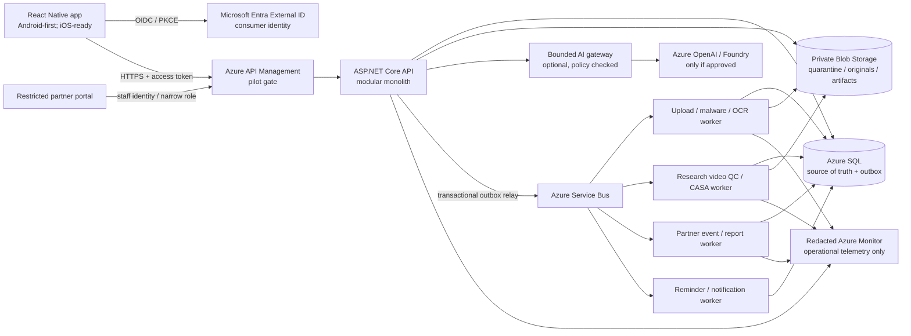

# Sahatna — corrected technical architecture

**Architecture baseline:** 19 November 2026  
**Status:** Recommended target design; not a production approval or proof that the services are deployable in a particular UAE subscription.  
**Product boundary:** A private men’s reproductive-health support journey with (1) user-entered and laboratory data, (2) an optional home semen-video research pathway, and (3) a consented laboratory handoff. Clinical interpretation, partner services, and regulatory status remain gated.

> **Read this first:** This document deliberately separates a working demonstration from a real clinical or partner pilot. A prototype may demonstrate screens, rules against approved fixtures, upload mechanics, and simulated partner events. It must not present simulated booking, payment, clinical interpretation, model accuracy, or laboratory results as real. A user-facing clinical result can only be released after the required clinical, regulatory, privacy, security, residency, and partner approvals are established.

## 1. Decisions, recommendations, and items still open

| Topic | Current status | Architecture treatment |
|---|---|---|
| Microsoft preference | Confirmed preference | Use Azure and Microsoft identity/data services where suitable, but choose each service only after region, SKU, data-flow, and cost verification. |
| Plan durations | Confirmed | Offer **30, 40, 60, 74, 90 days, or custom**. Mark **74 days as Recommended** by default. The duration is a habit-planning choice, not a biological deadline, fertility score, or retest instruction. |
| Mobile approach | Recommendation, not an owner-confirmed framework | Build one cross-platform app with Android-first testing and an iOS-ready design. **React Native + TypeScript** is the proposed default because the camera workflow will need a maintained native capture module. The owner/team still needs to confirm it. .NET MAUI is a reasonable alternative if the delivery team is substantially stronger in C# and proves camera, RTL, and identity requirements early. |
| Cloud region | Not verified | Use UAE North (Dubai) as the first **candidate** for a zone-aware production deployment, not as a selected or approved region. UAE Central is listed by Microsoft as reserved/restricted access. Confirm actual subscription access and each service/SKU independently. A region’s existence does not establish service availability or legal compliance. [1] [2] |
| Product geography | Conflicting in supplied material | The product plan is described as Dubai-first, while the developer blueprint uses Abu Dhabi as a demonstration service area. Keep both as synthetic demo fixtures until the owner confirms the intended real service geography and a partner confirms coverage. |
| Laboratory and Noon | No live partner/API confirmed | Use a simulated lab adapter and simulated price/payment only in the prototype. Do not assume a Noon ordering API or real lab slots, pickup, turnaround, prices, or test capability. |
| Clinical scope | Open gate | A clinician-approved rule set, interpretation boundary, report workflow, emergency content, and responsible human owner are required before any clinical-pilot use. Home-video interpretation stays research-only until separately validated and authorized. |
| “Everyday data in the sheet” | Needs a safe implementation interpretation | Use Azure SQL as the live system of record. Provide user-controlled Excel/CSV exports and aggregate reporting when approved. Do not use a shared Excel workbook as the production database for reproductive-health records. |

The default build is a **modular monolith with asynchronous workers**, not a network of microservices. This keeps the prototype understandable and the live pilot auditable. Split a module into a separate service only when a measured scaling, isolation, or independent-release need justifies its operational cost.

## 2. Two different products: demo and real pilot

| Capability | Demonstrable prototype | Real clinical/partner pilot |
|---|---|---|
| Accounts | Test Entra External ID tenant, synthetic users, private test data | Production tenant and recovery process approved; regional/data-processing review complete |
| Intake and action routing | Approved fixtures and versioned deterministic rules; visibly labeled demo content where needed | Clinician-approved wording, rules, translations, safety tests, ownership, and change control |
| Lab | One simulated adapter, fixture quote/slot/events, no real booking | Named partner, signed contract and data terms, verified capability, real status/report pathway, operational owner |
| Payment | Simulated screen only; no real charge | Approved payment provider, actual price/terms, refund and reconciliation process, security/legal review |
| Report upload | Synthetic test documents, quarantine and OCR/manual-review demonstration | Approved retention, location, consent, clinical record, access, and deletion policies; partner report authentication defined |
| Home semen video | Technical quality-gate demonstration on approved test clips; research processing only in restricted environment | Device-specific evidence, independent clinical validation, applicable authority approval, and an approved patient-facing intended use before results are exposed |
| Ask assistant | Templates first; synthetic or user-confirmed test data; no autonomous decisions | Exact model/deployment, region, data handling, source control, clinical and privacy approval, evaluation, monitoring, and fallback approved |
| Critical result | Simulated human-owned task and escalation drill | Named staffed rota, SOP, contact route, response window, backup owner, and tested escalation |

**The prototype must be visibly a prototype.** Keep demo users, database, blobs, queues, model flags, partner data, and credentials separate from pilot/production. A demo record must never be eligible for real partner dispatch, model validation, or real-world health reporting.

## 3. Target system architecture

The mobile app never talks directly to SQL, storage keys, a partner system, or a model deployment. It signs in, calls the Sahatna API, and receives only the user-scoped information or narrowly scoped upload capability that the server authorizes.

**Core connection path:**

1. The app signs in through Entra External ID using OIDC and OAuth authorization-code flow with PKCE. The native app is a public client; it has no client secret. Microsoft documents PKCE for native/mobile applications and recommends supported identity libraries rather than a hand-built token flow. [10] [11] [12]
2. The app requests an access token for the Sahatna API and calls the API over HTTPS. The API validates issuer, signature, audience, expiry, scopes/roles, and authorization for the specific object and action. The API derives the internal user key from the verified identity; it never trusts a `user_id` supplied by the phone. [13] [14]
3. The API reads or changes structured records in Azure SQL. A user’s upload goes to a private Blob container using a short-lived, single-object, upload-only capability issued after the API has checked identity, consent, file limits, and ownership.
4. The API and worker processes send only opaque record/job IDs through Service Bus. Workers retrieve the authorized record and blob by managed identity, recheck consent and access scope, process one idempotent step, persist its result, and then settle the message.
5. The assistant, if enabled, is called only through the backend AI gateway. It receives a minimal, server-built context pack and approved educational passages, not database credentials or unrestricted access to user records.
6. The app reads job status from the API. Push notifications are optional hints with neutral text; in-app state and the underlying database remain authoritative.

## 4. Recommended Microsoft-centred technology stack

These are target recommendations, not claims that every service is currently offered in every UAE region or subscription. Verify exact SKU, feature, version, quota, capacity, and data handling before deployment.

| Area | Recommended choice | Use and boundary |
|---|---|---|
| Mobile app | React Native + TypeScript; native development builds; React Navigation; i18next; TanStack Query | One cross-platform codebase. Keep the camera and resumable-upload adapters behind native interfaces. Do not depend on a generic camera preview for validated scientific capture. Framework choice remains an owner/team decision. |
| Patient web experience | React + TypeScript, responsive and accessible | Optional demo or account portal. It uses the same API and never receives direct database or model access. |
| Partner portal | Separate restricted web app or route with separate staff authorization | Assigned bookings only, no global patient search, no questionnaire history by default. Use synthetic data in the demo. |
| Consumer identity | Microsoft Entra External ID external tenant; OIDC/OAuth authorization code + PKCE | Consumer sign-up/sign-in, recovery, token issuance. The exact tenant, user-flow, recovery factors, issuer, redirect URI, and regional behavior need to be verified. External ID is a CIAM option, not a complete authorization model. [10] [11] |
| Partner/staff identity | Separate workforce/partner identity path, or explicitly governed business-customer flow | Do not let a consumer self-assign a lab role. Choose separate workforce tenant/federation when partner employees need organizational lifecycle controls. |
| API | ASP.NET Core on the current supported .NET LTS; modular monolith | Domain modules in one deployable API and one database transaction boundary. No model or client code decides authorization. |
| API gateway | Azure API Management before a real pilot | API versioning, quotas, partner endpoints, and policy enforcement. A prototype may use a single app/API endpoint. Confirm region and management-plane/data-flow requirements before selecting a tier. |
| API hosting | Azure App Service as the first candidate; Azure Container Apps as an alternative if a containerized operating model is preferred | Pick after region/SKU/private networking/identity/scale proof in the actual subscription. Do not deploy a multi-region gateway or automatic global failover without a residency decision. |
| Structured records | Azure SQL Database | Authoritative transactional data: account mapping, consent, questionnaire, daily events, plans, orders, reports metadata, jobs, audit, and outbox. Use tenant/user filters in the API; SQL row-level security is defense in depth. |
| Files | Private Azure Blob Storage | Separate containers or accounts for quarantine, clean report originals, derived report artifacts, research media, and exports. Disable anonymous access. Use managed identity and short-lived scoped upload access. |
| Messaging | Azure Service Bus | At-least-once delivery, retries, duplicate-safe consumers, dead-letter handling, queue monitoring, and replay procedures. A successful send is not the same as completed work. [18] [19] [20] |
| Background work | Azure Functions for short event handlers; Azure Container Apps Jobs for finite heavier tasks | Keep API requests fast. Use the exact service that is available and supportable in the selected region; every job must be restartable and idempotent. Container Apps Jobs support manual, scheduled, and event-driven finite tasks. [21] |
| Report extraction | Azure AI Document Intelligence only after service, language, retention, and regional processing are approved | Extraction drafts structured values; user or authorized lab staff confirms them. Manual entry remains available. OCR is not clinical interpretation. [26] |
| Approved content retrieval | Azure AI Search or an equivalent approved static content store | Index clinician-reviewed educational content, policy versions, and source citations only. Do not index all user reports or chat in a shared index. |
| LLM | Azure OpenAI / Microsoft Foundry, optional and only for constrained explanation/navigation | Exact model, deployment type, region, input handling, stateful features, and logging must pass approval. Otherwise use templates only. Model privacy statements do not prove regional residency. [22] [23] |
| CV research pipeline | Python containers, OpenCV and task-specific PyTorch/ONNX components as benchmarked | Isolated research processing only until the home-screening release gate. No general chat model as a sperm detector. GPU only if measured throughput requires it and regional capacity is verified. |
| Secrets and service identity | Azure Key Vault + managed identities | No database/storage/API secrets in mobile code or committed configuration. Service-to-service access uses the narrowest role possible. |
| Monitoring | Azure Monitor/Application Insights with redaction before emission | Operational counters, latency, queue age, worker status and failure codes only. Workspace region and backup/retention require data-flow review. |
| Infrastructure and deployment | Bicep + GitHub Actions using OIDC federation; separate dev/test/demo/pilot environments | Reproducible environments, no long-lived deployment secrets, approvals before pilot deployment, expand/contract database migrations. |
| User reminders | Device-local notifications for routine personal habits; backend task queue for operational/critical workflows | Remote push, if enabled, contains only neutral text and an opaque notification reference. Never put symptoms, test results, clinic names, or report data on the lock screen. |
| Reporting | User-generated Excel/CSV export; Power BI only for approved aggregate operational reporting | Excel is not the production record store. De-identified reporting still requires a defined purpose, access controls, and a residency check. |

### Why this is intentionally not microservices

The initial system has one product team, one narrow test journey, and no verified external lab API. A modular monolith lets consent, order, report, and audit changes commit consistently while preserving explicit module ownership. Workers run separately because OCR, video processing, partner reconciliation, and reminders have different latency and failure behavior. Split services only when there is evidence that a module needs independent scale, release cadence, or security isolation.

## 5. Login, permissions, and user/partner separation

### Consumer login

Use Entra External ID for consumer authentication, with a dedicated external tenant if that matches the intended customer identity boundary. Register a public mobile client and a protected API separately. Configure exact redirect URIs for each platform. Use authorization-code with PKCE through a supported MSAL/native integration; never embed a client secret in the app. Decide whether email OTP, password, social sign-in, or another recovery path is appropriate after reviewing assurance, fraud, accessibility, and UAE availability. External ID documents customer user flows and self-service recovery options, but the selected features and tenant configuration must be tested. [10] [11]

The API validates every token and maps a verified issuer/subject pair to a random internal `UserId`. Do not use an email address, display name, or phone number as the database ownership key. Email and phone may change; they are contact/recovery attributes, not authorization proof. Microsoft advises against using mutable profile fields such as `email` or `preferred_username` for authorization and describes validating audience and other claims at the API. [13] [14]

### Authorization rules

Use API-side authorization on every operation. Require both authentication and an operation-specific permission. The API should check:

- The requested record belongs to the authenticated user, or is an explicitly granted partner record.
- The consent for that purpose is active, current, and not expired.
- The partner user is assigned to the relevant organization/site and booking.
- The requested state transition is permitted for that role and current status.
- The staff user has a current role/assignment, not just a valid login.

Use delegated API scopes for actions performed by signed-in users. Use app-only roles only for actual service automation, with narrow permissions and managed identities. Microsoft documents the distinction between delegated scopes and app roles. [15]

### Role separation

| Role | Minimum access |
|---|---|
| Patient | Own records, reports, plans, consent, and orders |
| Collector | Assigned collection details and ticket only; no general reproductive history |
| Lab technician | Assigned specimen, processing events, and report tasks |
| Lab clinician/director | Authorized report sign-off and protocol-defined critical follow-up |
| Partner administrator | Partner/site capabilities and assigned operations; no global patient search |
| Sahatna support | No record browsing by default; time-limited, reason-coded, audited access only if needed |
| Sahatna content/rules administrator | Versioned question/content/rule publishing; no clinical-record browsing by default |
| Background worker | Managed identity scoped to only the queue, container, and operations it needs |

## 6. Data model and everyday tracking

### What is authoritative

- **Azure SQL is the source of truth** for structured records and workflow status.
- **Blob Storage is for file content**, not a second record database.
- **The event/audit history is append-only** where it records a clinical or operational fact. Corrections create a new version or correction event rather than silently overwriting provenance.
- **A derived daily summary is a view/cache**, not the original record. It can be rebuilt from the underlying events.
- A missing value is `Unknown` or `NULL`, never zero, normal, no, or completed.

Each health fact needs at least: internal user key, record ID, category, value and unit if applicable, source, status (`user-reported`, `device-derived`, `extracted-unconfirmed`, `user-confirmed`, `lab-confirmed`, `unknown`, or `outdated`), event/observation time, UTC creation time, local date and time zone where relevant, consent reference, version, and correction/deletion history.

### Suggested core tables

| Domain | Example records | Key rule |
|---|---|---|
| Identity and consent | `User`, `ExternalIdentity`, `ConsentRecord`, `ShareGrant` | Keep login attributes separate from reproductive-health history. Store consent purpose, recipient, field list, version, expiry and revocation. |
| Intake and rules | `QuestionnaireDefinition`, `QuestionnaireAnswer`, `RuleSetVersion`, `DecisionRun` | Preserve question/rule versions and the exact confirmed answers used for a decision. Unknown is not a negative answer. |
| Everyday data | `MealEntry`, `ActivityEntry`, `SleepSummary`, `SymptomEvent`, `PlanActionEvent` | Store one user event/fact with source, date, units, time zone and correction status. Avoid opaque “daily health score” fields. |
| Care and partner | `TestDefinition`, `Partner`, `PartnerSite`, `PartnerCapability`, `Quote`, `SlotHold`, `Order`, `Specimen`, `PartnerEvent` | Partner capacity, quote, booking, collection and sample states require a verified partner event or clearly marked simulation. |
| Reports | `ReportDocument`, `ReportVersion`, `ReportExtraction`, `ReportValue`, `ReportReview` | Preserve the original; extracted fields remain unconfirmed until reviewed; corrections create a new version. |
| Home research | `PreScreenSetup`, `Calibration`, `PreScreenSession`, `MediaUpload`, `PipelineRun`, `PipelineStage`, `ModelVersion` | Separate from lab reports and patient-facing clinical result domains. Research outputs cannot be used as signed lab results. |
| Workflow and audit | `OutboxMessage`, `InboxDeduplication`, `IdempotencyRecord`, `FollowUpTask`, `Notification`, `AuditEvent` | Include stable IDs, actor, correlation ID, state version, and operational outcome. Avoid sensitive payloads in logs. |
| Plans | `Plan`, `PlanAction`, `PlanSchedule`, `PlanCheckIn` | Record the selected duration, local time zone, action schedule, user changes, and plan-consistency numerator/denominator. |

### How daily data should appear in an Excel “sheet”

For the user, the app can provide an exportable workbook with separate tabs such as `Daily Summary`, `Meals`, `Activity`, `Symptoms`, `Plan Actions`, and `Reports Index`. Each row should retain its local date, time zone, source, unit, and confirmation status. The user selects a date range and which categories to export, previews the file, and downloads it. This is a **user-owned export**, not an automatic copy into a shared Sahatna workbook.

Do not make Excel Online/SharePoint the live health database. A shared spreadsheet makes row-level authorization, concurrent edits, audit history, idempotent updates, file lifecycle, and AI retrieval harder to enforce. Staff should not be able to edit a user’s medical record by changing a spreadsheet cell.

If the pilot needs operational reporting, expose only the minimum non-clinical workflow data through a controlled reporting view—for example, opaque booking reference, site, confirmed status, last event time, and assigned owner. Do not export symptoms, semen values, report contents, or chat to an operations sheet. Use Power BI only for aggregate/de-identified metrics after privacy and residency approval. If an approved non-clinical task list is temporarily delivered through Microsoft 365, treat it as a one-way, minimal, access-controlled convenience view; changes must be made through the Sahatna API, not by editing the workbook.

## 7. Uploads and pre-checks

There are two distinct upload workflows: **laboratory reports** and **home video**. A successful upload only means bytes arrived. It does not mean the file is safe, readable, clinically valid, or ready to show.

### 7.1 Common secure upload pattern

1. The user chooses a file and sees what will be uploaded, why, who can access it, and the relevant retention choice. Report screens warn that documents may include name, ID number, date of birth, phone, or address. A crop/cover option may help, but the app does not claim that PII has been removed unless it actually verifies it.
2. The app calls the API to create an upload record. The API validates identity, consent, allowed file type, size limits, ownership, and an idempotency key. It assigns an opaque object ID and a quarantine destination.
3. The API issues a short-lived, one-blob, upload-only user-delegation SAS or equivalent scoped capability. A SAS is bearer access, so it is never logged, reused for other objects, placed in analytics, or returned to another user. Microsoft recommends user-delegation SAS rather than account-key SAS. [16]
4. The app uploads directly to private Blob Storage using resumable/chunked transfer. The API does not proxy large video bytes unless required by a specific constraint. The client retries only missing chunks and reports progress based on confirmed transfer state.
5. The app finalizes the upload with the object ID, expected byte count, and checksum where available. The server verifies the blob exists, matches the expected upload, and remains owned by the initiating user.
6. The record moves to `Quarantined`. A worker validates file signature/MIME, size, codec or document structure, malware scan status, and parse safety. Defender for Storage scanning is asynchronous and variable in duration, so the upload remains pending until a clean result is recorded. [17]
7. Only a clean, supported object is promoted or made available to the next pipeline step. A malicious, unsupported, corrupted, or scan-error object stays quarantined or is rejected. If the scanner is unavailable, do not bypass the check.
8. Every stage is stored in the database with a stable job ID. The app polls the API or receives a neutral push hint and then reads current state. Duplicate events and retries do not create a second report or session.

### 7.2 Laboratory report pre-check and extraction

**Pre-upload checks:** allowed PDF/JPEG/PNG; size/page limit; password-protected or damaged-file detection; local preview; optional crop; consent; and warning not to upload someone else’s document without permission. The client-side checks are convenience only. The server repeats all security checks.

**After upload:**

`Created → Receiving → Quarantined → MalwareScanPending → FileValidated → Extracting → NeedsUserReview → Confirmed → AvailableForAsk`

Branches: `Rejected`, `ScanError`, `Unsupported`, `ExtractionFailed`, `ManualEntry`, `Cancelled`, or `DeletionPending`.

Document Intelligence may extract printed/handwritten text, tables, layout, or key-value candidates, subject to the chosen model and region. It does not diagnose or confirm the values. [26] The pipeline stores the source page/coordinates, extracted text, value, unit, reference range as printed, extraction version, and confidence. The app shows the original report beside the proposed fields and asks the user to confirm or correct each one. An authorized lab workflow may use an approved sign-off process instead. Unconfirmed values cannot drive rules, summaries, or the assistant.

If OCR cannot read a field, show a manual-entry path. Do not infer a missing unit, range, date, or result. Keep the original as the source of truth. If the report is corrected by the lab, store a new version and invalidate derived summaries based on the prior one.

**User-facing message examples:**

- While scanning: **“Upload received. We’re checking that the file is safe and readable. You can leave this screen; it isn’t available in your records yet.”**
- If malware or structural validation fails: **“We couldn’t accept this file. It hasn’t been added to your records. Choose another copy or contact support.”** Do not reveal raw scanner internals.
- If extraction is uncertain: **“We couldn’t confirm this value from the report. Compare it with the original or enter it yourself. It won’t be used until you confirm it.”**
- Before confirmation: **“These are draft values copied from your report—not a diagnosis. Check the value, unit, date, and reference range against the original.”**

### 7.3 Home semen-video pre-check and research pipeline

In this architecture, **CASA** means *computer-assisted sperm analysis*. It is not a chat-model feature and should not be confused with the unrelated Cloud Application Security Assessment acronym.

The home route is optional and requires a supported optical setup. Similar magnification does not establish a calibrated measurement. A device profile must identify the phone/camera, lens or microscope, chamber geometry/depth, illumination, calibration method/date, supported capture settings, and the operating envelope. A missing or invalid profile disables quantitative interpretation. The WHO laboratory manual is a reference for standardized semen examination and processing; a phone clip is not automatically equivalent to a laboratory workflow. [27]

**Before recording:** explain the research/pre-screen limit, check the supported kit and chamber, load a signed version of approved instructions, confirm calibration when relevant, check available phone storage/network, and collect only approved metadata. Exact abstinence, timing, handling, and collection instructions must come from a clinician/partner-approved protocol, not an engineering guess.

**On-device capture pre-check:** provide quick feedback on whether the device profile is supported, focus appears stable, exposure is usable, frame is not severely blurred, video is long enough, and the capture is not interrupted. This is a technical capture-quality check only. It must not tell a user that sperm are present/absent, infer fertility, or convert an unknown setup into a reassuring result. The server repeats the checks because the client can be modified or wrong.

**Server workflow:**

`SessionCreated → ConsentVerified → SetupVerified → Uploading → Quarantined → Malware/FileCheck → ServerQualityCheck → ResearchPipelineQueued → Processing → ResearchComplete / Unclear / Failed → RetentionAction`

Candidate research stages:

1. Verify active consent, user/session ownership, supported profile, calibration, and required metadata.
2. Verify chunk completion, checksum/hash, file header/container, codec, duration, resolution, frame rate, and decode integrity.
3. Scan for malware and safely decode in a restricted worker/container with CPU, memory, file-size, and execution-time limits.
4. Evaluate focus, exposure/clipping, illumination, chamber/profile match, field movement/drift, usable area, blur, and protocol metadata using profile-specific, experimentally determined thresholds. Do not use universal thresholds without validation.
5. If research is authorized, run versioned computer-vision components such as detection, segmentation/tracking, and deterministic feature calculations. Store internal outputs with model/version/configuration and uncertainty, but do not expose numeric estimates or a clinical band to a patient in the prototype.
6. If a stage fails, the model is out of distribution, calibration is unknown, or components disagree beyond the approved research rule, store `Unclear` or `Failed`; never transform failure into “normal.”
7. Retain or delete original media and derived artifacts according to the approved research/data-retention policy. Research consent is separate from routine app use.

A CASA model’s performance depends on acquisition setup, specimen handling, chamber, frame rate, debris, concentration range, operators, and validation population. Published performance for another device does not validate Sahatna’s device. A systematic review reports sources of variability and error across CASA systems, including at concentration extremes and in the presence of debris/non-sperm cells. [28]

**Prototype messages:**

- Unsupported kit: **“This camera setup is not supported for the home capture feature. Your reports and lab options are still available.”**
- Calibration missing: **“We can’t verify the chamber calibration, so this setup cannot produce a usable research run. Recheck the setup or choose a laboratory test.”**
- Poor focus: **“This recording is out of focus, so it can’t be used. Adjust the focus and record again, or choose a lab test.”**
- Upload received: **“The recording was uploaded and is waiting for technical checks. This is not a semen result.”**
- Research complete: **“Technical research processing is complete. This prototype does not provide a clinical semen interpretation. You can review the capture-quality status or choose a laboratory test.”**
- Processing error: **“We couldn’t complete the technical checks. No semen interpretation was produced. You can retry or continue with a laboratory option.”**

A later patient-facing mode is a separate release. It requires a defined intended use, a prespecified comparator, participant-level train/test separation, locked independent/external validation, documented analytical and clinical validation, calibration/uncertainty evaluation, subgroup/failure analysis, and regulatory/clinical approval. TRIPOD+AI describes evaluation data as distinct from training/tuning data and calls for transparent reporting; IMDRF distinguishes analytical validation from clinical validation. [29] [30]

## 8. Agent, model, and personal-data architecture

### 8.1 What the assistant may do

The assistant can explain approved educational content, navigate the app, summarize user-confirmed records with citations, help the user prepare questions for a clinician, and explain operational status from confirmed events. It cannot diagnose, prescribe, select a care pathway, determine urgency, approve consent, share data, pay, book, close a critical task, or turn a model output into a signed laboratory report.

Urgency and care-pathway rules are deterministic, versioned, clinically approved logic. They run before any optional model call. Emergency content must remain available offline and when the model, network, or cloud is down.

### 8.2 How Ask can see a user’s own data

1. The app sends the question to `POST /v1/ask` with its access token. The body contains the question and the current screen/context identifier, not an asserted `user_id`.
2. The API validates the token, checks that `reports_ai`/relevant consent is active, and identifies a narrow intent such as “explain my confirmed report line” or “show today’s plan.”
3. A policy-controlled tool router makes an allowlisted, read-only query. It derives the internal user key from the verified identity and retrieves only the specific fields needed. For a report, that means confirmed values with units, reference range, date, source and page/row—not the full PDF. For an order, it means partner-confirmed events and last-confirmed time—not a predicted status.
4. The server attaches source, timestamp, unit, confirmation status, and a freshness label. Unknown or unconfirmed data stays out of the answer context or is explicitly tagged as unconfirmed.
5. If approved, the server retrieves relevant passages from the curated health-education index. Personal health records are not placed in the shared educational search index. Apply access filters at retrieval time if any private index is ever approved; do not rely on prompt instructions as access control. Microsoft’s RAG guidance describes retrieval/grounding and the need for document-level access controls. [24]
6. An optional model drafts a constrained response. The API validates the output against the allowed schema, source citations, numerical values, dates, user scope, and prohibited claims. Invalid output is discarded and replaced by a safe template.
7. The response is returned with the source/date or a direct link to the relevant record. The model cannot persist new medical facts without the user’s explicit review and confirmation.

**No shared personal-record embeddings by default.** Per-user vector memory adds another sensitive, permissioned data store and deletion surface. Query structured records directly for current facts. Use RAG for versioned, reviewed educational content. Do not ask the model to “remember” health facts that are not stored with provenance in the user’s record.

### 8.3 Safe model integration and fallback

Call the model from the backend only. Use a fixed system policy, strict input length limits, retrieved text marked as untrusted data, a narrow tool list, and a typed response contract such as `{answer, citations, unknowns, next_action}`. Structured outputs constrain response shape but do not prove correctness or clinical validity. [25] Prompt-injection controls such as Prompt Shields can help identify attacks, but they do not replace authorization, validation, source checking, or clinical safety controls. [26]

Use Azure AI Search only for approved educational material with source title, URL, version, review owner, review date, and expiry/review date. If retrieval is empty or stale, state that and use a safe template. If Foundry/OpenAI is unavailable, disabled, outside the approved region, or returns invalid content, report values and order status still work; use templates-only mode.

Microsoft documents different processing behavior for Standard/Regional, Data Zone, and Global deployments. The exact model/version and deployment must be checked before use. A privacy statement about prompts not being used to train foundation models is not proof that a deployment is geographically confined to the UAE; model deployment geography, stateful features, indexes, OCR, logs, and backups must each be reviewed. [22] [23]

### 8.4 Fine-tuning and model training

**Do not fine-tune the language model to store personal health facts, medical guidelines, or clinical rules.** Facts change, and personal facts require per-user access control, correction, deletion, and provenance. Use structured records plus source retrieval. The clinical rule engine remains deterministic and clinician-owned.

For the first prototype, do not fine-tune the LLM. Benchmark a permitted model for English/Arabic comprehension, source fidelity, safe refusal, privacy, latency, cost, and response quality. Fine-tuning may be considered later only if a measured behavior/style/formatting problem remains after prompt, schema, retrieval, and validation improvements. Use consented, de-identified, rights-cleared examples; hold out evaluation data; measure regressions; version the tuned model; and retain a rollback path. Microsoft distinguishes retrieval for current/private knowledge from fine-tuning for behavior/task performance and says fine-tuning does not replace retrieval or application safety. [25]

For the computer-vision research model, establish a separate governed ML workstream:

- Decide the intended output and reference method before model selection. Do not assume that a published model or public dataset is licensed for commercial/clinical use.
- Use a consented, rights-cleared dataset with participant/sample/site/device metadata and an adjudicated reference. Split by participant and keep the locked test set outside all tuning and threshold selection.
- Track dataset version, preprocessing, code commit, dependencies, model weights/hash, training run, evaluation report, and supported device profile. Use Azure Machine Learning only if the exact region and data path are approved; otherwise use another formally approved controlled environment. Do not move identifiable video to a convenient but unapproved region.
- Measure failure/abstention rate, repeatability, reproducibility, calibration, subgroup performance, external site/device performance, and clinically relevant error—not only aggregate accuracy or correlation.
- Run the candidate silently in research mode first. A safety/clinical owner approves any mode change. Every model update is versioned, evaluated, releasable by feature flag, and reversible through a server-side kill switch.

## 9. Automation and workflow reliability

### 9.1 Transactional outbox and idempotency

A database change and the message that announces it must not be two unrelated operations. When an API transaction changes an order, report, plan, or upload state, write both the business record and an `OutboxMessage` in the same SQL transaction. A relay publishes the outbox record to Service Bus and marks it as published. This prevents the “database saved but message lost” and “message sent twice” failure pattern. Microsoft describes this transactional-outbox approach and an idempotent-consumer pattern. [19] [20]

Service Bus processing is treated as **at least once**, so duplicate deliveries are expected. Consumers use a stable `MessageId`/business idempotency key and atomically record a processed-message marker with the business side effect. State transitions have a version number and a uniqueness constraint. Retry transient faults with bounded backoff; dead-letter poison or exhausted messages with a reason; alert an operator; and support a tested replay procedure. Service Bus dead-letter messages remain until explicitly handled. [18]

The queue message carries opaque IDs, event type, schema version, attempt/correlation IDs, and routing metadata—not report text, symptoms, identity fields, or a full chat prompt. The worker rechecks user/partner scope and consent before acting.

### 9.2 Workflows to automate

| Trigger | Automated work | Safe completion rule |
|---|---|---|
| Questionnaire answer saved | Save versioned answer; run approved deterministic rules; create immutable decision trace | Only clinician-approved, versioned rules may set a pathway; missing data remains unknown |
| Report upload finalized | Malware/file check; safe extraction; create draft values; notify for review | No value is confirmed or usable until user/authorized staff review |
| Video upload finalized | Malware/file checks; profile/calibration/QC; research pipeline if consented | Prototype never releases a clinical interpretation; any fault yields `Unclear`/`Failed` |
| Plan accepted | Persist selected duration and actions; create local reminder schedule | 74 days is a recommended default; 30/40/60/90/custom remain user choices; adherence never changes care status |
| Scheduled habit time | Device-local reminder or neutral push hint | User controls alert; no sensitive lock-screen text; missed actions do not reset the plan |
| Booking request | Recheck consent, authorization, quote, slot; submit idempotent adapter request | “Pending” until partner confirmation; payment success alone is not booking confirmation |
| Partner webhook/portal event | Validate signature/actor, deduplicate, check allowed state transition, append confirmed event | Older/duplicate events do not regress status; no timer invents collection or lab receipt |
| Critical lab event | Create human-owned `FollowUpTask`; notify the operational owner through the approved escalation channel | Only authorized human evidence can close a critical task; app read receipt is not completion |
| Consent withdrawn | Block new use immediately; cancel/recheck queued work; start approved deletion/retention workflow | Already delivered partner copies cannot be recalled; report that limit honestly |
| Data export/delete request | Generate scoped export or deletion job; track each source/artifact and backup expiry | Report completion only after the defined lifecycle stages are reconciled |

Use SQL-backed due-work records for important schedules and a reconciler that can re-enqueue missed work. Do not rely only on a one-time timer message. Store local timezone and user-selected reminder time; the date in the UI is the user’s local date, while event timestamps are also stored in UTC. Routine personal reminders can be scheduled locally on the device. Critical operational escalation belongs in the backend workflow, not a phone alarm.

Power Automate may help with a low-risk approved office task, but it should not be the clinical rule engine, source of truth, booking transaction coordinator, or critical-result escalation system. Such a flow can be paused, edited, or misconfigured independently of the application’s state machine.

### 9.3 Partner booking and order state

Use a canonical interface so a simulator and eventual named partner implement the same contract:

`GetCapabilities → GetQuote → HoldSlot → ConfirmBooking → GetOrderStatus → RecordSpecimenEvent → DeliverSignedReport → Cancel/Reconcile/Refund (only where supported)`

The initial adapter is simulated. A real integration may be an authenticated API, signed webhooks, or an audited restricted portal if the partner lacks an API. Do not claim real-time integration when a staff member entered the event manually.

A representative order path is:

`Draft → NeedsAuthorization (if required) → QuoteReady → SlotHeld → PaymentPending (if enabled) → PartnerPending → Booked → Collection/CheckIn → Collected → Received → Accepted → Processing → ReportReady → FollowUpPending/Complete`

Exception states include `HoldExpired`, `PaymentFailed`, `PartnerConfirmationUnknown`, `CollectionMissed`, `SpecimenRejected`, `RecollectionRequested`, `Cancelled`, `RefundPending`, `Refunded`, and `ReportCorrected`. The payment/partner boundary is a saga, not a single distributed transaction. If payment succeeds but partner confirmation is unknown, show **Pending**, reconcile with the partner, and only then confirm or refund. Do not retry a charge or booking blindly.

Home collection within the draft’s 5 km rule is shown only when a verified partner accepts the test, confirms capacity and the required sample-handling window, and supplies a usable slot. Distance alone is not specimen viability. At the demo stage, this is test data, not service availability.

## 10. API surface and connection contract

All protected API routes use HTTPS, bearer access tokens, API-level ownership checks, consent checks, input validation, and structured error responses. Mutating calls include an idempotency key. Never include PHI in URLs or query parameters.

Illustrative routes:

| Route | Purpose |
|---|---|
| `GET /v1/me` | Return current app profile using authenticated identity |
| `GET/PUT /v1/consents` | Read/update versioned consent choices |
| `GET /v1/questionnaire/current` and `PUT /v1/questionnaire/answers` | Fetch approved questions and save versioned answers |
| `POST /v1/decision-runs` and `GET /v1/decision-runs/{id}` | Run/read a deterministic rule result and trace |
| `POST /v1/uploads` and `POST /v1/uploads/{id}/complete` | Create/finalize a scoped upload; processing is asynchronous |
| `GET /v1/jobs/{id}` | Read upload/OCR/research job state and next action |
| `PATCH /v1/reports/{id}/values/{valueId}` | Confirm/correct one extracted report value with provenance |
| `GET /v1/daily-events` and `POST /v1/daily-events` | Read/create the user’s daily entries |
| `GET /v1/plans/current` and `POST /v1/plans/{id}/actions/{actionId}` | Read plan and record completion/skip/pause |
| `POST /v1/quotes`, `POST /v1/slot-holds`, `POST /v1/orders` | Quote/hold/confirm after consent, authorization and price review |
| `GET /v1/orders/{id}/events` | Read confirmed partner event history |
| `POST /v1/ask` | Constrained, server-scoped assistant request |
| `POST /v1/exports` and `DELETE /v1/me/data` | User export/deletion request |

For a long-running upload, respond with `202 Accepted`, an opaque job ID, and a status route. Use a stable error envelope such as `{code, message_en, message_ar, retryable, correlation_id}`. The error message must not include file contents, extracted health values, tokens, SAS URLs, or stack traces.

## 11. Data protection, region, and UAE governance

### 11.1 Cloud placement is a verification task

Microsoft lists UAE North (Dubai) and UAE Central (Abu Dhabi), but service-level availability is separate. UAE Central is marked restricted/reserved access in Microsoft’s current region materials; UAE North lists three availability zones. Azure regional pairing does not automatically provide high availability, disaster recovery, or failover. [1] [2] [3]

Before production, build a service-by-service data-flow register for identity, API, SQL, Blob, Service Bus, workers, document extraction, model inference, search indexes, backups, diagnostics, support access, CI/CD, analytics, and notifications. For each item record: Azure service and SKU, region, processing/storage geography, replication/backup region, temporary files, logging, support access, subprocessor, evidence URL, date checked, owner, and approval.

Do not infer region compliance from a primary resource setting. Storage, database backups, telemetry, support operations, model deployment type, third-party push providers, and DR replication have their own behavior. For example, Microsoft documents synchronous within-region ZRS and asynchronous cross-region GRS/GZRS; a cross-region copy can be incompatible with a UAE-only processing requirement unless explicitly approved. [4] Azure SQL backup/restore and failover features must likewise be configured and tested for the actual tier and region. [5]

Use **no automatic cross-region failover of identifiable health records** until the legal and privacy owners approve the destination and the restore scenario. Define RPO/RTO, lost-write windows, queue replay, DNS changes, restore drills, and failover ownership. Keep the pilot single-region if that is the only currently approved design; make the resulting availability risk explicit rather than silently copying data elsewhere.

Azure’s UAE DESC attestation is evidence about Microsoft’s audited cloud scope, not a certificate that Sahatna’s application, data flows, legal basis, user experience, or clinical use is compliant. [6]

### 11.2 Conservative data controls

- Use TLS for network traffic, encryption at rest, managed identities, least privilege, private endpoints/network rules where supported, Key Vault, and an approved key-management design.
- Keep user identity/contact information separate from clinical content. Use opaque IDs for blob paths, queue messages, exports, and internal references.
- Redact before telemetry leaves the process. Never log symptoms, answers, semen values, report text/images, prompts, tokens, phone/email, precise addresses, or SAS URLs.
- Test cross-user and cross-partner access across API, SQL, Blob, queue worker, report export, search, staff portal, and AI tool endpoints.
- Use synthetic data only in development, CI, demo, and load tests. Do not copy production reports into staging.
- Define retention/deletion for original reports, report versions, thumbnails, video, derived outputs, caches, search artifacts, exports, email/push payloads, logs, backups, and partner copies. A deletion job must report what it completed and what remains under an approved retention exception.
- Recheck consent when a queued task begins, not only when it was created. Withdrawal prevents future processing/sharing to the extent possible and records the action.

### 11.3 UAE legal and clinical gates

The UAE has general personal-data law and health-specific ICT legislation. Federal Law No. 2 of 2019 addresses health information used in health fields, including confidentiality, availability to authorized persons, location/transfer limits in specified health-service contexts, consent and retention requirements. The Personal Data Protection Law also addresses personal-data processing and cross-border transfer. Which provisions apply to this exact app depends on its operator, intended use, contracts, service, emirate, and data flow; qualified UAE counsel must decide. [31] [32]

If the product operates a telehealth or remote-diagnosis workflow, additional federal and emirate-specific requirements may apply. The federal telehealth rules and DHA standards distinguish a technology platform from a licensed provider and set conditions for licensed facilities, consent, records, qualified professionals, infrastructure and data handling. DHA materials apply according to their scope and do not automatically resolve an Abu Dhabi or other emirate use case. [33] [34]

Before identifiable health-data or patient-facing clinical features are enabled, obtain written determinations covering:

- Which emirate/free zone, authority, facility, clinician, partner lab, and user locations are in scope.
- Whether Sahatna is a consumer wellness tool, health-data processor, telehealth platform, medical-device/software provider, or another regulated role for each feature.
- Whether questionnaire-based routing, report explanation, home semen imaging, AI, or future teleconsultation constitutes a regulated clinical/diagnostic/monitoring use.
- What user consent, clinic sharing, research consent, data residency, transfer, retention, correction, deletion, marketing, and secondary-use requirements apply.
- Who is clinically accountable for urgent routing, critical lab results, staff coverage, incident reporting, human review, adverse events, and feature suspension.
- What partner, payment, lab, study ethics, and authority approvals are required.

DHA’s health AI policy and consent standards have requirements within their applicable scope for validation, disclosure, oversight, consent, monitoring, and auditability. Treat them as review inputs, not as a conclusion that Sahatna is in or out of scope. [35] [36]

## 12. Security and operational reliability

### Threats to design against

Account recovery takeover; a user changing IDs to read someone else’s record; a leaked upload token; malicious or malformed PDF/video; spoofed/replayed partner webhook; staff overreach; queue poison/replay; prompt injection inside an uploaded report; incorrect model output; cloud-region outage; secrets in mobile app; device loss; and dependency/model-license risks.

### Operational controls

- Separate subscriptions/resource groups or equivalent isolation for development, demo, pilot, and production. No shared storage account, key, queue, identity registration, or AI deployment across demo and real pilot.
- Restrict Blob public access. Grant the API and worker managed identities only the required data-plane roles. A background worker must not be able to enumerate all user records unless the task requires it.
- Authenticate partner callbacks with a signed request or authenticated channel, verify timestamp/replay window, map partner identity to a tenant/site, and deduplicate partner event IDs.
- Make every consequential write idempotent. Repeated request with the same idempotency key and body returns the prior result; the same key with a different body is rejected.
- Use bounded retries and circuit breakers for partner/model/OCR dependencies. Define a manual fallback where appropriate. No retry loop can keep charging or booking.
- Track queue age, upload scan latency, stuck jobs, retries, dead letters, partner reconciliation backlog, report processing failures, failed notifications, and deletion backlog. Alerts need a named operator and runbook.
- Fail closed for safety decisions and data access. Fail gracefully for optional model explanations, OCR, wearable imports, or non-critical notifications.

There is no honest promise that a distributed system “never fails.” The architecture goal is to avoid silent state loss, make work resumable, prevent duplicate side effects, show the last confirmed status, and keep safety-critical behavior deterministic and human-owned.

## 13. Development, testing, and rollout

### Build sequence

**Stage 0 — Resolve design gates.** Confirm intended use, geography, the mobile framework, and the pilot boundary. Obtain clinical owner, UAE privacy/regulatory review, and Azure subscription/service-region verification. Keep unresolved items in an Architecture Decision Record (ADR) with owner and evidence.

**Stage 1 — Foundation.** Build the mobile shell, English/Arabic and RTL scaffolding, Entra test sign-in, ASP.NET Core API, SQL schema, consent records, audit events, Bicep infrastructure, telemetry redaction, and synthetic demo account. Use no personal health documents.

**Stage 2 — Core user flow.** Implement pause/resume intake, approved deterministic rules, the five-block questionnaire if clinically approved, plan options (30/40/60/74/90/custom), daily events, action history, report vault metadata, and Stay Alert state. 74 days is preselected and labelled Recommended; it does not determine care.

**Stage 3 — Safe file workflow.** Implement private upload creation, resumable Blob upload, quarantine, malware scanning, PDF/image validation, OCR draft extraction, side-by-side user confirmation, deletion, and failure recovery. Use synthetic files until production processing is approved.

**Stage 4 — Simulated partner loop.** Implement one simulator adapter and restricted staff fixture. Demonstrate quote/slot/consent preview, one idempotent order, partner-confirmed specimen events, signed report fixture, rejection/recollection, and human-owned follow-up. All simulated amounts/events are explicitly labelled.

**Stage 5 — Research CASA trace.** Run a small, controlled technical demonstration with supported sample clips, capture-quality failure cases, pipeline versioning, stage trace, restricted outputs, and kill switch. No clinical result or unvalidated numeric result is shown to a patient.

**Stage 6 — Pilot readiness.** Only after signoffs, deploy each exact service in the approved region/subscription; complete privacy and regulatory decisions; sign the named partner contract; implement actual adapter/payment/report workflow; complete external testing, restore/failover drills, penetration testing, clinical-safety review, and support/on-call rehearsal.

### Required tests before pilot

1. Login, recovery, token expiry/revocation, and wrong-audience token rejection.
2. Cross-user and cross-partner authorization attempts through every API, file, worker, report, and AI path.
3. Consent withdrawal while a job is queued and while a partner share is pending.
4. Malformed/oversized/password-protected, corrupted, infected, unsupported, or interrupted uploads; no scan result; scanner outage; repeated `complete` request; and duplicate queue event.
5. OCR errors, low-confidence extraction, unit mismatch, missing value, report correction, and unconfirmed-value rejection by the assistant/rules engine.
6. Video cases with unsupported device, unknown calibration, blur, bad exposure, drift, corrupt encoding, OOD input, model timeout, disagreement, worker crash, and retry. Every failure remains non-reassuring.
7. Duplicate, delayed, stale, and out-of-order partner events; payment succeeded but partner unknown; slot expiry; refund path; and rejected specimen.
8. Reminder daylight-saving/time-zone cases, user pause, disabled notifications, missed habit, and a clinical follow-up that must remain visible regardless of habit completion.
9. Arabic RTL, screen reader, large text, offline emergency content, app termination during upload, local storage full, token expiry, and reconnect/resume.
10. Backup/restore, queue replay, region outage, RPO/RTO, deletion lifecycle, audit retention, and telemetry redaction.
11. Assistant red-team tests for prompt/document injection, hallucinated numbers, stale facts, user-scope bypass, diagnosis/dose language, unconfirmed-value access, Arabic safety, and templates-only fallback.

## 14. Explicitly deferred or gated features

- **Noon ordering:** Not part of the core pilot. At most, consider a user-approved link or list after checking retailer policy, availability, data-sharing, and regional behavior. Do not assume a customer ordering API.
- **Wearables:** Optional later integration, per-category consent, and only what HealthKit/Health Connect actually exposes. Wearable data does not measure sperm, fertility, or testosterone and cannot downgrade a safety route.
- **Food-photo estimation:** Deferred until consent, editable estimates, quality evaluation, and safe content are approved.
- **Telehealth/video doctor visits:** Separate licensed-provider, consent, operations, scheduling, and platform approval workstream.
- **Home test clinical outputs:** Separate device-specific validation and regulatory program. No exact counts, fertility verdicts, or unapproved bands in the prototype.
- **More tests/partners/service areas:** Each requires a verified test catalog, clinical indication/authorization, partner capability, price/slot evidence, sample handling SOP, report flow, consent, and support owner.
- **Fine-tuning on user data:** Not enabled. App-use consent is not training consent.

## 15. Open decisions that must be recorded

1. **Mobile framework:** Confirm React Native + TypeScript or approve .NET MAUI after a short camera/auth/RTL proof. The architecture recommends a shared Android-first application, but no framework is owner-confirmed.
2. **Product geography:** Confirm Dubai, Abu Dhabi, or another pilot service area. Keep the Abu Dhabi fixture clearly synthetic if the actual intent is Dubai-first.
3. **Identity trust boundary:** Decide whether partner staff use a separate workforce tenant/federation or a business-customer model in External ID.
4. **Azure deployment evidence:** Confirm target subscription access to each service, region, SKU, quota, model, network feature, backup mode, and support workflow. UAE North is a candidate, not a guarantee; UAE Central is restricted/reserved in current Microsoft region materials. [1] [2]
5. **Data residency/DR:** Define whether the requirement is UAE-only, UAE geography, or another legally approved boundary, then choose storage/database/telemetry/AI/backup replication consistently. Region pairing is not automatic DR. [3] [4]
6. **Clinical intended use:** Identify the accountable clinician and define which outputs are education, screening, triage, report explanation, or diagnosis. Approve wording and emergency logic.
7. **Partner and payment:** Name the lab, test, site, contact owners, API/portal, payment provider, quote, cancellation/refund, sample acceptance/rejection, and critical-result workflow.
8. **CASA scope:** Confirm the device/optics/chamber and exact parameters the team wants to study. Define labels, comparator, validation protocol, media retention, and training consent.
9. **Report processing:** Decide whether OCR/AI processing may leave the approved location, which languages and report types are supported, and who confirms extracted fields.
10. **Spreadsheet usage:** Confirm whether the owner means personal exports, internal aggregate reporting, or an operational workbook. Do not interpret it as approval to store identifiable health records in a shared spreadsheet.
11. **Pilot feature list:** Decide whether the first real pilot is only a private habit/report companion, a lab booking and report handoff, or a clinically regulated screening workflow. These are materially different releases.

## 16. Sources

[1]: https://learn.microsoft.com/en-us/azure/reliability/regions-list "Azure regions list"
[2]: https://azure.microsoft.com/en-us/explore/global-infrastructure/products-by-region/table "Product Availability by Region"
[3]: https://learn.microsoft.com/en-us/azure/reliability/regions-paired "Azure region pairs and nonpaired regions"
[4]: https://learn.microsoft.com/en-us/azure/storage/common/storage-redundancy "Azure Storage redundancy"
[5]: https://learn.microsoft.com/en-us/azure/azure-sql/database/sql-database-paas-overview "What is Azure SQL Database?"
[6]: https://learn.microsoft.com/en-us/azure/compliance/offerings/offering-uae-desc "UAE DESC CSP Security Standard"
[10]: https://learn.microsoft.com/en-us/entra/external-id/customers/overview-customers-ciam "External Tenant Overview - Microsoft Entra External ID"
[11]: https://learn.microsoft.com/en-us/entra/external-id/customers/how-to-user-flow-sign-up-sign-in-customers "Create a sign-up and sign-in user flow in Microsoft Entra External ID"
[12]: https://learn.microsoft.com/en-us/entra/identity-platform/v2-oauth2-auth-code-flow "Microsoft identity platform and OAuth 2.0 authorization code flow"
[13]: https://learn.microsoft.com/en-us/entra/identity-platform/claims-validation "Secure applications and APIs by validating claims"
[14]: https://learn.microsoft.com/en-us/entra/identity-platform/scenario-protected-web-api-verification-scope-app-roles "Protected web API: Verify scopes and app roles"
[15]: https://learn.microsoft.com/en-us/entra/identity-platform/permissions-consent-overview "Overview of permissions and consent in the Microsoft identity platform"
[16]: https://learn.microsoft.com/en-us/azure/storage/common/storage-sas-overview "Grant limited access to data with shared access signatures (SAS)"
[17]: https://learn.microsoft.com/en-us/azure/defender-for-cloud/on-upload-malware-scanning "Microsoft Defender for Storage On-upload Malware Scanning"
[18]: https://learn.microsoft.com/en-us/azure/service-bus-messaging/service-bus-dead-letter-queues "Overview of Azure Service Bus dead-letter queues"
[19]: https://learn.microsoft.com/en-us/azure/architecture/databases/guide/transactional-outbox-cosmos "Implement the Transactional Outbox pattern by using Azure Cosmos DB"
[20]: https://learn.microsoft.com/en-us/azure/architecture/patterns/idempotent-consumer "Idempotent Consumer pattern"
[21]: https://learn.microsoft.com/en-us/azure/container-apps/jobs "Jobs in Azure Container Apps"
[22]: https://learn.microsoft.com/en-us/azure/foundry/responsible-ai/openai/data-privacy "Data, privacy, and security for Models sold by Azure in Microsoft Foundry"
[23]: https://learn.microsoft.com/en-us/azure/foundry/foundry-models/concepts/deployment-types "Deployment types for Microsoft Foundry Models"
[24]: https://learn.microsoft.com/en-us/azure/foundry/concepts/retrieval-augmented-generation "Retrieval augmented generation (RAG) and indexes"
[25]: https://learn.microsoft.com/en-us/azure/foundry/fine-tuning/overview "Fine-tuning overview"
[26]: https://learn.microsoft.com/en-us/azure/ai-services/document-intelligence/overview?view=doc-intel-4.0.0 "What is Azure Document Intelligence in Foundry Tools?"
[27]: https://www.who.int/publications/i/item/9789240030787 "WHO laboratory manual for the examination and processing of human semen, 6th ed"
[28]: https://pmc.ncbi.nlm.nih.gov/articles/PMC8350227/ "The validity and reliability of computer-aided semen analyzers in performing semen analysis: a systematic review"
[29]: https://pmc.ncbi.nlm.nih.gov/articles/PMC11019967/ "TRIPOD+AI statement: updated guidance for reporting clinical prediction models"
[30]: https://www.imdrf.org/sites/default/files/docs/imdrf/final/technical/imdrf-tech-170921-samd-n41-clinical-evaluation_1.pdf "Software as a Medical Device (SaMD): Clinical Evaluation"
[31]: https://uaelegislation.gov.ae/en/legislations/1209/download "Federal Law No. (2) of 2019 Concerning the Use of Information and Communications Technology in Health Fields"
[32]: https://u.ae/en/about-the-uae/digital-uae/data/data-protection-laws "UAE data protection laws"
[33]: https://uaelegislation.gov.ae/en/legislations/1191/regulations/753/download "Annex: Rules & Conditions for Providing Telehealth Services"
[34]: https://dha.gov.ae/uploads/012023/Standards%20for%20Telehealth%20Services2023158613.pdf "Standards for Telehealth Services (DHA/HRS/HPSD/ST-14)"
[35]: https://www.dha.gov.ae/uploads/082022/Artificial%20Intelligence%20Policy20228457.pdf "Artificial Intelligence Policy in Healthcare in the Emirate of Dubai"
[36]: https://www.dha.gov.ae/uploads/012025/Standards%20for%20Consnet%20and%20Access%20Control2025129762.pdf "Standards for Health Information Consent and Access Control (DHA/HISHD/ST-09)"
